* Table of Contents
{:toc}

--------------------------------------------------------------------------------------------------------------------

## **Acknowledgements**

* The proposed undo/redo design adapts the snapshot-history idea from the
  [AddressBook-Level3 Developer Guide](https://se-education.org/addressbook-level3/DeveloperGuide.html).
  The explanation and diagrams are rewritten for TAssist data and its save-failure recovery.

* The GUI is based on the team-supplied **TAssist UI Mockups.html** design reference
  ([image of the mock-up](images/UiMockup.png)): its colors, cards and command-first layout. A single light top bar
  with the group chips, and a navigation bar that opens the screens, replace the mock-up's dark header with a menu bar
  and its separate group strip. It is implemented with native JavaFX controls; no HTML runtime, web fonts, or
  additional libraries are bundled.

--------------------------------------------------------------------------------------------------------------------

## **Setting up, getting started**

Refer to the guide [_Setting up and getting started_](SettingUp.md).

--------------------------------------------------------------------------------------------------------------------

## **Design**

<div markdown="span" class="alert alert-primary">

:bulb: **Tip:** The `.puml` files used to create diagrams are in `docs/diagrams`. Refer to the [_PlantUML Tutorial_ at se-edu/guides](https://se-education.org/guides/tutorials/plantUml.html) to learn how to create and edit diagrams.
</div>

### Architecture


The ***Architecture Diagram*** given above explains the high-level design of the App.

The following provides a quick overview of the main components and their interactions.

**Main components of the architecture**

**`Main`** (consisting of classes [`Main`](https://github.com/se-edu/addressbook-level3/tree/master/src/main/java/seedu/address/Main.java) and [`MainApp`](https://github.com/se-edu/addressbook-level3/tree/master/src/main/java/seedu/address/MainApp.java)) is in charge of the app launch and shut down.
* At app launch, it initializes the other components in the correct sequence, and connects them up with each other.
* At shut down, it shuts down the other components and invokes cleanup methods where necessary.

The bulk of the app's work is done by the following four components:

* [**`UI`**](#ui-component): The UI of the App.
* [**`Logic`**](#logic-component): The command executor.
* [**`Model`**](#model-component): Holds the data of the App in memory.
* [**`Storage`**](#storage-component): Reads data from, and writes data to, the hard disk.

[**`Commons`**](#common-classes) represents a collection of classes used by multiple other components.

**How the architecture components interact with each other**

The *Sequence Diagram* below shows how the components interact when a command changes TAssist data and startup
loading has not failed. Logic copies the current data before execution. A successful save returns a result marked
as saved; a failed save restores the copy and reports an error while retaining the command input. Parsing and
command-specific interactions are omitted. Commands that leave data unchanged skip saving (see
[Saving and loading TAssist data](#saving-and-loading-tassist-data)).

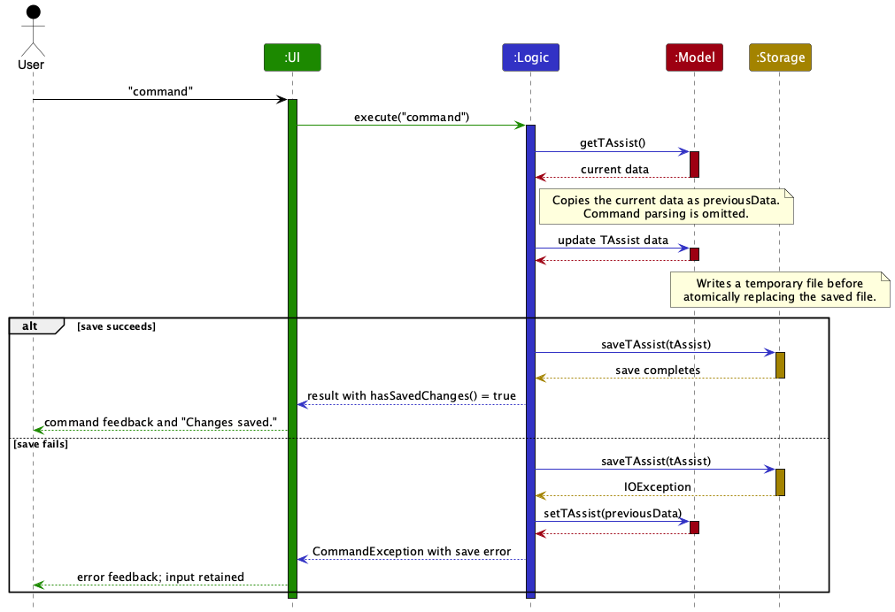

Each of the four main components (also shown in the diagram above),

* defines its *API* in an `interface` with the same name as the Component.
* provides its functionality through a concrete `{Component Name}Manager` class that implements the corresponding API interface.

For example, the `Logic` component defines its API in `Logic.java` and implements it in `LogicManager.java`. Other components interact with a component through its interface rather than its concrete class, preventing them from coupling to that component's implementation, as illustrated in the following partial class diagram.


The sections below give more details of each component.

### UI component

The **API** of this component is specified in [`Ui.java`](https://github.com/se-edu/addressbook-level3/tree/master/src/main/java/seedu/address/ui/Ui.java)

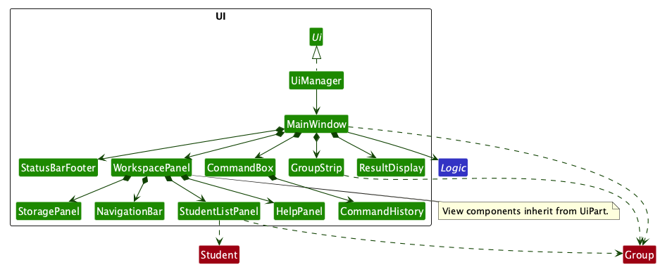

The UI consists of `MainWindow`, `GroupStrip`, `NavigationBar`, `WorkspacePanel`, `CommandBox`, `ResultDisplay`, and
`StatusBarFooter`. `MainWindow` places the `GroupStrip` and the `NavigationBar` in one light bar at the top.
`WorkspacePanel` hosts the live `StudentListPanel` table, `HelpPanel`, `StoragePanel`, and four `FeaturePreview` panels.
Its tab strip is hidden: it only holds the screens, and `NavigationBar` selects them. Each button of the bar opens the
same screen as `view SCREEN` (without its feedback message), names that command in its tooltip, and does not take
keyboard focus away from the command box, so the UI stays usable by mouse while the app remains command-first.
All inherit from `UiPart`, which loads their FXML. `TAssist.css` defines the shared visual style and compact layout.

The `GroupStrip` and the Students screen (`StudentListPanel`) observe the
views that `Logic` provides: `getGroupList()`, `activeGroupProperty()` and `getActiveGroupStudentList()` (see
[Observing the active group](#observing-the-active-group)). They never keep their own copy of the data, so a change to
the groups, the active group or its students shows at once. The card of the Students screen is titled with the active
group's name, and says "No active group" when none is active. When there are no students, an explanation replaces the
table, and says whether no group is active or the active group has no students yet. Columns cannot be sorted or reordered, a list change refreshes the row numbers,
and long values are shortened with an ellipsis and shown in full in a tooltip.

`view SCREEN` follows the normal command/parser pattern and returns a `WorkspaceView` in `CommandResult`.
`MainWindow` selects the corresponding screen. `LogicManager` saves only when the persisted model changes, so
navigation and other read-only commands do not write data. `CommandResult.hasSavedChanges()` tells the UI whether
to show `Changes saved.` in the footer. Commands keep the current screen unless they request navigation or help.

The command reference is shown only on the Help screen. `help` returns `CommandResult.forHelp(...)` with a one-line
confirmation and, for `help TOPIC`, the topic. `MainWindow` then asks `WorkspacePanel` to open Help, which scrolls
`HelpPanel` to that topic's heading. F1, the Help button of the `NavigationBar` and `view help` open the same screen.

`ResultDisplay` sizes itself to the message: it measures how many lines the text wraps to at the current width and
shows that many rows, from one up to six. Longer messages scroll. It shows a check mark beside a message, or a cross on
a red row when the command failed, and failed commands retain their input.

The four feature previews deliberately contain no records and are marked **Coming soon**. They are UI layouts only;
future increments must connect domain models, commands and persistence before enabling their controls.

The screenshot below shows the implemented Students screen with an active group and its roster.


#### Differences from the supplied mock-up

The original mock-up is preserved as [`UiMockup.png`](images/UiMockup.png). The implemented UI differs in these ways:

* The mock-up's dark menu header and separate group strip are replaced by a light group bar and a screen-navigation row.
* The app uses native JavaFX controls rather than rendering the mock-up as an HTML page.
* The mock-up shows only the Attendance screen. Students, Help, Storage, and the group bar use live data.
  Groups, Attendance, Participation, and Assignments are **Coming soon** previews.

The `UI` component uses the JavaFX UI framework. The layouts of these UI parts are defined in matching `.fxml` files in `src/main/resources/view`. For example, [`MainWindow.fxml`](https://github.com/se-edu/addressbook-level3/tree/master/src/main/resources/view/MainWindow.fxml) specifies the layout of [`MainWindow`](https://github.com/se-edu/addressbook-level3/tree/master/src/main/java/seedu/address/ui/MainWindow.java).

The `UI` component,

* executes user commands using the `Logic` component.
* listens for changes to `Model` data so that the UI can be updated with the modified data.
* keeps a reference to the `Logic` component, because the `UI` relies on the `Logic` to execute commands.
* depends on some classes in the `Model` component because it displays `Group` and `Student` objects from the model.

### Logic component

**API** : [`Logic.java`](https://github.com/se-edu/addressbook-level3/tree/master/src/main/java/seedu/address/logic/Logic.java)

Here's a (partial) class diagram of the `Logic` component:

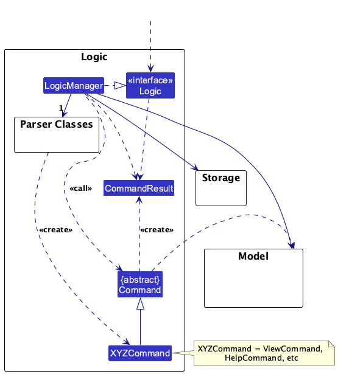

The sequence diagram below illustrates the interactions within the `Logic` component, taking `execute("view students")` API call as an example.


<div markdown="span" class="alert alert-info">:information_source: **Note:** The lifeline for `ViewCommandParser` should end at the destroy marker (X), but due to a limitation of PlantUML, it continues to the end of the diagram.
</div>

How the `Logic` component works:

1. When `Logic` is called upon to execute a command, the command is passed to a `TAssistParser` object, which in turn creates a parser that matches the command (e.g., `ViewCommandParser`) and uses it to parse the command.
1. This results in a `Command` object (more precisely, an object of one of its subclasses e.g., `ViewCommand`) which is executed by the `LogicManager`.
1. The command can communicate with the `Model` when it is executed (e.g. to add a student to a group). The `ViewCommand` in the diagram only asks the UI to show a screen, so it leaves the `Model` alone.<br>
   Note that although this is shown as a single step in the diagram above for simplicity, the code can require several interactions between the command object and the `Model` to complete the operation.
1. The result of the command execution is encapsulated as a `CommandResult` object which is returned from `Logic`.

Here are the other classes in `Logic` (omitted from the class diagram above) that are used for parsing a user command:

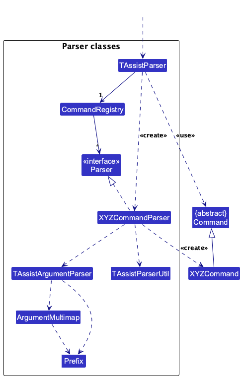

How the parsing works:
* When called upon to parse a user command, the `TAssistParser` class creates an `XYZCommandParser` (`XYZ` is a placeholder for the specific command name, e.g., `ViewCommandParser`), or asks the `CommandRegistry` for the parser that a feature registered for a two-word command (see [Command registration and shared validation](#command-registration-and-shared-validation)). The parser uses the other classes shown above to parse the user command and create an `XYZCommand` object (e.g., `ViewCommand`). The `TAssistParser` returns that object as a `Command` object.
* All `XYZCommandParser` classes, such as `ViewCommandParser` and `HelpCommandParser`, implement the `Parser` interface so they can be treated similarly where appropriate, for example during testing.

### Model component
**API** : [`Model.java`](https://github.com/se-edu/addressbook-level3/tree/master/src/main/java/seedu/address/model/Model.java)

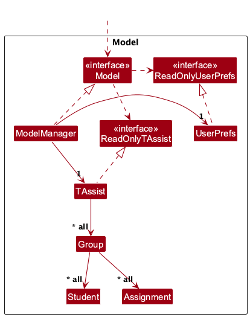


The `Model` component,

* stores the TAssist data, i.e., the tutorial groups, their students and assignments, and the active group, in a `TAssist` object (see [TAssist domain model](#tassist-domain-model)). It exposes the active group and the active group's students as observable values that the UI can bind to (see [Observing the active group](#observing-the-active-group)).
* stores a `UserPrefs` object that represents the user’s preferences (currently, just the GUI settings). This is exposed to the outside as a `ReadOnlyUserPrefs` object.
* does not depend on any of the other three components (as the `Model` represents data entities of the domain, they should make sense on their own without depending on other components)


### Storage component

**API** : [`Storage.java`](https://github.com/se-edu/addressbook-level3/tree/master/src/main/java/seedu/address/storage/Storage.java)

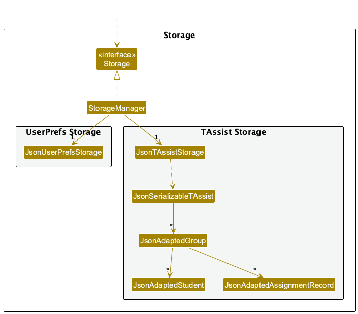

The `Storage` component,
* can save both TAssist data and user preference data in JSON format, and read them back into corresponding objects.
* is implemented by `StorageManager`, which delegates the actual JSON file access to `JsonTAssistStorage` and `JsonUserPrefsStorage` (one class per data file).
* converts TAssist data to and from JSON through one Jackson-friendly class per model class: `JsonSerializableTAssist` for `TAssist`, `JsonAdaptedGroup` for `Group` and `JsonAdaptedStudent` for `Student` (see [Saving and loading TAssist data](#saving-and-loading-tassist-data)).
* depends on some classes in the `Model` component (because the `Storage` component's job is to save/retrieve objects that belong to the `Model`)

### Common classes

Classes used by multiple components are in the `seedu.address.commons` package.

--------------------------------------------------------------------------------------------------------------------

## **Implementation**

This section describes some noteworthy details on how certain features are implemented.

### Command registration and shared validation

`CommandRegistry` maps a feature keyword and subcommand to a `Parser<? extends Command>` and its `HelpEntry`.
Each feature owns its parser, format, description, and examples, so adding a command does not require editing another
feature's help content or adding a case to the command switch in `TAssistParser`. Register commands before creating `LogicManager`:

```java
CommandRegistry registry = new CommandRegistry();
GroupCommandRegistration.registerCommands(registry);
StudentCommandRegistration.registerCommands(registry);
ParticipationCommandRegistration.registerCommands(registry);
AttendanceCommandRegistration.registerCommands(registry);
AssignmentCommandRegistration.registerCommands(registry);
Logic logic = new LogicManager(model, storage, registry);
```

`MainApp.init` uses this registration before constructing `LogicManager`. The group feature registers `add`, `list`,
and `use` with their parsers and help entries. Future features can register their commands in the same registry.

* `TAssistParser` and `LogicManager` take snapshots of registrations at construction. Later changes to the source
  registry do not change the running parser or its help.
* A feature keyword cannot shadow a built-in command (`help`, `view` or `exit`). Duplicate registrations and invalid registration
  keywords are developer errors and throw `IllegalArgumentException`.

#### In-app help

* The built-in commands `help`, `view` and `exit` keep their `HelpEntry` objects in `HelpCatalog`. `TAssistParser` combines
  them with the registered feature entries, and `Logic#getHelpEntries()` exposes the combined list.
* `HelpCommandParser` accepts an optional topic. `HelpCatalog.TOPICS` lists the valid topics, and an unknown topic
  throws a `ParseException` with the message required for unknown topics. A feature's `HelpEntry` topic must equal
  its feature keyword, so a feature appears under `help TOPIC` only if its keyword is listed in `HelpCatalog.TOPICS`.
* `HelpCommand` does not format the entries. It returns `CommandResult.forHelp(...)` with a one-line confirmation and,
  for `help TOPIC`, the topic, and `MainWindow` asks `WorkspacePanel.showHelp` to open the Help screen at that topic.
* The Help screen (`HelpPanel`) renders the same entries and uses `HelpCatalog.getTopicHeading` for its headings.

The class diagram below shows how help entries reach the Help screen.

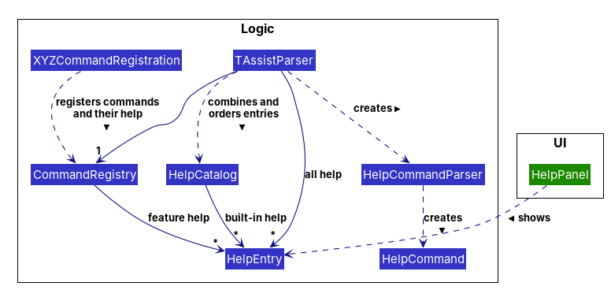

**Order of the reference.** `HelpCatalog.getEntries` puts the built-in commands first, under "General commands", and
then the feature commands grouped by topic in the order of `HelpCatalog.TOPICS` (group, student, attendance,
participation, assignment). This is the order `help TOPIC` lists the topics in, and the order of the User Guide's
sections. Within a topic, `CommandRegistry` keeps the order in which the commands were registered, so each
`XYZCommandRegistration` registers its commands in the order a TA uses them: create or record first, then list, then
delete.

**Rules for help text.** Each `HelpEntry` uses the command's `MESSAGE_USAGE` as its format, so the format in help and
in error messages cannot drift apart. Its description states the rules a user needs (value ranges, case
insensitivity, what replaces what), in the same words as the User Guide. Its examples must work when typed: taken
in the order of the reference, the examples of all topics form one session that starts from a new TAssist. For
example, the group examples create T01 and T02 and switch back to T01, so that the student examples add students to
T01, and the attendance and participation examples record data for a student who is still there.

`HelpIntegrationTest` enforces these rules on the running app. It checks that help lists every command in the
expected order, that each example runs its own command, that typing every example in order into a new TAssist
succeeds, that the User Guide shows every help format and example, and that every example in the User Guide's
command summary is one of the help examples. A new command therefore needs a help entry,
an example that continues the session, and matching User Guide text before its tests pass.

For registered commands, `TAssistParser` extracts the first keyword and lets `CommandRegistry` extract
the subcommand. The registered parser receives only the remaining arguments. Missing and unknown subcommands
produce distinct `ParseException` messages listing the registered subcommands in alphabetical order.
Unknown feature keywords report an unknown command. Both keywords use lowercase letters; surrounding whitespace
and repeated whitespace between keywords are ignored. Argument values retain their capitalization and spacing
until their value validator normalizes them.

Feature parsers declare their required and optional parameters with `TAssistArgumentParser`:

```java
TAssistArgumentParser arguments = new TAssistArgumentParser(
        List.of(PREFIX_NAME, PREFIX_ID), List.of());
ArgumentMultimap values = arguments.parse(args);
StudentName name = TAssistParserUtil.parseStudentName(values.getValue(PREFIX_NAME).orElseThrow());
StudentId id = TAssistParserUtil.parseStudentId(values.getValue(PREFIX_ID).orElseThrow());
```

Prefixes contain lowercase letters followed by `/`, and start at the beginning of arguments or after whitespace.
Prefix-like tokens at those boundaries are reserved for parameters. A slash embedded in a value does not separate
parameters, and URL schemes such as `https://` are retained as values. Parameters can appear in any order.
Unknown prefixes, repeated parameters, missing required parameters, and unexpected text before parameters
produce specific errors. Optional parameters may appear at most once. Empty values are retained for the value
validator to report a value error instead of a missing-parameter error. A command declaring no prefixes rejects
extra input.

`TAssistParserUtil` reuses `StudentName`, `StudentId`, and `GroupName` validation and normalization.
It also validates assignment names, weeks (whole numbers 1–13), participation scores (whole numbers 0–5), and
grades (whole numbers 0–100). Assignment names follow the same rules as group names: 1–60 letters, digits, spaces
or hyphens after whitespace normalization, with at least one letter or digit. They retain the entered capitalization
and are compared ignoring case. Numeric input is trimmed, accepts digits including leading zeros,
and rejects signs, decimals, out-of-range values, and integer overflow with a field-specific `ParseException`.

Parsers only validate and construct commands. `LogicManager` executes after parsing succeeds and saves data changes;
parsing failures neither execute a command nor call storage. Registry, argument, and value-validator unit tests
cover these rules. `LogicManagerTest` also verifies that rejected feature input leaves the model and existing
data file unchanged, using a storage implementation that fails if saving is attempted.

### Tutorial-group commands

`GroupAddCommandParser`, `GroupListCommandParser`, and `GroupUseCommandParser` construct the commands for
`group add g/GROUP_NAME`, `group list`, and `group use g/GROUP_NAME`. `GroupCommandRegistration` connects all three
parsers and their `HelpEntry` objects to `CommandRegistry`, making them available through `help group`.

Creation and switching share `GroupCommandParserUtil`. It uses `TAssistArgumentParser` to reject unknown prefixes,
duplicates, and unexpected text, then `TAssistParserUtil.parseGroupName` to apply the existing domain rules.
It declares `g/` optional to the argument parser so absent and blank values can both report
`Missing group name. Usage: ...` with the relevant command's syntax. The feature still requires a nonblank name.
The listing parser declares no parameters and rejects extra input.

`GroupName` hashes each Unicode code point after converting it to uppercase and then lowercase, matching its
case-insensitive equality. Equal names therefore have the same hash code, while display capitalization is preserved.

* `GroupAddCommand` checks `Model.hasGroup` before changing data, calls `Model.addGroup` with an empty group, and
  then calls `Model.setActiveGroup`. Creating any group therefore activates it, without modifying existing groups.
  A duplicate name throws `CommandException` with the existing group's display name.
* `GroupListCommand` reads `Model.getTAssist().getGroupList()` and `Model.getActiveGroup()`. It returns numbered
  names in creation order and an active-group line, or a creation hint when no groups exist. If groups exist without
  an active selection, it shows `Active group: None`.
* `GroupUseCommand` checks that the group exists before calling `Model.setActiveGroup`. Feedback uses the stored
  capitalization, even if the input uses another case. A missing group throws `CommandException` before mutation.

These commands return feedback without a screen-navigation request. `LogicManager` saves changes to the groups and
active selection through JSON storage; listing or selecting the already active group does not save. The group strip
and Students screen update through the model views, while the current screen stays selected. The separate Groups
table remains a preview.

Command and parser tests cover successful operations, exact feedback, name boundaries, case and space normalization,
and invalid input. `GroupCommandsIntegrationTest` checks that parsing and execution rejections preserve the model,
observable student list, active group, and file contents, and never call storage. `MainAppTest` exercises actual startup
registration and shutdown/restart persistence. `WorkspaceSmokeTest` checks the commands through the JavaFX command box.

### Participation commands

`ParticipationCommandRegistration` registers `participation set` and `participation list` and their help entries
before `LogicManager` is created. Their parsers use `TAssistArgumentParser` for prefix validation and
`TAssistParserUtil` for IDs, weeks 1–13, and whole-number scores 0–5. Command constructors also reject invalid weeks
or scores defensively, even when called without a parser.

`ParticipationSetCommand` finds the student in the active group before changing anything. It checks whether that
week already has a value, creates an immutable copy with `Student.withParticipationRecord`, and passes the copy to
`Model.setStudent`. Feedback distinguishes a first entry from a replacement. The replacement preserves roster
order, attendance, and scores for other weeks; students in other groups are untouched.

The sequence diagram below shows how `LogicManager` executes the input `participation set id/A0123456X w/3 s/2`
while T01 is the active group. The command replaces the student with the updated copy `u` instead of changing the
original.


<div markdown="span" class="alert alert-info">:information_source: **Note:** The lifeline for `ParticipationSetCommand` should end at the destroy marker (X), but due to a limitation of PlantUML, it continues to the end of the diagram.
</div>

The `parse participation set` reference frame is shown below. `CommandRegistry` passes the arguments to the
`ParticipationSetCommandParser` registered at startup, so no parser is created for each command.


`ParticipationListCommand` uses `Group.getWeeklyRecordEntries` with `Student::getParticipationRecords`, so it reuses
the shared weekly listing mechanism. Each row formats its value or `Not recorded`; zero is an actual score.

Both commands use the standard feedback box and keep the current screen selected. The Participation table remains
a preview and points users to the commands. Existing JSON storage already persists participation records, so the
feature adds no new file format. Loading rejects a participation score outside 0–5 the same way it rejects a week
outside 1–13. `ParticipationCommandsIntegrationTest` exercises startup registration, help,
restart persistence, and rejected commands preserving existing records and the file. Command and parser unit tests
cover boundaries, corrections, group isolation, missing values, and malformed input. `WorkspaceSmokeTest` checks
participation feedback and failed-input retention through the JavaFX command box.

### Student commands

`StudentCommandRegistration` registers `student add`, `student list`, and `student delete`, including their help
formats and examples. `MainApp.init` installs these registrations before constructing `LogicManager`.
The add and delete parsers use `StudentCommandParserUtil` to reject malformed parameters and report missing
prefixes with the command's usage. Present but blank values go through the existing domain validators, so a blank
name or ID reports its value constraints. Listing accepts no parameters.

Each command obtains the active group at execution time and throws `CommandException` if none is selected.
`StudentAddCommand` checks ID uniqueness before calling `Model.addStudent`; names need not be unique.
`StudentDeleteCommand` checks for the ID in the active group before calling `Model.removeStudent`. Removing the
student also removes their owned weekly records. Neither command changes another group, even if it contains the
same ID. `StudentListCommand` reads the group's roster and returns numbered rows or an empty-roster hint.

Mutations pass through the existing model and observable roster, so the Students screen updates without navigating
away from the current screen. Successful commands use the existing JSON persistence in `LogicManager`.
Parser and command tests cover validation, normalization, feedback, uniqueness, group isolation, and empty states.
`StudentCommandsIntegrationTest` exercises the real startup registration, help examples, add/delete persistence
across restarts, and rejected commands preserving both the model and the saved file.

### Assignment commands

`AssignmentCommandRegistration` registers `assignment add`, `assignment submit`, `assignment grade`, and
`assignment list` with offline help entries, and `MainApp.init` installs it before constructing `LogicManager`.
The submit and grade parsers require `a/`, `id/`, and their status (`s/`) or mark (`m/`) prefix exactly once with
`TAssistArgumentParser`. `TAssistParserUtil` validates the assignment name, student ID, yes/no status, and grade.
The `m/` prefix avoids giving `g/` a second meaning when it already identifies a tutorial group.

`AssignmentName` mirrors `GroupName`: it normalizes spaces, keeps the entered capitalization for display, and
compares ignoring case, so `PS1` and `ps1` are the same assignment. An `Assignment` is identified by its name, and
a `Group` holds its assignments in a `UniqueAssignmentList` in creation order. Assignment names are only unique
within one group.

`AssignmentAddCommand` finds the active group and rejects a name that the group already holds, then calls
`Model.addAssignment`. Its duplicate message shows the name of the existing assignment, so the TA sees the
capitalization that is stored. `AssignmentSubmitCommand` and `AssignmentGradeCommand` resolve the active group,
assignment, and student before updating an immutable `Assignment` through `Model#setAssignment`. A grade update also
checks that the record is submitted. Each failed command leaves the model unchanged. `AssignmentListCommand` returns
one row per student in roster order: name, student ID, submission status, and grade; missing records show
`Not submitted` and `-`.

`Assignment` stores immutable `AssignmentRecord` values in a map keyed by `StudentId`. A record contains a submitted
flag and an optional grade. Setting status or grade replaces the prior value; withdrawing a submission clears any
recorded grade and the success message calls out that loss. Removing a student removes only that student's records
from every assignment in the group.

`JsonAdaptedGroup` preserves the existing `assignments` name list and stores explicit records in an optional
`assignmentRecords` list. The list can be absent in older data files. During loading, records must refer to an
existing assignment and student, duplicate assignment/student pairs are rejected, and status/grade invariants are
validated before the group is returned.

`AssignmentCommandsIntegrationTest` exercises startup registration, help, persistence across restarts, and rejected
commands preserving the model and the saved file, including persistence of submission and grade updates after restart.
`SaveFailureIntegrationTest` checks rollback after submission and grade updates when saving fails.
The model, storage, command and parser tests cover validation, replacement, group isolation, legacy JSON files, and
malformed input.

### TAssist domain model

TAssist's own data is modelled by the classes below. `ModelManager` holds the `TAssist` data, and the `Model` interface delegates group, active-group and student operations to it. TAssist data is saved to a JSON data file (see [Saving and loading TAssist data](#saving-and-loading-tassist-data)).

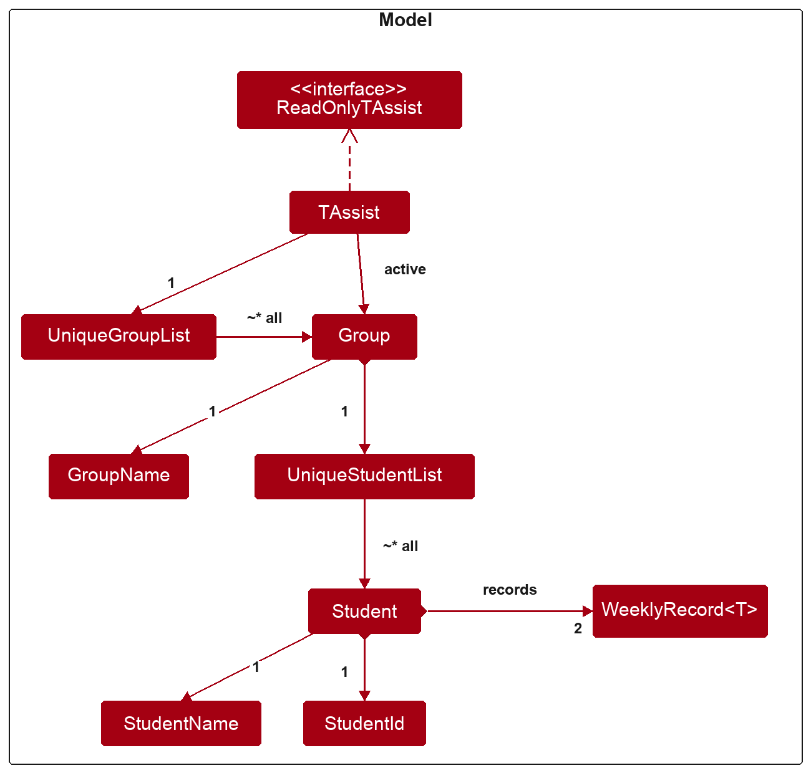

* `TAssist` is the root object. It holds the tutorial groups in a `UniqueGroupList` and remembers which group is active, if any. Other components see it through the read-only `ReadOnlyTAssist` interface.
* A `Group` has a `GroupName` and holds its own students in a `UniqueStudentList` and its own assignments in a `UniqueAssignmentList`.
* An `Assignment` has an `AssignmentName`, which is unique within its group, ignoring case, and stores student records
  by ID. `AssignmentRecord` combines a submitted flag with an optional grade from 0 to 100.
* A `Student` has a `StudentName`, a `StudentId`, weekly attendance and participation records, and is immutable.
* `UniqueGroupList`, `UniqueStudentList` and `UniqueAssignmentList` share the uniqueness logic of the generic `UniqueList`, which also exposes the items as an unmodifiable `ObservableList` that the UI can bind to.

#### Shared weekly record mechanism

`WeeklyRecord<T>` stores values in a week-keyed map and accepts weeks 1 through 13. Its `withRecord` method returns a
copy, replacing the value when that week already exists. A `Student` owns separate attendance and participation
records; `withAttendanceRecord` and `withParticipationRecord` return updated student copies. `Model#setStudent`
replaces that copy in its group while preserving the student's position.

`Group#getWeeklyRecordEntries` creates one row for each student, in group order, and selects the requested record
kind. Each `WeeklyRecordEntry` holds an optional value and formats a missing value as `Not recorded`. Attendance and
participation commands are implemented separately and can share this model behavior without duplicating record code.

These classes follow the rules in our feature specification:

* **Group names** are compared case-insensitively, so `T01` and `t01` are the same group. The name is shown with the capitalization the TA typed.
* **Student IDs** are stored in uppercase, so they are compared case-insensitively. A student ID is unique *within a group* only, so the same student can be in two groups (e.g. for a make-up session). Two students may share a name if their IDs differ.
* **Spaces:** leading and trailing spaces are ignored, and repeated spaces inside group names and student names count as one space.
* **Active group:** the active group, if any, is always one of the groups held. Adding a group does not make it active by itself; commands decide when to switch.
* **Copies:** `new TAssist(data)` copies every group, so changing the copy never changes the original.

#### Recording attendance

`AttendanceCommandRegistration` registers the attendance parsers and their offline help in `MainApp`.
`AttendanceMarkCommandParser` uses `TAssistArgumentParser` to require `id/`, `w/`, and `s/` exactly once.
`AttendanceCommandParserUtil` reuses the shared week parser with the attendance error message;
`AttendanceStatus` accepts present or absent, ignoring case and surrounding spaces.

`AttendanceMarkCommand` checks the active group and finds the student in that group before changing data.
It checks whether a record already exists for the week, creates an updated student through
`withAttendanceRecord`, and replaces it through `Model#setStudent`. The stored status is `PRESENT` or `ABSENT`;
the confirmation distinguishes a first mark from an update. Existing `LogicManager` persistence saves the result.

`AttendanceListCommandParser` requires only `w/` and uses the same week validation. `AttendanceListCommand`
selects attendance through `Group#getWeeklyRecordEntries`. If no student has a record for that week, it returns
the no-records message. Otherwise, it formats each row with the student's name, ID, and capitalized status,
using `WeeklyRecordEntry#formatValueOrNotRecorded` for missing values. The rows appear in the scrollable
command feedback box; the Attendance workspace screen remains a preview.

#### Where per-student records are stored

Attendance and participation records are stored **on the `Student` object, inside the group the student belongs to**.
The shared `WeeklyRecord<T>` supports week-keyed values for both features. Assignment records are stored on each
`Assignment` within its group, in a map keyed by `StudentId`:

* **Weekly records** (attendance and participation): each `Student` holds one record per kind, using the shared
  mechanism. Attendance values are stored as strings and participation values as integers; feature commands validate
  their own values before updating a student.
* **Assignments:** each `Assignment` holds explicit student records with a submitted flag and optional grade. The
  assignment's group scopes those IDs, since IDs are unique only within a group. Removing a student removes their
  records from every assignment in that group.
* `Student` and `Assignment` are immutable. Weekly updates replace the student in its group; assignment updates
  replace the assignment while preserving its position in the group's list.

**Aspect: Where per-student records are stored**

* **Weekly-record choice:** Store attendance and participation records on each `Student`, inside its group.
  * Pros: A student's records are automatically scoped to the right group, which matters because student IDs are only unique within a group. Removing a student also removes all of their records, so no record can point to a student who no longer exists. The data file nests group → students → records, which is easy to read and edit by hand, and each feature adds its own field without changing the others.
  * Cons: `Student` grows a field for each kind of record, and every update creates a new `Student` object.

* **Alternative 2 for weekly records:** Keep separate tables in each `Group`, keyed by student ID (e.g. one attendance table, one participation table).
  * Pros: `Student` stays small, and each feature owns its own table.
  * Cons: Removing a student must also clean up every table, and a wrong manual edit of the data file can leave records for a student who does not exist.

* **Alternative 3 for weekly records:** Keep one list of records for the whole app, keyed by group, student ID and week.
  * Pros: All records are in one place.
  * Cons: Every lookup has to filter by group and student, and the data file is the hardest of the three to read and edit by hand.

* **Assignment-record choice:** Store student records on each `Assignment`, keyed by student ID. Records describe a
  student's state for that assignment, so the assignment owns them; the containing group scopes IDs that are only
  unique within a group. Removing a student removes only their entry from each assignment. If a hand edit removes a
  student but leaves an `assignmentRecords` entry for them, loading rejects the file with an unknown-student error.

#### Observing the active group

The UI shows the active group and its students, and must update when either changes. `Model` and `Logic` provide two observable views for this:

* `activeGroupProperty()` holds the active group, or an empty `Optional` when no group is active.
* `getActiveGroupStudentList()` is an unmodifiable `ObservableList` of the active group's students. It is empty when no group is active.

Both views are kept by `ActiveGroupTracker`, a helper class inside the `Model` component. The student list *follows* the active group: it listens to the active group's own student list, so adding or removing a student in that group shows at once. Whenever the active group may have changed (`setActiveGroup` or `setTAssist`), `ModelManager` asks the tracker to track the new active group. The tracker stops listening to the old group, copies the new group's students into the list it exposes, and then updates the active group. The sequence diagram below shows this for `setActiveGroup`.

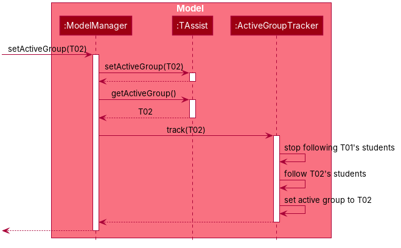

`setTAssist` replaces every group with a copy, so the tracker is pointed at the copy of the active group even when the active group's name stays the same. Changes to a group that is no longer active do not show in the list.

`activeGroupProperty()` compares groups by value, so it does not notify when the active group is replaced by an equal one, for example when `setTAssist` loads the same data. Bind to `getActiveGroupStudentList()` for the students, and do not keep a `Group` taken from the property, as it may be replaced by an equal copy without notice.

**Aspect: How the UI follows the active group's students**

* **Alternative 1 (current choice):** `Model` exposes one student list that follows the active group.
  * Pros: The UI binds once and never needs to know which group is active. Listener bookkeeping is in one small class that is easy to unit test without the UI.
  * Cons: The list holds a copy of the active group's students, which is refreshed after each change (cheap for a tutorial group of about 20 students).

* **Alternative 2:** The UI listens to the active group and rebinds its table to the new group's own student list.
  * Pros: No copy of the students is kept.
  * Cons: Every UI part that shows students must repeat the rebinding logic, and the UI must remember to stop listening to the old group.

* **Alternative 3:** Keep one list of all students and filter it by the active group, with a `FilteredList`.
  * Pros: Reuses the familiar `FilteredList` pattern.
  * Cons: Students belong to a group in our model, and a student ID is only unique within a group. A flat list of all students would have to be rebuilt whenever any group changes.

### Saving and loading TAssist data

TAssist data is kept in one human-editable JSON file, `data/tassist.json`. The file nests the data the same way as the model: the active group's name, then each group with its students and assignments.

```json
{
  "activeGroup" : "T01",
  "groups" : [ {
    "name" : "T01",
    "students" : [ {
      "name" : "Alice Tan",
      "studentId" : "A0123456X",
      "attendance" : { "1" : "PRESENT" },
      "participation" : { "1" : 4 }
    } ],
    "assignments" : [ "PS1" ]
  } ]
}
```

**Saving.** `LogicManager` takes a defensive `TAssist` snapshot before executing a parsed command. If execution
leaves the persisted model unchanged, it returns without calling storage. This covers help, listing, navigation,
exit, and repeated commands that make no change. Otherwise, it calls `Storage#saveTAssist(model.getTAssist())`.
Only a successful save produces a result with `hasSavedChanges()` set to true; `MainWindow` then shows
`Changes saved.` alongside the file path without replacing the command's own feedback.

`JsonTAssistStorage` serializes the complete model through `JsonSerializableTAssist` and `JsonUtil`, writes it to
a temporary file in the target directory, and atomically replaces the data file. If writing or atomic replacement
fails, the previous saved file is preserved. There is no non-atomic fallback. Temporary files are removed after
each attempt; a cleanup failure is logged without masking the save outcome.

**Save failures.** `LogicManager` maps an `IOException` to
`Unable to save changes. Your previous saved data is unchanged.` An `AccessDeniedException` additionally asks the
user to check write permission for the data folder. It restores the snapshot on a `CommandException`, including
one caused by saving, so groups, students, weekly records, the active selection, and observable rosters return to
their previous state. The UI shows the error and retains the rejected input. A subsequent command can retry saving.

**Loading.** At startup, `MainApp#initModelManager` calls `Storage#readTAssist()`:

* If the file does not exist, the app starts with an empty `TAssist` and shows
  `No saved data found. Starting with an empty database.` The first successful data change creates the file.
* If the file cannot be read, is not valid JSON, or holds invalid data, loading throws a `DataLoadingException`.
  `MainApp` logs the reason and starts with an empty model. The UI shows
  `Saved data could not be read. No changes were made to the saved file.`
* Otherwise, `JsonSerializableTAssist#toModelType()` rebuilds the `TAssist` with the model's own constructors, so values are checked and normalized as if the TA had typed them.

`MainApp` passes the `DataLoadStatus` to both logic and UI. After a failed load, logic rejects commands that would
change data and restores the snapshot without attempting a save. Read-only commands remain available. This
protection lasts until restart, including if the user repairs the file while the app is running. The user must
close the app, repair or move the unreadable file, and restart to enable saving. Missing files do not enable this
protection. `JsonUtil` treats only a definitely absent path as missing. Otherwise, it attempts reading the file so
permission errors are reported rather than treated as missing data.

`JsonTAssistStorageTest` injects partial-write and atomic-replacement failures to check file preservation and
temporary-file cleanup. `SaveFailureIntegrationTest` checks rollback across all implemented mutations, retry,
and restart. `MainAppTest` checks missing, corrupt, and unreadable startup data and protection through shutdown.
`WorkspaceSmokeTest` verifies startup messages, save confirmations, permission guidance, and restored UI state.

`toModelType()` rejects, with a message naming the problem, a missing or invalid group name, student name or student ID, an empty entry in a list, a weekly record outside weeks 1 to 13, a participation score outside 0 to 5, an attendance status other than present or absent, two groups with the same name (ignoring case), two students with the same ID in one group, an invalid, empty or repeated (ignoring case) assignment name in a group, an assignment record with a missing or unknown assignment or student, duplicate assignment/student records, an invalid grade or a grade for an unsubmitted assignment, and an active group that is not one of the groups. To keep manual editing forgiving, a missing `groups`, `students`, `assignments` or `assignmentRecords` list is read as empty, a missing or `null` `activeGroup` means no group is active, a missing attendance or participation field means that student has no records of that kind, and unknown fields are ignored. If a student is removed from the file but their assignment record remains, loading rejects the dangling record instead of silently discarding it.

Each Jackson-friendly class mirrors one model class and only converts its own fields. Assignments keep their names in
the `assignments` list on `JsonAdaptedGroup`; explicit student records are serialized as the optional
`assignmentRecords` list with assignment name, student ID, submitted status, and optional grade. On load, every record
must refer to an assignment and student in the same group. The check prevents an edited file from retaining records
for a student or assignment that no longer exists (see [Where per-student records are stored](#where-per-student-records-are-stored)).

`JsonAdaptedStudent` also validates attendance statuses with `AttendanceStatus`, accepting case and surrounding
spaces and storing the canonical `PRESENT` or `ABSENT` value. An invalid status becomes an `IllegalValueException`
so the existing storage error handling reports the invalid file before commands use its records.

Older files may omit attendance and participation maps, which `JsonAdaptedStudent` reads as empty records. The
`assignmentRecords` list is optional for the same reason; an omitted list means no explicit submission or grade
records have been entered.

**Aspect: How TAssist data is laid out in the file**

* **Alternative 1 (current choice):** One file that nests group → students and stores the group's assignments and
  assignment records alongside them.
  * Pros: The whole state is easy to inspect and edit in one place. Removing a student through the app also removes
    their weekly and assignment records. A hand edit that leaves an assignment record for a missing student is
    rejected with a clear error instead of being silently ignored.
  * Cons: The whole file is rewritten on every save, which is cheap for a TA's few groups of about 20 students.

* **Alternative 2:** One file per feature (e.g. `groups.json`, `attendance.json`), linked by group name and student ID.
  * Pros: Each feature owns its file.
  * Cons: A manual edit to one file, such as renaming a group, can leave records in another file that point to nothing. Loading must check every file against the others.

### \[Proposed\] Undo/redo feature

**Status: optional future work, not implemented in the current release.** This proposal is tracked in
[issue #63](https://github.com/AY2627S1-CS2103T-T12-4/tp/issues/63). The `undo` and `redo` commands,
`UndoRedoHistory`, `HistoryEntry`, and the history operations below are proposed additions. Existing TAssist
classes are named to show where the design would fit; this section does not describe working commands.

#### Proposed implementation

The TA would use `undo` to reverse the latest successful data change and `redo` to restore the change just undone.
The proposal would cover changes across tutorial groups, students, attendance, participation, and assignments.
A snapshot would contain the complete `TAssist` data, including the active group, so restoring a deleted student
would also restore that student's records in the correct group. GUI preferences would remain outside the history.

`LogicManager` would own an `UndoRedoHistory` containing an ordered list of `HistoryEntry` objects and a
`currentIndex`. Each entry would hold a private `TAssist` snapshot and, except for the initial entry, a description
of the command that produced it. Copies would use the existing `TAssist(ReadOnlyTAssist)` constructor; neither
live model changes nor a restored model could modify a retained snapshot.

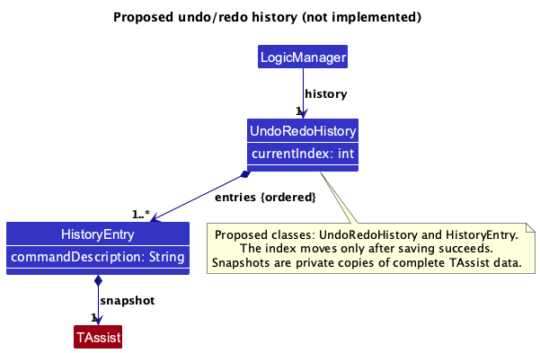

At startup, the history would contain only a copy of the loaded data. History would be kept in memory for the
current session; restarting would retain the saved data but clear the ability to undo earlier commands.
The implementation would bound the number of retained entries and discard the oldest entries when full,
adjusting `currentIndex` to keep pointing to the retained current entry.

**Recording a change.** The existing `LogicManager` already copies the model before execution, saves changed
data, and restores the copy if a command or save fails (see [Saving and loading TAssist data](#saving-and-loading-tassist-data)).
The proposal would add a history entry only after this save succeeds. At that point, it would discard entries
after `currentIndex`, append a copy of the new data with its command description, and advance the index.
A rejected command, a failed save, or a command that leaves the data unchanged would preserve the entire history,
including any entries available for redo.

This rule would also cover `group use` when it changes the active group, because that selection is part of the
saved data. Read-only commands such as `student list`, `help`, and `view students` would not add history entries.

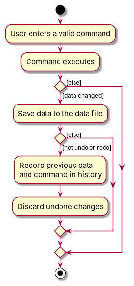

The activity diagram covers ordinary commands. Undo and redo would follow a separate path, so restoring a
snapshot would not itself append a new entry or discard redo history.

**Restoring a change.** `TAssistParser` would recognize the one-word `undo` and `redo` commands beside `help`,
`exit`, and `view`, because `CommandRegistry` only dispatches input of the form `feature subcommand`.
The commands would return a proposed history-action request in `CommandResult`, leaving `LogicManager` to
coordinate restoration and persistence. `LogicManager` would check for this request as soon as the command returns,
before the existing check that skips saving when the data is unchanged. An undo request leaves the model unchanged
at that point, so without this order the snapshot would never be restored or saved. The proposed flow would be:

1. Check that a previous or next entry exists. If none exists, return a specific message such as
   `Nothing to undo.` or `Nothing to redo.` without changing data or history.
2. Keep a copy of the current model and obtain a copy of the target snapshot without moving `currentIndex`.
3. Restore the target through the existing `Model#setTAssist`, which also refreshes the observable group and
   student views, and save it through `Storage#saveTAssist`.
4. Only after saving succeeds, move `currentIndex` to the target and return a saved-change confirmation naming
   the affected command, for example `Undid: student delete id/A0123456X`.

If saving fails, restore the pre-command model and leave the index and history unchanged. The existing atomic
save mechanism preserves the previous file. The startup protection for unreadable data must also continue to
reject changes without attempting a save. Redo would restore the recorded snapshot, including its active group,
rather than parse and execute the original command again.

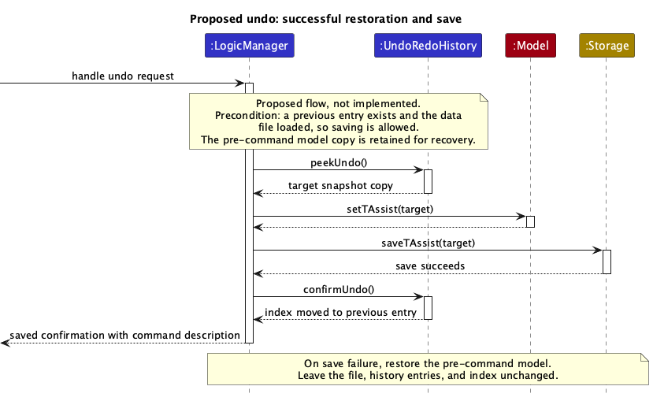

The sequence diagram omits parsing and shows the successful path after an undo request is recognized.
`peekUndo()` would return a copy without moving the index; `confirmUndo()` would move it only after saving.
Redo would use equivalent next-entry operations. These history methods do not exist yet.

#### Example history

Suppose T01 is active and contains Alice (`A0123456X`) when the app starts. Let S0 be that initial snapshot.
The following illustrates the proposed behavior; `undo` and `redo` cannot yet be run in the app.

| Step | Command | Retained snapshots | Current snapshot and result |
| --- | --- | --- | --- |
| 1 | `attendance mark id/A0123456X w/3 s/present` | S0, S1 | S1: Alice is present in week 3. |
| 2 | `student delete id/A0123456X` | S0, S1, S2 | S2: Alice and her records are removed. |
| 3 | `undo` | S0, S1, S2 | S1: Alice and her attendance are restored. |
| 4 | `redo` | S0, S1, S2 | S2: Alice is removed again. |
| 5 | `undo`, then `student list` | S0, S1, S2 | S1: listing leaves the history unchanged. |
| 6 | `participation set id/A0123456X w/3 s/2` | S0, S1, S3 | S3: the new score is saved; S2 is no longer available for redo. |

Each data-changing step assumes saving succeeds. A failed step would retain the previous model, saved file,
and history position. Undo at the oldest retained entry and redo at the newest entry would report that no
further change is available.

#### Design considerations

**Aspect: How to represent changes**

* **Alternative 1 (proposed choice):** Keep complete TAssist snapshots.
  * Pros: One mechanism restores groups, students, records, and active selection together. It reuses the model's
    copy and restore operations and does not require a different inverse operation for each command.
  * Cons: Each entry copies the data. A bounded history limits memory use but also limits how far the TA can undo.
* **Alternative 2:** Store an inverse operation for each command.
  * Pros: Small changes can use less memory than a complete snapshot.
  * Cons: Each command needs its own restoration logic, including dependent records when a student is deleted.

**Aspect: When to move the history position**

* **Proposed choice:** Update history only after a successful save. A storage error can then leave the model,
  file, and history at the last successful state, and the TA can retry the same undo or redo.
* **Alternative:** Move the index before saving. This would require rolling back both the model and history on
  failure, adding another opportunity for them to disagree.

### \[Proposed\] Data archiving

_{Explain here how the data archiving feature will be implemented}_


--------------------------------------------------------------------------------------------------------------------

## **Documentation, logging, testing, dev-ops**

* [Documentation guide](Documentation.md)
* [Testing guide](Testing.md)
* [Logging guide](Logging.md)
* [DevOps guide](DevOps.md)

--------------------------------------------------------------------------------------------------------------------

## **Appendix: Requirements**

### Product scope

**Target user profile**:

* is a teaching assistant (TA) for CS2040S who runs weekly tutorial sessions
* handles several tutorial groups of around 20 students each
* records tutorial attendance and class participation every week, and grades the problem sets submitted by each student
* works alone from their own laptop
* can type fast and prefers typing to mouse interactions
* is reasonably comfortable using CLI apps

**Value proposition**: Track each student's tutorial attendance, class participation scores, and assignment submissions across tutorial groups as fast as the TA can type, which saves the TA time compared to paper sheets or clicking through Canvas.


### User stories

Priority 1 = Must have in MVP, Priority 2 = Nice to have, Priority 3 = Stretch

| # | Priority | As a … | I can … | So that I can … |
| --- | --- | --- | --- | --- |
| 1 | P1 | new user | see usage instructions / a command list | refer to them when I forget how to use the app |
| 2 | P2 | new user | see the app populated with sample data | see what the app looks like when in use |
| 3 | P2 | new user | purge all sample data | get rid of the data I used for exploring |
| 4 | P3 | new user | see an example of the correct format when I mistype a command | fix my mistake without opening the help page |
| 5 | P3 | new user | go through a short guided setup | get my first group set up without reading a manual |
| 6 | P1 | TA | create a tutorial group | keep each of my groups' records separate |
| 7 | P1 | TA | add a student to a tutorial group | start tracking that student |
| 8 | P1 | TA | list all students in a group | see who I am teaching |
| 9 | P1 | TA | delete a student | remove someone who dropped the module |
| 10 | P1 | TA | switch between my tutorial groups | work on the group I am currently teaching |
| 11 | P2 | TA | import a student list from a CSV file | avoid typing 60 names by hand |
| 12 | P2 | TA | edit a student's details | fix a typo or update a changed name |
| 13 | P2 | TA | move a student from one group to another | handle students who switch tutorial slots |
| 14 | P3 | TA | record a private note, like a student’s preferred name or name pronunciation | address students the way they want in class |
| 15 | P3 | TA | attach a photo to a student | learn to recognise my students’ faces |
| 16 | P1 | TA | mark a student present or absent for a given week | keep a record of attendance |
| 17 | P1 | TA | view a tutorial group’s attendance for a given week | check I have not missed anyone before class ends |
| 18 | P1 | busy TA | correct an attendance mark I entered wrongly | keep my records accurate |
| 19 | P2 | TA | mark a student as late rather than absent | record partial attendance fairly |
| 20 | P2 | TA | record a reason for an absence | tell excused absences apart from unexcused ones |
| 21 | P3 | TA | mark the whole group present in one command | mark a full-attendance week in seconds |
| 22 | P3 | TA | see one student's attendance across the whole semester | answer individual students’ queries about their attendance |
| 23 | P1 | TA | give a student a participation score for a week | record who contributed in class |
| 24 | P1 | TA | change a participation score I already gave | correct myself after the session |
| 25 | P1 | TA | see the participation scores for a group in a week | check my marking is consistent across students |
| 26 | P2 | TA | award a participation point with a single short command | do it mid-discussion without losing my train of thought |
| 27 | P3 | TA | see each student's total participation score so far | know who is falling behind on participation |
| 28 | P3 | TA | see who has never participated | make a point of calling on them next week |
| 29 | P1 | TA | create an assignment for a group | start tracking it |
| 30 | P1 | TA | mark a student's assignment as submitted or not | track who handed in work |
| 31 | P1 | TA | record a grade for a student’s assignment | keep marks in one place |
| 32 | P2 | TA | see which students have not submitted an assignment | chase them before the deadline passes |
| 33 | P3 | TA | set a deadline for an assignment | tell late submissions from on-time ones |
| 34 | P3 | TA | mark a submission as late | apply the late penalty consistently |
| 35 | P2 | TA | find a student by name or student ID | pull up their record without scrolling |
| 36 | P2 | TA | see a single student's full record | answer a student's question about their standing |
| 37 | P1 | TA | have my data saved automatically | not lose a session's marks if the app closes |
| 38 | P1 | TA | have my data stored on my own laptop | keep student records private |
| 39 | P2 | TA | export a group's records to CSV | hand figures to the course coordinator |
| 40 | P3 | TA | import partial records from another TA's export | take over a group mid-semester |


### Use cases

(For all use cases below, the **System** is `TAssist` and the **Actor** is the `TA`, unless specified otherwise)

The following extensions apply to every use case that changes or views records of a tutorial group, and are not repeated below:

* \*a. There is no active tutorial group.
    * \*a1. TAssist shows an error message asking the TA to create or select a group first.

      Use case ends.

* \*b. The TA's command is missing a required parameter, contains an unknown prefix, or repeats a parameter.
    * \*b1. TAssist shows an error message with the correct command format. No data is changed.

      Use case resumes from the step at which the command was entered.

**Use case: UC01 - Set up a tutorial group**

**MSS**

1.  TA requests to create a tutorial group with a given name.
2.  TAssist creates the group, makes it the active group, and shows a confirmation.
3.  TA requests to list all tutorial groups.
4.  TAssist shows all tutorial groups and indicates the active group.

    Use case ends.

**Extensions**

* 1a. The group name is invalid.
    * 1a1. TAssist shows an error message stating the valid group name format.

      Use case resumes at step 1.

* 1b. A group with the same name (ignoring case and extra spaces) already exists.
    * 1b1. TAssist shows an error message stating that the group already exists.

      Use case ends.

* 3a. No tutorial group exists.
    * 3a1. TAssist informs the TA that there are no groups and shows how to create one.

      Use case ends.

**Use case: UC02 - Switch to another tutorial group**

**MSS**

1.  TA requests to switch to a tutorial group with a given name.
2.  TAssist makes that group the active group and shows a confirmation.

    Use case ends.

**Extensions**

* 1a. No group with the given name (case-insensitive) exists.
    * 1a1. TAssist shows an error message stating that the group does not exist.

      Use case resumes at step 1.

**Use case: UC03 - Add a student to the active group**

**MSS**

1.  TA requests to add a student with a given name and student ID.
2.  TAssist adds the student to the active group and shows a confirmation.

    Use case ends.

**Extensions**

* 1a. The name or student ID is invalid.
    * 1a1. TAssist shows an error message stating the valid format.

      Use case resumes at step 1.

* 1b. A student with the same student ID (case-insensitive) already exists in the active group.
    * 1b1. TAssist shows an error message stating that the student ID already exists in the group.

      Use case ends.

* 1c. A student with the same name but a different student ID exists in the active group.
    * 1c1. TAssist adds the student as a separate student.

      Use case resumes at step 2.

**Use case: UC04 - Remove a student from the active group**

**MSS**

1.  TA requests to list the students in the active group.
2.  TAssist shows the name and student ID of every student in the group.
3.  TA requests to delete a specific student by student ID.
4.  TAssist removes the student and the student's attendance, participation and assignment records from the group, and shows a confirmation.

    Use case ends.

**Extensions**

* 2a. The group has no students.

  Use case ends.

* 3a. No student in the active group has the given student ID.
    * 3a1. TAssist shows an error message stating that the student does not exist in the group.

      Use case resumes at step 2.

**Use case: UC05 - Take attendance during a tutorial**

**Preconditions:** The active group has at least one student.

**MSS**

1.  TA requests to mark a student as present or absent for a given week.
2.  TAssist records the attendance and shows a confirmation.
3.  TA repeats steps 1-2 until every student in the group has been marked.
4.  TA requests to view the group's attendance for that week.
5.  TAssist shows the attendance status of every student in the group for that week.

    Use case ends.

**Extensions**

* 1a. No student in the active group has the given student ID.
    * 1a1. TAssist shows an error message stating that the student does not exist in the group.

      Use case resumes at step 1.

* 1b. The week is not a whole number from 1 to 13.
    * 1b1. TAssist shows an error message stating the valid range of weeks.

      Use case resumes at step 1.

* 1c. The status is not `present` or `absent`.
    * 1c1. TAssist shows an error message stating the valid statuses.

      Use case resumes at step 1.

* 1d. The student already has an attendance record for that week (e.g. the TA is correcting a mistake).
    * 1d1. TAssist replaces the existing record with the new status and shows that the record was updated.

      Use case resumes at step 3.

* 4a. No attendance has been recorded for that week.
    * 4a1. TAssist informs the TA that there are no attendance records for that week.

      Use case ends.

* 5a. Some students have no attendance record for that week.
    * 5a1. TAssist shows those students as not recorded.

      Use case ends.

**Use case: UC06 - Record class participation**

**Preconditions:** The active group has at least one student.

**MSS**

1.  TA requests to set a student's participation score for a given week.
2.  TAssist records the score and shows a confirmation.
3.  TA requests to view the group's participation scores for that week.
4.  TAssist shows the participation score of every student in the group for that week.

    Use case ends.

**Extensions**

* 1a. No student in the active group has the given student ID.
    * 1a1. TAssist shows an error message stating that the student does not exist in the group.

      Use case resumes at step 1.

* 1b. The week is not a whole number from 1 to 13, or the score is not a whole number from 0 to 5.
    * 1b1. TAssist shows an error message stating the valid values. The existing score, if any, is unchanged.

      Use case resumes at step 1.

* 1c. The student already has a participation score for that week.
    * 1c1. TAssist replaces the previous score with the new score and shows that the score was updated.

      Use case resumes at step 3.

* 4a. Some students have no participation score for that week.
    * 4a1. TAssist shows those students as not recorded.

      Use case ends.

**Use case: UC07 - Track an assignment**

**Preconditions:** The active group has at least one student.

**MSS**

1.  TA requests to create an assignment with a given name.
2.  TAssist creates the assignment for the active group and shows a confirmation.
3.  TA requests to mark a student's assignment as submitted.
4.  TAssist records the submission status and shows a confirmation.
5.  TA requests to record a grade for that student's assignment.
6.  TAssist records the grade and shows a confirmation.
7.  TA repeats steps 3-6 for other students.
8.  TA requests to view the records of the assignment.
9.  TAssist shows the submission status and grade of every student in the group for that assignment.

    Use case ends.

**Extensions**

* 1a. The assignment name is invalid.
    * 1a1. TAssist shows an error message stating the valid assignment name format.

      Use case resumes at step 1.

* 1b. An assignment with the same name (case-insensitive) already exists in the active group.
    * 1b1. TAssist shows an error message stating that the assignment already exists.

      Use case ends.

* 3a. The assignment does not exist in the active group.
    * 3a1. TAssist shows an error message stating that the assignment does not exist.

      Use case resumes at step 3.

* 3b. No student in the active group has the given student ID.
    * 3b1. TAssist shows an error message stating that the student does not exist in the group.

      Use case resumes at step 3.

* 3c. The submission status is not `yes` or `no`.
    * 3c1. TAssist shows an error message stating the valid statuses.

      Use case resumes at step 3.

* 5a. The grade is not a whole number from 0 to 100.
    * 5a1. TAssist shows an error message stating the valid range of grades.

      Use case resumes at step 5.

* 5b. The student's assignment has not been marked as submitted.
    * 5b1. TAssist shows an error message asking the TA to mark the assignment as submitted first.

      Use case resumes at step 3.

* 5c. The student already has a grade for that assignment (e.g. the TA is correcting a mistake).
    * 5c1. TAssist replaces the previous grade with the new grade.

      Use case resumes at step 6.

* 9a. Some students have not submitted the assignment.
    * 9a1. TAssist shows those students as not submitted, without a grade.

      Use case ends.

**Use case: UC08 - Get help on a command**

**MSS**

1.  TA requests help on a specific topic (e.g. attendance).
2.  TAssist shows the command formats and examples for that topic.

    Use case ends.

**Extensions**

* 1a. The TA does not specify a topic.
    * 1a1. TAssist shows the formats of all commands.

      Use case ends.

* 1b. The given topic is not a valid topic.
    * 1b1. TAssist shows an error message listing the valid topics.

      Use case ends.

**Use case: UC09 - Export a group's records**

**Preconditions:** The active group has at least one student.

**MSS**

1.  TA requests to export the records of the active group.
2.  TAssist saves the group's students, attendance, participation scores, and assignment records to a CSV file, and shows the location of the file.
3.  TA sends the file to the course coordinator.

    Use case ends.

**Extensions**

* 2a. TAssist is unable to write the file.
    * 2a1. TAssist shows an error message stating that the export failed. No data is changed.

      Use case ends.

**Use case: UC10 - Resume work after restarting TAssist**

**MSS**

1.  TA closes TAssist after recording data.
2.  TA launches TAssist again.
3.  TAssist loads the saved data and shows the tutorial groups and records as they were when TAssist was closed.

    Use case ends.

**Extensions**

* 3a. No saved data is found.
    * 3a1. TAssist starts with no data and informs the TA.

      Use case ends.

* 3b. The saved data cannot be read.
    * 3b1. TAssist shows an error message and does not overwrite the saved data file.

      Use case ends.

### Non-Functional Requirements

1.  Should work on any _mainstream OS_ as long as it has Java `25` or above installed.
2.  Should be able to hold up to 10 tutorial groups of 30 students each, with records for 13 weeks and 20 assignments per group, without noticeable sluggishness in performance for typical usage.
3.  Should show the result of any command within 1 second when holding the amount of data stated above.
4.  A TA with above average typing speed for regular English text (i.e. not code, not system admin commands) should be able to accomplish most of the tasks faster using commands than using the mouse.
5.  A TA who is familiar with the commands should be able to record attendance for a group of 20 students within 2 minutes, so that attendance can be taken during a tutorial.
6.  Should be used by a single TA on their own computer; it does not need to support multiple users or sharing data between users.
7.  Should work without an internet connection, and should not send any data to an external server, so that student records stay on the TA's computer.
8.  Should save data automatically after every successful command that changes data, so that no recorded data is lost when TAssist is closed or stops unexpectedly after that command.
9.  A command that fails should not change any data, either in the app or in the data file.
10. Should store data locally in a human-editable text file, so that an advanced user can inspect or repair the data without using TAssist.
11. Should not depend on a database management system.
12. Should be distributed as a single JAR file of at most 100MB that runs without an installer.
13. The GUI should work well (i.e. no resolution-related inconveniences) for standard screen resolutions of 1920x1080 and higher, and for screen scales of 100% and 125%. It should be usable (i.e. all functions can be used, even if the layout is not optimal) for resolutions of 1280x720 and higher, and for screen scales of 150%.
14. Every error message should state what is wrong with the command, so that a TA can correct the command without referring to the User Guide.

### Glossary

* **Mainstream OS**: Windows, Linux, Unix, or macOS
* **TA (teaching assistant)**: A person who runs tutorial sessions for a course and records the students' attendance, participation, and assignment results
* **Tutorial group**: A fixed group of students, around 20, that attends the same weekly tutorial session run by one TA
* **Active group**: The tutorial group that the commands currently apply to
* **Student ID**: The unique identifier of a student, such as `A0123456X`, which distinguishes students with similar names
* **Week**: A teaching week of the semester, numbered 1 to 13, to which attendance and participation records belong
* **Attendance status**: Whether a student was present or absent at the tutorial of a given week
* **Participation score**: A whole number from 0 to 5 awarded to a student for contributing in the tutorial of a given week
* **Assignment**: A piece of coursework, such as a problem set, that students submit and the TA grades
* **Submission status**: Whether a student has submitted a given assignment
* **Grade**: A whole number from 0 to 100 given to a student for an assignment
* **Command box**: The text field in which the user types commands, one line at a time

--------------------------------------------------------------------------------------------------------------------

## **Appendix: Instructions for manual testing**

Given below are instructions to test the app manually.

<div markdown="span" class="alert alert-info">:information_source: **Note:** These instructions only provide a starting point for testers to work on;
testers are expected to do more *exploratory* testing.

</div>

### Launch and shutdown

1. Initial launch

   1. Check that `java -version` reports Java 25. Download the JAR file and copy it into an empty folder that you can
      write to.

   1. Open a terminal in that folder and run `java -jar "tassist.jar"`. Double-clicking the JAR may not work on every
      system, so prefer the terminal.<br>
      Expected: The GUI opens with no data and shows `No saved data found. Starting with an empty database.`
      `preferences.json` and the log file `tassist.log.0` appear in the folder, but `data/tassist.json` does not.

   1. Start the JAR from another folder, for example `java -jar "path/to/tassist.jar"`.<br>
      Expected: The files are still read from and written to the folder that contains the JAR.

1. Saving window preferences

   1. Resize the window to an optimal size. Move the window to a different location. Enter `exit`.

   1. Relaunch the app with `java -jar "tassist.jar"`.<br>
      Expected: The most recent window size and location are retained.

1. Shutting down

   1. Close the window with its close button instead of `exit`.<br>
      Expected: The app closes, and the window size and location are saved as with `exit`.

### Saving data

1. Restoring saved data

   1. Prerequisites: Close the app. In the folder of the JAR file, create `data/tassist.json` with the example content from [Saving and loading TAssist data](#saving-and-loading-tassist-data).

   1. Launch the app, then enter `help` and `group list`. Close the app.<br>
      Expected: The original groups, students, records, and active selection are restored. The file stays unchanged,
      and read-only commands do not show `Changes saved.`

   1. Reopen, enter `group add g/SaveTest`, close, and reopen again.<br>
      Expected: The command shows `Changes saved.` in the footer, and `SaveTest` remains the active group on restart.

1. Dealing with a missing data file

   1. Prerequisites: Close the app and delete `data/tassist.json`.

   1. Launch the app.<br>
      Expected: The app starts empty and shows `No saved data found. Starting with an empty database.`
      `help` does not create the file. `group add g/T01` creates it and shows `Changes saved.`

1. Dealing with an invalid data file

   1. Prerequisites: Close the app. In `data/tassist.json`, change `activeGroup` to a group that is not in the file, or delete a closing brace.

   1. Launch the app.<br>
      Expected: The app starts empty and shows
      `Saved data could not be read. No changes were made to the saved file.` The log records the cause.

   1. Enter `group add g/T01`, then `help`, close the app, and inspect the file.<br>
      Expected: The mutation is rejected with recovery guidance, help remains available, and the file stays unchanged.
      Repair the file while the app is closed and restart; normal saving should resume.

1. Dealing with a save failure

   1. Prerequisites: Use a disposable copy of the app with valid saved data. Remove write permission from its data
      file or folder using your operating system's file permissions.

   1. Enter `group add g/SaveFailure`.<br>
      Expected: The feedback reports that saving failed and the previous saved data is unchanged, with permission
      guidance. No save confirmation appears, and `SaveFailure` is absent from the model and saved file.

   1. Restore write permission and enter the command again, then close and reopen.<br>
      Expected: Saving succeeds and `SaveFailure` is restored as the active group.


### Recording and listing participation

1. Load T01 with students Alice Tan (A0123456X) and Ben Lim (A0234567Y), using the JSON format in the User Guide.
   Select T01 with `group use g/T01`. Enter `participation list w/3`; both rows should say `Not recorded`.
2. Enter `participation set id/a0123456x w/3 s/0`. Expect a first-entry confirmation and Alice's Week 3 score of zero.
   Set it again with `s/4`. Expect the update message, with Ben still `Not recorded` when listing Week 3.
3. Set Alice's Week 13 score to 5. Close and reopen, then list Weeks 3 and 13. Expect 4 and 5 respectively.
   List Week 1; Alice and Ben should still be `Not recorded`.
4. Try `participation set id/A0123456X w/0 s/2`, `participation set id/A0123456X w/3 s/6`,
   `participation set id/A0123456X w/3 s/2.5`, `participation set id/A999 w/3 s/2`,
   `participation set id/A0123456X w/3`, and `participation list w/3 w/4`.
   Expect specific week, score, student, missing-prefix, and duplicate-prefix errors without changing any record or file.
5. Switch to an empty group and list Week 3. Expect `No students in GROUP_NAME.`
   With no active group, both commands must ask you to create or select a group first.

### Creating assignments and listing their records

1. Load T01 with students Alice Tan (A0123456X) and Ben Lim (A0234567Y), using the JSON format in the User Guide.
   Select T01 with `group use g/T01`. Enter `assignment add a/PS1`. Expect `Created assignment PS1 for T01.`
2. Enter `assignment list a/ps1`. Expect `PS1 records for T01:` followed by `Alice Tan | A0123456X | Not submitted | -`
   and `Ben Lim | A0234567Y | Not submitted | -`.
3. Enter `assignment grade a/PS1 id/A0234567Y m/87`. Expect an error with the exact command
   `assignment submit a/PS1 id/A0234567Y s/yes`. Then submit Alice with
   `assignment submit a/PS1 id/A0123456X s/yes` and grade her with
   `assignment grade a/PS1 id/A0123456X m/87`. Expect the success messages and verify the list shows Alice's grade
   as 87.
4. Replace Alice's grade with `assignment grade a/PS1 id/A0123456X m/91`; the list should now show 91. Withdraw her
   submission with `assignment submit a/PS1 id/A0123456X s/no`. Expect the feedback to say any recorded grade was
   cleared, and the list should show `Not submitted | -` for Alice.
5. Submit Alice again and record grade 87 so the saved file contains a complete record. Close and reopen the app,
   select T01, and list `PS1`; Alice's `Submitted | 87` record should remain. Open `data/tassist.json` while the app
   is closed; the group should have `"assignments" : [ "PS1" ]` and an `"assignmentRecords"` entry with the
   assignment name, student ID, `"submitted" : true`, and grade 87.
6. Enter `assignment add a/ PS1 ` and `assignment add a/ps1`. Expect `Assignment PS1 already exists in T01` both
   times.
   Enter `assignment add a/Mid-term   1`. Expect `Created assignment Mid-term 1 for T01.`
7. Try `assignment list a/PS9`, `assignment add a/PS_1`, `assignment add a/`, `assignment add`, `assignment list`,
   `assignment add a/PS2 a/PS3`, and `assignment add a/PS2 n/x`. Expect specific unknown-assignment, invalid-name,
   missing-parameter, and duplicate- or unknown-prefix errors, without changing the group or the file. Enter
   `assignment grade a/PS1 id/A0123456X g/87`; expect an unknown-prefix error, since `g/` is reserved for groups.
8. Switch to group T02 and enter `assignment list a/PS1`. Expect an unknown-assignment error, because assignments
   belong to one group.
   With no active group, both commands must ask you to create or select a group first.

### Managing students

1. With no active group, enter `student list`, `student add n/Alice Tan id/A0123456X`, and
   `student delete id/A0123456X`. Each should ask you to create or select a group, without changing data.
2. Create T01 with `group add g/T01`. Add Alice using the command above, then enter
   `student add n/Alice Tan id/A2`. Both succeed, and the Students screen shows two rows.
3. Enter `student list`. Expect numbered rows with both IDs. Close and reopen the app; both students remain.
4. Try `student add n/Other Name id/a0123456x`, `student add n/Alice`, `student add n/Alice id/ABC`,
   `student add n/Alice id/A3 id/A4`, and `student list extra`. Each reports the specific problem and preserves
   the roster and saved file.
5. Create T02, add Alice with ID A0123456X there, then switch back using `group use g/T01`.
   Enter `student delete id/a0123456x`. Expect `Removed Alice Tan from T01.` and A2 becomes row 1.
6. Delete A2, then list students. Expect an empty-roster hint. Try deleting A2 again; expect an unknown-ID error.
   Close and reopen; T01 stays empty and T02 still contains Alice.

### Managing tutorial groups

1. Creating and listing groups

   1. Prerequisites: Launch the JAR in an empty writable folder.
   1. Enter `group list`. Expected: The feedback says no tutorial groups exist and shows the creation command.
   1. Enter `group add g/T01`, then `group add g/T02`. Expected: Each group is created and becomes active.
      The top bar highlights T02 and the Students screen shows that T02 has no students yet.
   1. Enter `group list`. Expected: Numbered T01 and T02, followed by `Active group: T02`.

1. Switching and persistence

   1. Enter `group use g/t01`. Expected: `Switched active group to T01.` and T01 is highlighted.
   1. Close and reopen the app. Expected: Both groups remain and T01 is active.
      If groups contain students loaded from JSON, switching shows only the selected group's roster.

1. Rejected commands

   1. Enter `group add g/t01`, `group use g/T03`, `group add`, `group use g/`, and `group add g/T_01`.
      Expected: Specific duplicate, unknown-group, missing-name, or invalid-name feedback, respectively.
   1. Enter `group add g/T03 g/T04`, `group use n/T01`, and `group list g/T01`.
      Expected: Repeated-prefix, unknown-prefix, and unexpected-parameter errors, respectively.
   1. Verify that the active group, group chips, students, and `data/tassist.json` have not changed after each error.

### Recording and viewing attendance

1. Prerequisites: Close the app and load the JSON example from the User Guide's
   [Editing the data file](UserGuide.html#editing-the-data-file) section. T01 must contain Alice Tan
   (`A0123456X`) and be active. Remove its attendance map to start with no marks.

1. Marking and correcting

   1. Enter `attendance mark id/A0123456X w/3 s/present`.
      Expected: `Recorded Alice Tan as present for Week 3.`
   1. Enter `attendance mark id/A0123456X w/3 s/absent`.
      Expected: `Updated Alice Tan's attendance for Week 3 to absent.`
   1. Enter `attendance list w/3`. Expected: `Attendance for T01, Week 3:` and
      `Alice Tan | A0123456X | Absent`. Other students, if present, show `Not recorded`.
   1. Enter `attendance list w/13`. Expected: `No attendance records have been recorded for Week 13.`
   1. Close and reopen the app. Enter `attendance list w/3`. Expected: Alice is still absent.

1. Rejected commands

   1. Enter `attendance mark id/A0123456X w/0 s/present`, then `attendance list w/14`.
      Expected: `Invalid week. Enter a number from 1 to 13.`
   1. Enter `attendance mark id/A0123456X w/3 s/late`.
      Expected: `Invalid attendance status. Use present or absent.`
   1. Use a valid student ID absent from T01 in a mark command.
      Expected: `Student does not exist in the active group.`
   1. Omit `s/`, repeat `w/`, and add an unknown `x/` prefix. Expected: Specific parameter errors.
   1. Verify that records and the saved file remain unchanged after each rejection.
   1. Close the app, set `activeGroup` to `null` in the file, and reopen it. Both attendance commands must
      report no active group and suggest `group add` or `group use`, without changing data.

Automated `AttendanceIntegrationTest` exercises the real parsers, model, and JSON storage. It covers correction,
save/reload, preservation of participation and other weeks, isolation when one student ID belongs to two groups,
and unchanged model and file contents after invalid commands. Parser and command unit tests cover additional
parameter errors, empty groups, week boundaries, and display formatting.

### Testing the workspace

Run `./gradlew clean test checkstyleMain checkstyleTest` and `sh .github/run-checks.sh` for the standard checks.
The optional `WorkspaceSmokeTest` needs a desktop and JavaFX. Set the environment variable
`JAVA_TOOL_OPTIONS=-Dtassist.uiTests=true`, then run
`./gradlew test --tests seedu.address.ui.WorkspaceSmokeTest`. Unset the variable after the run.
It uses temporary storage and writes rendered previews to `build/ui-previews/`.
Linux CI enables this test under the runner's virtual display (`xvfb-run`) so the uploaded coverage includes the UI.
The macOS and Windows CI jobs run the standard suite.

The smoke test covers all seven screens at normal and compact sizes, F1 and Escape, navigation without saving,
the group strip, the navigation bar highlighting the current screen and keeping focus in the command box, the Students
screen following the active group and its students, group creation/listing/switching through the command box,
both empty states, long group and student names, row numbering after a removal, `help TOPIC` scrolling to its topic, commands that
do not open a screen keeping the current screen, a usage message fitting the feedback box, and invalid-input retention. Normal unit tests cover screen
parsing, result identity, navigation with unavailable storage, and the Students screen's captions and empty states.
It also checks attendance commands through the command box, scrolling a 20-student listing in a compact window,
and retaining an invalid attendance command for correction.

For manual testing, build with `./gradlew shadowJar` and launch the JAR in an empty writable folder:

1. Type `help`, `view groups`, `view attendance`, `view participation`, `view assignments`, and `view storage`.
   Verify that preview features are explicitly unavailable, and the storage path is the actual TAssist data path.
2. Use `view students`. With no active group, the Students screen says **No active group**, and the group strip says
   that there are no tutorial groups yet. Enter `group add g/T01` and check that the group becomes active.
   Add and remove students with `student add` and `student delete`. The group strip and the table should update
   at once. Click each screen in the
   navigation bar and check that the tooltip names the matching `view` command and that the command box keeps focus.
3. Enter `view nowhere`. Verify that the command remains editable and the feedback names the valid screens.
   Enter `view` and verify that the whole usage message is readable without scrolling.
4. Enter `help group`. Verify that Help opens at the group commands and the feedback box shows one line.
5. Check F1 and Escape while typing. Resize the window and scroll long content and feedback. Check 1920x1080 at
   100% and 125%, and 1280x720 at 100% and 150% on the target platforms. The automated compact preview uses
   853x440 content pixels, allowing for window decorations at 150% scaling.
