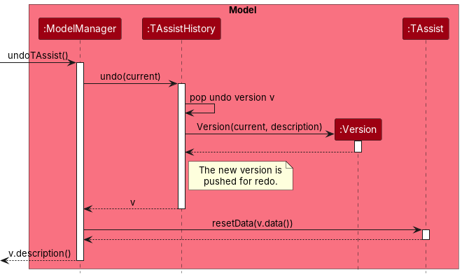

* Table of Contents
{:toc}

--------------------------------------------------------------------------------------------------------------------

## **Acknowledgements**

* TAssist is based on [AddressBook-Level3](https://github.com/se-edu/addressbook-level3) by
  [SE-EDU](https://se-education.org).

* The undo/redo design adapts the snapshot-history idea from the
  [AddressBook-Level3 Developer Guide](https://se-education.org/addressbook-level3/DeveloperGuide.html).
  The explanation and diagrams are rewritten for TAssist data and its save-failure recovery.

* The GUI is based on the team-supplied **TAssist UI Mockups.html** design reference
  ([image of the mock-up](images/UiMockup.png)): its colors, cards and command-first layout. A single light top bar
  with the group chips, and a navigation bar that opens the screens, replace the mock-up's dark header with a menu bar
  and its separate group strip. It is implemented with native JavaFX controls; no HTML runtime, web fonts, or
  additional libraries are bundled.

* Libraries used: [JavaFX](https://openjfx.io/) (GUI), [Jackson](https://github.com/FasterXML/jackson) (JSON storage),
  and [JUnit 5](https://github.com/junit-team/junit5) (testing). Build and quality tools: [Gradle](https://gradle.org/),
  [Checkstyle](https://checkstyle.sourceforge.io/), [JaCoCo](https://www.jacoco.org/jacoco/) and
  [Codecov](https://about.codecov.io/). Diagrams are drawn with [PlantUML](https://plantuml.com/).

* AI tool use: the team used [Claude Code](https://claude.com/claude-code) (Anthropic),
  [Codex](https://openai.com/codex/) (OpenAI) and [Cursor](https://cursor.com/) (SpaceX), AI coding assistants, to
  help with some code, tests and documentation. Team members reviewed, tested and take responsibility for all
  submitted work.

--------------------------------------------------------------------------------------------------------------------

## **Setting up, getting started**

Refer to the guide [_Setting up and getting started_](SettingUp.md).

--------------------------------------------------------------------------------------------------------------------

## **Design**

<div markdown="span" class="alert alert-primary">

:bulb: **Tip:** The `.puml` files used to create diagrams are in `docs/diagrams`. Refer to the [_PlantUML Tutorial_ at se-edu/guides](https://se-education.org/guides/tutorials/plantUml.html) to learn how to create and edit diagrams.
</div>

### Architecture


The ***Architecture Diagram*** given above explains the high-level design of the App.

The following provides a quick overview of the main components and their interactions.

**Main components of the architecture**

**`Main`** (consisting of classes [`Main`](https://github.com/AY2627S1-CS2103T-T12-4/tp/tree/master/src/main/java/seedu/address/Main.java) and [`MainApp`](https://github.com/AY2627S1-CS2103T-T12-4/tp/tree/master/src/main/java/seedu/address/MainApp.java)) is in charge of the app launch and shut down.
* At app launch, it initializes the other components in the correct sequence, and connects them up with each other.
* At shut down, it shuts down the other components and invokes cleanup methods where necessary.

The bulk of the app's work is done by the following four components:

* [**`UI`**](#ui-component): The UI of the App.
* [**`Logic`**](#logic-component): The command executor.
* [**`Model`**](#model-component): Holds the data of the App in memory.
* [**`Storage`**](#storage-component): Reads data from, and writes data to, the hard disk.

[**`Commons`**](#common-classes) represents a collection of classes used by multiple other components.

**How the architecture components interact with each other**

The *Sequence Diagram* below shows how the components interact when a command changes TAssist data and startup
loading has not failed. Logic copies the current data before execution. A successful save returns a result marked
as saved; a failed save restores the copy and reports an error while retaining the command input. Parsing and
command-specific interactions are omitted. Commands that leave data unchanged skip saving (see
[Saving and loading TAssist data](#saving-and-loading-tassist-data)).


Each of the four main components (also shown in the diagram above),

* defines its *API* in an `interface` with the same name as the Component.
* provides its functionality through a concrete `{Component Name}Manager` class that implements the corresponding API interface.

For example, the `Logic` component defines its API in `Logic.java` and implements it in `LogicManager.java`. Other components interact with a component through its interface rather than its concrete class, preventing them from coupling to that component's implementation, as illustrated in the following partial class diagram.


The sections below give more details of each component.

### UI component

The **API** of this component is specified in [`Ui.java`](https://github.com/AY2627S1-CS2103T-T12-4/tp/tree/master/src/main/java/seedu/address/ui/Ui.java)


The UI consists of `MainWindow`, `GroupStrip`, `NavigationBar`, `WorkspacePanel`, `CommandBox`, `ResultDisplay`, and
`StatusBarFooter`. `MainWindow` places the `GroupStrip` and the `NavigationBar` in one light bar at the top.
`WorkspacePanel` hosts the three screens: the live `StudentListPanel` table, `HelpPanel`, and `StoragePanel`.
Its tab strip is hidden: it only holds the screens, and `NavigationBar` selects them. Each button of the bar opens the
same screen as `view SCREEN` (without its feedback message), names that command in its tooltip, and does not take
keyboard focus away from the command box, so the UI stays usable by mouse while the app remains command-first.
All inherit from `UiPart`, which loads their FXML. `TAssist.css` defines the shared visual style and compact layout.

The `GroupStrip` and the Students screen (`StudentListPanel`) observe the
views that `Logic` provides: `getGroupList()`, `activeGroupProperty()` and `getDisplayedStudentList()` (see
[Observing the active group](#observing-the-active-group)). They never keep their own copy of the data, so a change to
the groups, the active group or its students shows at once. The card of the Students screen is titled with the active
group's name, and says "No active group" when none is active. When there are no students, an explanation replaces the
table, and says whether no group is active, the active group has no students, or no search results match. After a
failed load of the saved data (see [Saving and loading TAssist data](#saving-and-loading-tassist-data)), both the
Students screen and the group strip say "Saved data could not be read" instead, because adding a group is rejected
until the file is repaired. Columns cannot be sorted or reordered, a list change refreshes the row numbers,
and long values are shortened with an ellipsis and shown in full in a tooltip.

`StudentListPanel` handles primary-button clicks on populated `TableRow` objects. The row's current `Student`
is passed through a callback in `WorkspacePanel` to `MainWindow`, which fills the template built by
`AttendanceMarkCommand.buildTemplate` using its ID.
This callback calls `CommandBox.fillTemplate` rather than Logic; only Enter follows the execution and save path.
Keyboard or programmatic selection does not prepare a template, and empty rows and other mouse buttons are ignored.

`view SCREEN` follows the normal command/parser pattern and returns a `WorkspaceView` in `CommandResult`.
`MainWindow` selects the corresponding screen. `LogicManager` saves only when the persisted model changes, so
navigation and other read-only commands do not write data. `CommandResult.hasSavedChanges()` tells the UI whether
to show `Changes saved.` in the footer. Commands keep the current screen unless they request navigation or help.

The command reference is shown only on the Help screen. `help` returns `CommandResult.forHelp(...)` with a one-line
confirmation and, for `help TOPIC`, the topic. `MainWindow` then asks `WorkspacePanel` to open Help, which scrolls
`HelpPanel` to that topic's heading. F1, the Help button of the `NavigationBar` and `view help` open the same screen.

`ResultDisplay` sizes itself to the message: it measures how many lines the text wraps to at the current width and
shows that many rows, from one up to six. Longer messages scroll. It shows a check mark beside a message, or a cross on
a red row when the command failed, and failed commands retain their input.

`CommandBox` keeps a `CommandHistory` of every command entered in the session, including failed ones. An event filter
on the text field turns Up into `CommandHistory#previous` and Down into `CommandHistory#next`, and consumes both keys.
Up and Down with Shift, Ctrl, Alt or Meta are left to the text field, so shortcuts such as Shift+Up still select text.
Both methods take the text in the box and keep it at the current position before moving, so edits to a recalled
command survive moving away and back, and Down past the newest command restores what the TA was typing. Entering a
command adds it to the history, stops recalling and discards those edits, so the history keeps each command as entered.
Both methods skip positions whose text matches the text in the box. A failed command stays in the box and is also the
newest entry, so without this the first Up after a failure would appear to do nothing. The history is kept in
memory only, because it is a typing aid rather than TAssist data, and `CommandHistory` has no JavaFX dependency so
that it can be unit tested.

`CommandBox.fillTemplate` replaces the current draft without executing it or adding it to history.
It starts a fresh history position, returns focus to the input, and places the caret at the end.
A repeated template clears failed-input styling too. Enter still follows the normal parser and command path;
an incomplete template stays editable after its validation error.

Groups, attendance, participation, and assignments have no screen of their own; their commands show records in the
feedback box. Earlier versions showed empty **Coming soon** tables for them, which looked like unfinished work, so they
were removed. Table screens for these records remain a possible future enhancement: each would observe the model in the
same way as the Students screen, add a `WorkspaceView` constant, and register a button in `NavigationBar`.

The screenshot below shows the implemented Students screen with an active group and its roster.


#### Differences from the supplied mock-up

The original mock-up is preserved as [`UiMockup.png`](images/UiMockup.png). The implemented UI differs in these ways:

* The mock-up's dark menu header and separate group strip are replaced by a light group bar and a screen-navigation row.
* The app uses native JavaFX controls rather than rendering the mock-up as an HTML page.
* The mock-up shows an Attendance screen. The app has Students, Help, and Storage screens and the group bar, all
  showing live data. Attendance, participation, and assignment records appear in the feedback box instead.

The `UI` component uses the JavaFX UI framework. The layouts of these UI parts are defined in matching `.fxml` files in `src/main/resources/view`. For example, [`MainWindow.fxml`](https://github.com/AY2627S1-CS2103T-T12-4/tp/tree/master/src/main/resources/view/MainWindow.fxml) specifies the layout of [`MainWindow`](https://github.com/AY2627S1-CS2103T-T12-4/tp/tree/master/src/main/java/seedu/address/ui/MainWindow.java).

The `UI` component,

* executes user commands using the `Logic` component.
* listens for changes to `Model` data so that the UI can be updated with the modified data.
* keeps a reference to the `Logic` component, because the `UI` relies on the `Logic` to execute commands.
* depends on some classes in the `Model` component because it displays `Group` and `Student` objects from the model.

### Logic component

**API** : [`Logic.java`](https://github.com/AY2627S1-CS2103T-T12-4/tp/tree/master/src/main/java/seedu/address/logic/Logic.java)

Here's a (partial) class diagram of the `Logic` component:


The sequence diagram below illustrates the interactions within the `Logic` component, taking `execute("view students")` API call as an example.


<div markdown="span" class="alert alert-info">:information_source: **Note:** The lifeline for `ViewCommandParser` should end at the destroy marker (X), but due to a limitation of PlantUML, it continues to the end of the diagram.
</div>

How the `Logic` component works:

1. When `Logic` is called upon to execute a command, the command is passed to a `TAssistParser` object, which in turn creates a parser that matches the command (e.g., `ViewCommandParser`) and uses it to parse the command.
1. This results in a `Command` object (more precisely, an object of one of its subclasses e.g., `ViewCommand`) which is executed by the `LogicManager`.
1. The command can communicate with the `Model` when it is executed (e.g. to add a student to a group). The `ViewCommand` in the diagram only asks the UI to show a screen, so it leaves the `Model` alone.<br>
   Note that although this is shown as a single step in the diagram above for simplicity, the code can require several interactions between the command object and the `Model` to complete the operation.
1. The result of the command execution is encapsulated as a `CommandResult` object which is returned from `Logic`.

Here are the other classes in `Logic` (omitted from the class diagram above) that are used for parsing a user command:


How the parsing works:
* When called upon to parse a user command, the `TAssistParser` class creates an `XYZCommandParser` (`XYZ` is a placeholder for the specific command name, e.g., `ViewCommandParser`), or asks the `CommandRegistry` for the parser that a feature registered for a two-word command (see [Command registration and shared validation](#command-registration-and-shared-validation)). The parser uses the other classes shown above to parse the user command and create an `XYZCommand` object (e.g., `ViewCommand`). The `TAssistParser` returns that object as a `Command` object.
* All `XYZCommandParser` classes, such as `ViewCommandParser` and `HelpCommandParser`, implement the `Parser` interface so they can be treated similarly where appropriate, for example during testing.

### Model component
**API** : [`Model.java`](https://github.com/AY2627S1-CS2103T-T12-4/tp/tree/master/src/main/java/seedu/address/model/Model.java)


The `Model` component,

* stores the TAssist data, i.e., the tutorial groups, their students and assignments, and the active group, in a `TAssist` object (see [TAssist domain model](#tassist-domain-model)). It exposes the active group and the active group's students as observable values that the UI can bind to (see [Observing the active group](#observing-the-active-group)).
* stores a `UserPrefs` object that represents the user’s preferences (currently, just the GUI settings). This is exposed to the outside as a `ReadOnlyUserPrefs` object.
* does not depend on any of the other three components (as the `Model` represents data entities of the domain, they should make sense on their own without depending on other components)


### Storage component

**API** : [`Storage.java`](https://github.com/AY2627S1-CS2103T-T12-4/tp/tree/master/src/main/java/seedu/address/storage/Storage.java)


The `Storage` component,
* can save both TAssist data and user preference data in JSON format, and read them back into corresponding objects.
* is implemented by `StorageManager`, which delegates the actual JSON file access to `JsonTAssistStorage` and `JsonUserPrefsStorage` (one class per data file).
* converts TAssist data to and from JSON through one Jackson-friendly class per model class: `JsonSerializableTAssist` for `TAssist`, `JsonAdaptedGroup` for `Group` and its assignment names, `JsonAdaptedStudent` for `Student`, and `JsonAdaptedAssignmentRecord` for each student's `AssignmentRecord` in an assignment (see [Saving and loading TAssist data](#saving-and-loading-tassist-data)).
* also writes a group's records to a CSV file through `GroupRecordsCsvExporter`. This is a one-way export that TAssist never reads back, so it is kept out of the `Storage` interface (see [Exporting a group's records](#exporting-a-groups-records)).
* depends on some classes in the `Model` component (because the `Storage` component's job is to save/retrieve objects that belong to the `Model`)

### Common classes

Classes used by multiple components are in the `seedu.address.commons` package.

--------------------------------------------------------------------------------------------------------------------

## **Implementation**

This section describes some noteworthy details on how certain features are implemented.

### Command registration and shared validation

`CommandRegistry` maps a feature keyword and subcommand to a `Parser<? extends Command>` and its `HelpEntry`.
Each feature owns its parser, format, description, and examples, so adding a command does not require editing another
feature's help content or adding a case to the command switch in `TAssistParser`. Register commands before creating `LogicManager`:

```java
CommandRegistry registry = new CommandRegistry();
GroupCommandRegistration.registerCommands(registry, exportFolder);
StudentCommandRegistration.registerCommands(registry);
ParticipationCommandRegistration.registerCommands(registry);
AttendanceCommandRegistration.registerCommands(registry);
AssignmentCommandRegistration.registerCommands(registry);
Logic logic = new LogicManager(model, storage, registry, dataLoadStatus);
```

`MainApp.init` uses this registration before constructing `LogicManager`. The group feature registers `add`, `delete`, `export`,
`list`, `rename`, and `use` with their parsers and help entries. Future features can register their commands in the same registry.

* `TAssistParser` and `LogicManager` take snapshots of registrations at construction. Later changes to the source
  registry do not change the running parser or its help.
* A feature keyword cannot shadow a built-in command (`help`, `view` or `exit`). Duplicate registrations and invalid registration
  keywords are developer errors and throw `IllegalArgumentException`.

#### In-app help

* The built-in commands `help`, `view` and `exit` keep their `HelpEntry` objects in `HelpCatalog`. `TAssistParser` combines
  them with the registered feature entries, and `Logic#getHelpEntries()` exposes the combined list.
* `HelpCommandParser` accepts an optional topic and maps `groups`, `students`, and `assignments` to their singular
  topics before validation. `HelpCatalog.TOPICS` lists the canonical topics, and an unknown topic
  throws a `ParseException` with the message required for unknown topics. A feature's `HelpEntry` topic must equal
  its feature keyword, so a feature appears under `help TOPIC` only if its keyword is listed in `HelpCatalog.TOPICS`.
* `HelpCommand` does not format the entries. It returns `CommandResult.forHelp(...)` with a one-line confirmation and,
  for `help TOPIC`, the topic, and `MainWindow` asks `WorkspacePanel.showHelp` to open the Help screen at that topic.
* The Help screen (`HelpPanel`) renders the same entries and uses `HelpCatalog.getTopicHeading` for its headings.

The class diagram below shows how help entries reach the Help screen.


**Order of the reference.** `HelpCatalog.getEntries` puts the built-in commands first, under "General commands", and
then the feature commands grouped by topic in the order of `HelpCatalog.TOPICS` (group, student, attendance,
participation, assignment). This is the order `help TOPIC` lists the topics in, and the order of the User Guide's
sections. Within a topic, `CommandRegistry` keeps the order in which the commands were registered, so each
`XYZCommandRegistration` registers its commands in the order a TA uses them: create or record first, then list, then
delete.

**Rules for help text.** Each `HelpEntry` uses the command's `MESSAGE_USAGE` as its format, so the format in help and
in error messages cannot drift apart. Its description states the rules a user needs (value ranges, case
insensitivity, what replaces what), in the same words as the User Guide. Its examples must work when typed: taken
in the order of the reference, the examples of all topics form one session that starts from a new TAssist. For
example, the group examples create T01 and T02 and switch back to T01, so that the student examples add students to
T01, and the attendance and participation examples record data for a student who is still there.

`HelpIntegrationTest` enforces these rules on the running app. It checks that help lists every command in the
expected order, that each example runs its own command, that typing every example in order into a new TAssist
succeeds, that the User Guide shows every help format and example, and that every example in the User Guide's
command summary is one of the help examples. A new command therefore needs a help entry,
an example that continues the session, and matching User Guide text before its tests pass.

For registered commands, `TAssistParser` extracts the first keyword and lets `CommandRegistry` extract
the subcommand. The registered parser receives only the remaining arguments. Missing and unknown subcommands
produce distinct `ParseException` messages listing the registered subcommands in alphabetical order.
Unknown feature keywords report an unknown command. User-entered command words and subcommands ignore case,
using `Locale.ROOT` for lookup. Registrations still require lowercase keywords. Surrounding whitespace and repeated
whitespace between keywords are ignored. Argument values retain their capitalization and spacing until their value
validator normalizes them; parameter prefixes remain lowercase.

Before splitting the input, `TAssistParser` replaces every Unicode space separator (`\p{Zs}`, such as the
non-breaking space U+00A0 or the em space U+2003) and every Unicode line separator (U+2028, U+2029, and U+0085)
with a normal space. Text pasted from a web page, a PDF, or a chat app often contains these characters. They look
like a space or a line break, but Java's `\s` and `String#trim` do not treat them as whitespace, so a command such as
`group add` followed by a non-breaking space would otherwise be read as one unknown subcommand. Tabs and ASCII line
breaks are left to the existing whitespace rules.

Zero-width characters, such as the zero-width space U+200B, the word joiner U+2060, and the byte order mark U+FEFF,
are not changed. Unlike the characters above, they do not separate words: replacing one with a space would split
`A0123<ZWSP>456X` into two words, while deleting it would join `group<ZWSP>add` into the unknown command `groupadd`.
Either way, the command means something other than what the TA sees. Such input is rejected like any other invalid
command, so the data stays unchanged, and the User Guide lists this under its known issues.
`TAssistParserTest#replaceUnicodeSpaces_zeroWidthCharacters_areKept` records this choice.

`HelpIntegrationTest` executes every help example with uppercase command words and compares the data with the
lowercase examples, then reloads the saved file. It also checks that invalid uppercase commands preserve data and
that mixed-case undo and redo work.

Feature parsers declare their required and optional parameters with `TAssistArgumentParser`:

```java
TAssistArgumentParser arguments = new TAssistArgumentParser(
        List.of(PREFIX_NAME, PREFIX_ID), List.of());
ArgumentMultimap values = arguments.parse(args);
StudentName name = TAssistParserUtil.parseStudentName(values.getValue(PREFIX_NAME).orElseThrow());
StudentId id = TAssistParserUtil.parseStudentId(values.getValue(PREFIX_ID).orElseThrow());
```

Prefixes contain lowercase letters followed by `/`, and start at the beginning of arguments or after whitespace.
Prefix-like tokens at those boundaries are reserved for parameters. A slash embedded in a value does not separate
parameters, and URL schemes such as `https://` are retained as values. Parameters can appear in any order.
Unknown prefixes, repeated parameters, missing required parameters, and unexpected text before parameters
produce specific errors. If a missing prefix appears inside another value right after other text, as `w/` does in
`id/A0123456Xw/3`, the error says `Missing space before w/ in 'id/A0123456Xw/3'.` instead of naming `w/` as
missing. It quotes only the value's first word, the only word that can hide a prefix, since a later word with a
slash is read as a prefix of its own. Such a word, as in `n/Alice Tanid/A1`, is an unknown prefix (`Tanid/`). The
error adds `If id/ starts a new parameter, put a space before it.` only when the word comes after another value,
ends with an allowed prefix that the input lacks, and has text before that prefix that is not all lowercase letters.
Without these checks, a mistyped prefix name such as `status/` or `studentid/` would get a hint that does not help.
Each command parser passes the prefixes whose values are a single word (for example `id/`
and `w/`). Extra words after one of those values are reported after the missing-parameter check, naming the text,
instead of being joined onto the value. A parser that checks its own optional-but-needed prefixes, as the student
and group parsers do, calls `verifyNoMissingSpaceBefore()` for a missing one before reporting it. If it also has
single-word prefixes, it calls `parseWithoutExtraTextCheck()` first and `verifyNoExtraText()` last.
Optional parameters may appear at most once.
Empty values are retained for the value validator to report a value error instead of a missing-parameter error.
A command declaring no prefixes rejects extra input.

A parser may also declare **literal words**: words such as `s/o` that look like a prefix followed by text but belong
to a value. `student add` and `student find` declare `StudentName.SLASH_PARTICLES` (`s/o`, `d/o`, `a/l` and `a/p`),
so `n/Ravi s/o Kumar` keeps `s/o` in the name instead of reporting an unknown prefix `s/`. A literal word counts only
when it stands alone between whitespace, ignoring case. `s/oKumar` is still an unknown prefix, and the error adds
`If s/o is part of the value, put a space before and after it.` The hint appears only when the text after the
literal word does not start with a lowercase letter, so `a/lee` is reported as an unknown prefix without it. A literal
word also may not start with one of the parser's own prefixes (ignoring case), which would make the input ambiguous. Commands that declare no literal
words parse exactly as before, so `s/` in `attendance mark` is unaffected.

**Aspect: Reading `s/o` in a name**

* **Alternative 1 (current choice):** `student add` and `student find` declare a short list of literal words.
  * Pros: Only the commands that take a name change, and only for these particles. Every other prefix check,
    including typos such as `x/`, still reports a specific error.
  * Cons: A particle that is not in the list, or one joined to the next word, is still read as a prefix.
* **Alternative 2:** Treat every unknown prefix after `n/` as part of the name.
  * Pros: Accepts any slash in a name.
  * Cons: A mistyped prefix, such as `i/` in `n/Alice i/A1`, would be swallowed into the name and reported as an
    invalid name or a missing ID, which hides the real mistake.
* **Alternative 3:** Ask users to write the particle without the slash, such as `so`.
  * Pros: No parser change.
  * Cons: The roster no longer matches the official name that the TA reads from the class list.

`TAssistParserUtil` reuses `StudentName`, `StudentId`, and `GroupName` validation and normalization.
It also validates assignment names, weeks (whole numbers 1–13), participation scores (whole numbers 0–5), and
grades (whole numbers 0–100). Assignment names contain 1–60 letters, digits, spaces, hyphens, periods, colons, or
parentheses after whitespace normalization, with at least one letter or digit. They retain the entered
capitalization and are compared ignoring case. Numeric input is trimmed, accepts digits including leading zeros,
and rejects signs, decimals, out-of-range values, and integer overflow with a field-specific `ParseException`.

Parsers only validate and construct commands. `LogicManager` executes after parsing succeeds and saves data changes;
parsing failures neither execute a command nor call storage. Registry, argument, and value-validator unit tests
cover these rules. `LogicManagerTest` also verifies that rejected feature input leaves the model and existing
data file unchanged, using a storage implementation that fails if saving is attempted.

### Tutorial-group commands

`GroupAddCommandParser`, `GroupDeleteCommandParser`, `GroupListCommandParser`, `GroupRenameCommandParser`, and
`GroupUseCommandParser` construct the commands for `group add g/GROUP_NAME`, `group delete g/GROUP_NAME [f/yes]`, `group list`,
`group rename g/GROUP_NAME n/NEW_NAME`, and `group use g/GROUP_NAME`. `GroupCommandRegistration` connects these
parsers, and the one for `group export` (see [Exporting a group's records](#exporting-a-groups-records)), with their
`HelpEntry` objects to `CommandRegistry`, making them available through `help group`.

Creation, switching, renaming and deletion share `GroupCommandParserUtil`. It uses `TAssistArgumentParser` to reject unknown prefixes,
duplicates, and unexpected text, then `TAssistParserUtil.parseGroupName` to apply the existing domain rules.
It declares `g/` optional to the argument parser so absent and blank values can both report
`Missing group name. Usage: ...` with the relevant command's syntax. The feature still requires a nonblank name.
The listing parser declares no parameters and rejects extra input.

`GroupName` and `AssignmentName` hash with `StringUtil#hashCodeIgnoreCase`, which converts each Unicode code point
to uppercase and then lowercase, matching their case-insensitive equality. Equal names, such as `PSI` and `psı`,
therefore have the same hash code, while display capitalization is preserved.

* `GroupAddCommand` checks `Model.hasGroup` before changing data, calls `Model.addGroup` with an empty group, and
  then calls `Model.setActiveGroup`. Creating any group therefore activates it, without modifying existing groups.
  A duplicate name throws `CommandException` with the existing group's display name.
* `GroupListCommand` reads `Model.getTAssist().getGroupList()` and `Model.getActiveGroup()`. It returns numbered
  names in creation order and an active-group line, or a creation hint when no groups exist. If groups exist without
  an active selection, it shows `Active group: None`.
* `GroupUseCommand` checks that the group exists before calling `Model.setActiveGroup`. Feedback uses the stored
  capitalization, even if the input uses another case. A missing group throws `CommandException` before mutation.
* `GroupDeleteCommand` overrides `Command#getConfirmationPrompt`, like `StudentDeleteCommand`, so the UI asks before
  deleting unless `f/yes` is given (parsed by `GroupDeleteCommandParser`). It then checks that the group exists and
  calls `Model.removeGroup`, which removes the group with its students and clears the active group if it was the
  one removed. The feedback states how many students were deleted.
* `GroupRenameCommand` checks that the group exists and that `n/` does not name a different group, then calls
  `Model.renameGroup`. `TAssist` replaces the group with a renamed copy (`Group#withName`) at the same position
  and keeps it active if it was active. Changing only the case of the group's own name is allowed.
  `GroupName` equality ignores case, but `Group#equals` compares the name's exact capitalization, so `LogicManager`
  sees a case-only rename as a change. It is saved and recorded for undo like any other rename. A new name equal
  to the stored name, after spaces are normalized, returns unchanged feedback without calling `Model.renameGroup`.
* `GroupUseCommand` returns unchanged feedback when the group is already active, without calling
  `Model.setActiveGroup`.

These commands return feedback without a screen-navigation request. `LogicManager` saves changes to the groups and
active selection through JSON storage; listing or selecting the already active group does not save. The group strip
and Students screen update through the model views, while the current screen stays selected.

Command and parser tests cover successful operations, exact feedback, name boundaries, case and space normalization,
and invalid input. `GroupCommandsIntegrationTest` checks that parsing and execution rejections preserve the model,
observable student list, active group, and file contents, and never call storage. `MainAppTest` exercises actual startup
registration and shutdown/restart persistence. `WorkspaceSmokeTest` checks the commands through the JavaFX command box.

### Exporting a group's records

`group export` saves the active group's attendance, participation, and assignment records as a CSV file that
spreadsheets open. Four classes share the work:

* `GroupExportCommandParser` (Logic) rejects any parameters, like the `group list` parser.
* `GroupExportCommand` (Logic) finds the active group and reports where its file was written.
* `GroupRecordsCsvExporter` (Storage) lays the group out as rows and writes the file.
* `CsvUtil` (Commons) turns rows into CSV text. It knows nothing about TAssist, so a later import or another export
  can reuse it.

The diagram below shows `group export` with T01 active. The `parse group export` frame works like the parse frame of
`participation set` in [Participation commands](#participation-commands).


<div markdown="span" class="alert alert-info">:information_source: **Note:** The lifeline for `GroupExportCommand` should end at the destroy marker (X), but due to a limitation of PlantUML, it continues to the end of the diagram.
</div>

**Where the file goes.** Commands receive only the `Model`, so the exporter is created once at startup and handed
to the parser, which gives it to every command it creates. `GroupCommandRegistration.registerCommands(registry,
exportFolder)` builds the exporter. `MainApp` passes the `exports` folder in the home folder, beside `data` and
`preferences.json`, so TAssist still writes only inside its own folder. The `MainApp(Path, Path)` constructor that tests
use places `exports` beside the data file, so tests never write next to the build. The file is named after the group,
with spaces replaced by underscores, such as `exports/T01-records.csv`. Group names cannot contain underscores, so
`Lab 1` and `Lab-1` get different files. Names that differ only in Unicode normalization can still map to the same
file on macOS.

**What the file holds.** `GroupRecordsCsvExporter.toRows(Group)` returns a header row, then one row per student in
roster order:

* `Name` and `Student ID`;
* `Week 1 Attendance` to `Week 13 Attendance`;
* `Week 1 Participation` to `Week 13 Participation`;
* `PS1 Submitted` and `PS1 Grade` for each assignment in `Group#getAssignmentList()`, in creation order.

A week without a record is an empty cell, so it is not mistaken for an absence or a score of 0. The same holds for
a missing grade. A submission cell is always `Yes` or `No`: `Assignment#getStudentRecord` gives an unsubmitted record
for a student without one, as `assignment list` shows. Attendance uses
`AttendanceStatus.formatStoredValue`, which `attendance list` also uses, so the file and the app show the same
`Present` and `Absent`.

**Writing valid CSV.** `CsvUtil` follows RFC 4180. Rows end with CRLF. A field is quoted only if it holds a comma,
a quote, a line break, or a leading or trailing space, and quotes inside it are doubled. The exporter starts the
file with a UTF-8 byte order mark, so Excel shows names such as `Chloé` correctly instead of guessing another
encoding. A field that starts with `=`, `+`, `-`, `@`, a tab, or a carriage return gets a leading `'`, so a
spreadsheet shows it as text instead of running it as a formula. A student name may start with a hyphen, such as
`-Ann`, and `CsvUtil` writes that field as `'-Ann`. Student IDs cannot start with those characters. The guard
still keeps the export safe if the ID rules are relaxed later.

**Failing safely.** The exporter writes the whole file to a temporary file in the exports folder, then moves it over
the old export in one step (`ATOMIC_MOVE` with `REPLACE_EXISTING`). A failed export therefore never leaves a half-written
file, and the previous export stays intact. The temporary file is deleted in a `finally` block. An `IOException`
becomes a `CommandException` that names the group and the file, and the cause is logged. Exporting reads the model
without changing it, so `LogicManager` never saves after `group export`, whether it succeeds or fails.

**Design considerations.**

* **Aspect: Shape of the table**
  * **Alternative 1 (current choice):** One row per student, with a column for each week.
    * Pros: Matches how a coordinator reads a gradebook. A student's total is one `SUM` over their row.
    * Cons: The file always has 26 week columns, even when only a few weeks have records.
  * **Alternative 2:** One row per student and week, with attendance and participation columns.
    * Pros: Never has empty cells, and suits importing into a database.
    * Cons: Each student is spread over 13 rows, so a per-student total needs a pivot table.
* **Aspect: Choosing the location**
  * **Alternative 1 (current choice):** Always write to the `exports` folder in the home folder.
    * Pros: Keeps TAssist from writing outside its folder (see [Editing the data file](UserGuide.html#editing-the-data-file)).
      The command needs no path, so there are no path or permission errors to explain in the parser.
    * Cons: Users cannot pick the folder. They move or copy the file themselves.
  * **Alternative 2:** Take a path, such as `group export f/~/Desktop/t01.csv`.
    * Pros: Users can pick where the file goes.
    * Cons: Writes outside the home folder. Needs rules for relative paths, existing files, and paths that differ
      between operating systems.
* **Aspect: Assignment records**
  * **Alternative 1 (current choice):** Two columns per assignment, `PS1 Submitted` and `PS1 Grade`, after the week
    columns.
    * Pros: One row still holds all of a student's records, and the week columns keep their positions in every
      export.
    * Cons: Each group has its own assignments, so the number of columns differs between groups.
  * **Alternative 2:** One column per assignment, holding the grade, `Submitted` without a grade, or empty.
    * Pros: Fewer columns.
    * Cons: Mixes text and numbers in one column, so a spreadsheet cannot simply sum or average the grades.

`CsvUtilTest` covers quoting, line breaks, formula guards, and CRLF. `GroupRecordsCsvExporterTest` covers the
layout, including the assignment columns, the byte order mark, replacing an earlier export without leaving
temporary files, and an unwritable folder.
`GroupExportCommandTest` covers the feedback, a missing active group, and a failed write. `GroupCommandsIntegrationTest`
runs `group export` through `LogicManager`, reads the file back, and checks that the model and data file are
unchanged and that storage is never called.

### Participation commands

`ParticipationCommandRegistration` registers `participation set`, `participation list` and `participation clear`
and their help entries
before `LogicManager` is created. Their parsers use `TAssistArgumentParser` for prefix validation and
`TAssistParserUtil` for IDs, weeks 1–13, and whole-number scores 0–5. Command constructors also reject invalid weeks
or scores defensively, even when called without a parser.

`ParticipationSetCommand` finds the student in the active group before changing anything. It reads that week's
existing value, if any, creates an immutable copy with `Student.withParticipationRecord`, and passes the copy to
`Model.setStudent`. Feedback distinguishes a first entry, a replacement (showing the old and new score, such as
`2 to 4`), and an entry equal to the existing score, which says nothing changed. The replacement preserves roster
order, attendance, and scores for other weeks; students in other groups are untouched.

The sequence diagram below shows how `LogicManager` executes the input `participation set id/A0123456X w/3 s/2`
while T01 is the active group. The command replaces the student with the updated copy `u` instead of changing the
original.


<div markdown="span" class="alert alert-info">:information_source: **Note:** The lifeline for `ParticipationSetCommand` should end at the destroy marker (X), but due to a limitation of PlantUML, it continues to the end of the diagram.
</div>

The `parse participation set` reference frame is shown below. `CommandRegistry` passes the arguments to the
`ParticipationSetCommandParser` registered at startup, so no parser is created for each command.


`ParticipationListCommand` uses `Group.getWeeklyRecordEntries` with `Student::getParticipationRecords`, so it reuses
the shared weekly listing mechanism. Each row formats its value or `Not recorded`; zero is an actual score.

Because zero is an actual score, setting a score to 0 cannot undo a score entered by mistake.
`ParticipationClearCommand` removes the week's score with `withoutParticipationRecord`, so the week shows
`Not recorded` again. It works like `attendance clear`: it takes only `id/` and `w/`, names the score it removed, and
changes nothing when the week has no score.

**Aspect: How a TA removes a wrong weekly record**

* **Alternative 1 (current choice):** A `clear` subcommand for each record kind, such as
  `attendance clear id/A0123456X w/4`.
  * Pros: The command says what it does. It takes only the student and week, so it cannot be confused with a mark,
    and both record kinds use the same word.
  * Cons: Two more commands to learn and document.
* **Alternative 2:** A special value in the existing commands, such as `attendance mark ... s/none`.
  * Pros: No new commands.
  * Cons: `none` would become a third status for attendance and a non-number for participation, which every
    validator, list, and export would have to treat as missing. A typo could also clear a record by accident.
* **Alternative 3:** Rely on a general undo command.
  * Pros: Fixes any mistake, not only weekly records.
  * Cons: It only helps right after the mistake. A wrong mark noticed a week later stays in the data and the export.

`participation set`, `participation list`, and `participation clear` use the standard feedback box and keep the
current screen selected. Existing JSON storage already persists participation records, so the
feature adds no new file format. Loading rejects a fractional participation score, or one outside 0–5, the same way
it rejects a week outside 1–13. `ParticipationCommandsIntegrationTest` exercises startup registration, help,
restart persistence, clearing a score, and rejected commands preserving existing records and the file. Command and
parser unit tests cover boundaries, corrections, clearing a recorded or missing score, group isolation, missing
values, and malformed input. `WorkspaceSmokeTest` checks
participation feedback and failed-input retention through the JavaFX command box.

### Student commands

`StudentCommandRegistration` registers `student add`, `student list`, `student find`, `student sort`, and
`student delete`, including their help formats and examples. `MainApp.init` installs these registrations before constructing `LogicManager`.
The add and delete parsers use `StudentCommandParserUtil` to reject malformed parameters and report missing
prefixes with the command's usage. Present but blank values go through the existing domain validators, so a blank
name or ID reports its value constraints. Listing accepts no parameters. `StudentName` accepts `s/o`, `d/o`, `a/l`
and `a/p` only as a separate word between two parts of a name, and the add and find parsers keep them in the name as
literal words (see [Command registration and shared validation](#command-registration-and-shared-validation)).

Each command obtains the active group at execution time and throws `CommandException` if none is selected.
`StudentAddCommand` checks ID uniqueness before calling `Model.addStudent`; names need not be unique. If
`Group.findStudentNamed` finds a student with the same name (ignoring case) before the add, the command still adds the
student and appends a warning that names the existing student and their ID to its success message.
`StudentDeleteCommand` checks for the ID in the active group before calling `Model.removeStudent`. Removing the
student also removes their owned weekly records. Neither command changes another group, even if it contains the
same ID. `StudentListCommand` clears the display filter and sort order, opens Students, and returns the full
numbered roster or an empty-roster hint.

Before execution, `MainWindow` asks Logic for the command's optional confirmation prompt. A command describes the
affected data without changing it; cancelling skips execution and persistence. Student deletion names the student,
their student ID, and the group in the prompt, because names are not unique. Cancel is the dialog's default button,
so Enter cancels, and `f/yes` bypasses the prompt for experienced users. Mutations pass through the existing model and
observable roster, so the Students screen updates without navigating away from the current screen. Successful
commands use the existing JSON persistence in `LogicManager`. Parser and command tests cover validation,
normalization, confirmation details, feedback, uniqueness, group isolation, and empty states.
`StudentCommandsIntegrationTest` exercises the real startup registration, help examples, add/delete persistence
across restarts, and rejected commands preserving both the model and the saved file. `WorkspaceSmokeTest` checks
that cancelling preserves the roster and saved file, while accepting or using `f/yes` removes the student.

#### Student search and sorting

`StudentFindCommandParser` accepts optional `n/` and `id/` parameters using `TAssistArgumentParser`, requiring
at least one nonblank fragment. Fragments are not validated as complete names or IDs. `StudentSearchPredicate`
uses case-insensitive substring matching and combines the supplied filters with AND.
`StudentFindCommand` checks for an empty roster before applying a new predicate. In that case it reports the
empty roster and preserves the existing display settings, allowing a later addition to follow those settings.

`ModelManager` maintains a `FilteredList` over the active group's live roster, wraps it in a `SortedList`,
and exposes an unmodifiable `getDisplayedStudentList()` through Logic. The Students table binds to this display; `getActiveGroupStudentList()`
continues to expose the complete roster. Searching changes only the predicate and sorting changes only the
comparator, so `LogicManager` does not save them.
Each search replaces the previous one while preserving sorting, and sorting preserves the current filter.
`student list` clears both. Switching to a different group resets both; rebinding the same group after a failed
command preserves them. `LogicManager` also snapshots `StudentDisplayState` and restores it on command failure,
including a group switch whose save fails. Restarting constructs an unfiltered view in roster order.
The table observes the read-only `studentFilterActiveProperty()` exposed by Model and Logic, which follows
whether a predicate is installed. Empty-state captions and counts use this property rather than roster size.
An active search always shows the matching count against the total, including `0 of 0 students`.

`StudentSortCommandParser` requires `by/name` or `by/id`, ignoring the field's case. `by/` takes a single word, so
`by/id now` is reported as extra text rather than as an invalid field. `StudentSortField` supplies
ascending comparators: names use case-insensitive text comparison with student ID as the tie-breaker; IDs use
lexicographic comparison of their normalized uppercase values. Sorting is exposed through the CLI; table headers
remain non-sortable. These transformations keep the original roster order and all record/export commands intact.
Sort feedback reports the displayed count even when it is zero, without suggesting that the sort be reset.

### Assignment commands

`AssignmentCommandRegistration` registers `assignment add`, `assignment submit`, `assignment grade`, and
`assignment list` with offline help entries, and `MainApp.init` installs it before constructing `LogicManager`.
The submit and grade parsers require `a/`, `id/`, and their status (`s/`) or mark (`m/`) prefix exactly once with
`TAssistArgumentParser`. `TAssistParserUtil` validates the assignment name, student ID, yes/no status, and grade.
The `m/` prefix avoids giving `g/` a second meaning when it already identifies a tutorial group.

`AssignmentName` mirrors `GroupName`: it normalizes spaces, keeps the entered capitalization for display, and
compares ignoring case, so `PS1` and `ps1` are the same assignment. An `Assignment` is identified by its name, and
a `Group` holds its assignments in a `UniqueAssignmentList` in creation order. Assignment names are only unique
within one group.

`AssignmentAddCommand` finds the active group and rejects a name that the group already holds, then calls
`Model.addAssignment`. Its duplicate message shows the name of the existing assignment, so the TA sees the
capitalization that is stored. `AssignmentSubmitCommand` and `AssignmentGradeCommand` resolve the active group,
assignment, and student before updating an immutable `Assignment` through `Model#setAssignment`. A grade update also
checks that the record is submitted. Each failed command leaves the model unchanged. With `a/`,
`AssignmentListCommand` returns one row per student in roster order: name, student ID, submission status, and grade;
missing records show `Not submitted` and `-`. Without `a/`, it numbers the names of the active group's assignments in
creation order, so the TA can recover the exact names after a restart. The unknown-assignment message points to this
form.

Design considerations for listing assignment names:

* **Alternative 1 (current choice):** make `a/` optional in `assignment list`.
  * Pros: No new command word to learn; the TA reaches for `assignment list` first anyway.
  * Cons: One command returns two kinds of output, depending on whether `a/` is present.
* **Alternative 2:** list the existing names in the unknown-assignment error.
  * Pros: The names appear exactly when a guess fails.
  * Cons: There is no way to see them before guessing, and a long list makes the error message hard to read.

`Assignment` stores immutable `AssignmentRecord` values in a map keyed by `StudentId`. A record contains a submitted
flag and an optional grade. Setting status or grade replaces the prior value; withdrawing a submission clears any
recorded grade and the success message calls out that loss only when a grade existed. If the requested status equals
the recorded one, `AssignmentSubmitCommand` returns unchanged feedback without updating the model. For `s/no`, this
also covers a student with no explicit record, so the command does not create a record or save the file.
Like `participation set`, `AssignmentGradeCommand` feedback distinguishes a first grade, a replacement (showing the
old and new grade, such as `87 to 60`), and a grade equal to the existing one, which says nothing changed.
Unlike `AssignmentSubmitCommand`, the grade command still calls `Model.setAssignment` for an equal grade, and
`LogicManager` skips saving because the data is unchanged.
Removing a student removes only that student's records from every assignment in the group.

`JsonAdaptedGroup` preserves the existing `assignments` name list and stores explicit records in an optional
`assignmentRecords` list. The list can be absent in older data files. During loading, records must refer to an
existing assignment and student, duplicate assignment/student pairs are rejected, and status/grade invariants are
validated before the group is returned.

`AssignmentCommandsIntegrationTest` exercises startup registration, help, persistence across restarts, and rejected
commands preserving the model and the saved file, including persistence of submission and grade updates after restart.
`SaveFailureIntegrationTest` checks rollback after submission and grade updates when saving fails.
The model, storage, command and parser tests cover validation, replacement, group isolation, legacy JSON files, and
malformed input.

### TAssist domain model

TAssist's own data is modelled by the classes below. `ModelManager` holds the `TAssist` data, and the `Model` interface delegates group, active-group and student operations to it. TAssist data is saved to a JSON data file (see [Saving and loading TAssist data](#saving-and-loading-tassist-data)).


* `TAssist` is the root object. It holds the tutorial groups in a `UniqueGroupList` and remembers which group is active, if any. Other components see it through the read-only `ReadOnlyTAssist` interface.
* A `Group` has a `GroupName` and holds its own students in a `UniqueStudentList` and its own assignments in a `UniqueAssignmentList`.
* An `Assignment` has an `AssignmentName`, which is unique within its group, ignoring case, and stores student records
  by ID. `AssignmentRecord` combines a submitted flag with an optional grade from 0 to 100.
* A `Student` has a `StudentName`, a `StudentId`, weekly attendance and participation records, and is immutable.
* `UniqueGroupList`, `UniqueStudentList` and `UniqueAssignmentList` share the uniqueness logic of the generic `UniqueList`, which also exposes the items as an unmodifiable `ObservableList` that the UI can bind to.

#### Shared weekly record mechanism

`WeeklyRecord<T>` stores values in a week-keyed map and accepts weeks 1 through 13. Its `withRecord` method returns a
copy, replacing the value when that week already exists, and `withoutRecord` returns a copy without that week's
value. A `Student` owns separate attendance and participation records; `withAttendanceRecord`,
`withParticipationRecord`, `withoutAttendanceRecord` and `withoutParticipationRecord` return updated student copies. `Model#setStudent`
replaces that copy in its group while preserving the student's position.

`Group#getWeeklyRecordEntries` creates one row for each student, in group order, and selects the requested record
kind. Each `WeeklyRecordEntry` holds an optional value and formats a missing value as `Not recorded`. Attendance and
participation commands are implemented separately and can share this model behavior without duplicating record code.

These classes follow the rules in our feature specification:

* **Group names** are compared case-insensitively, so `T01` and `t01` are the same group. The name is shown with the capitalization the TA typed.
* **Student IDs** are stored in uppercase, so they are compared case-insensitively. A student ID is unique *within a group* only, so the same student can be in two groups (e.g. for a make-up session). Two students may share a name if their IDs differ.
* **Spaces:** leading and trailing spaces are ignored, and repeated spaces inside group names and student names count as one space.
* **Active group:** the active group, if any, is always one of the groups held. Adding a group does not make it active by itself; commands decide when to switch.
* **Copies:** `new TAssist(data)` copies every group, so changing the copy never changes the original.

#### Recording attendance

`AttendanceCommandRegistration` registers the attendance parsers and their offline help in `MainApp`.
`AttendanceMarkCommandParser` uses `TAssistArgumentParser` to require `id/`, `w/`, and `s/` exactly once.
`AttendanceCommandParserUtil` reuses the shared week parser with the attendance error message;
`AttendanceStatus` accepts present or absent, ignoring case and surrounding spaces.

`AttendanceMarkCommand` checks the active group and finds the student in that group before changing data.
It reads the week's existing record, if any, creates an updated student through
`withAttendanceRecord`, and replaces it through `Model#setStudent`. The stored status is `PRESENT` or `ABSENT`.
The confirmation distinguishes a first mark, an update (showing the old and new status, such as
`present to absent`), and a mark equal to the existing one, which says nothing changed.
Existing `LogicManager` persistence saves the result.

`AttendanceListCommandParser` requires only `w/` and uses the same week validation. `AttendanceListCommand`
selects attendance through `Group#getWeeklyRecordEntries`. If the group has no students, it returns
`No students in GROUP.` Otherwise, it lists every student, formatting each row with the student's name, ID, and
capitalized status, using `WeeklyRecordEntry#formatValueOrNotRecorded` to show a missing mark as `Not recorded`.
The rows appear in the scrollable command feedback box.

`AttendanceClearCommandParser` requires `id/` and `w/` exactly once, with the same validation as marking. It does not
accept `s/`, so a status copied from a mark command is reported instead of being ignored. `AttendanceClearCommand`
finds the student in the active group, then replaces them through `Model#setStudent` with a copy from
`withoutAttendanceRecord`. The feedback names the status it removed, such as `present to Not recorded`, so a TA who
cleared the wrong week can mark it again. If the week has no mark, the command changes nothing and says so. The data
is then unchanged, so `LogicManager` does not save, just as for a repeated mark.

#### Where per-student records are stored

Attendance and participation records are stored **on the `Student` object, inside the group the student belongs to**.
The shared `WeeklyRecord<T>` supports week-keyed values for both features. Assignment records are stored on each
`Assignment` within its group, in a map keyed by `StudentId`:

* **Weekly records** (attendance and participation): each `Student` holds one record per kind, using the shared
  mechanism. Attendance values are stored as strings and participation values as integers; feature commands validate
  their own values before updating a student.
* **Assignments:** each `Assignment` holds explicit student records with a submitted flag and optional grade. The
  assignment's group scopes those IDs, since IDs are unique only within a group. Removing a student removes their
  records from every assignment in that group.
* `Student` and `Assignment` are immutable. Weekly updates replace the student in its group; assignment updates
  replace the assignment while preserving its position in the group's list.

**Aspect: Where per-student records are stored**

* **Weekly-record choice:** Store attendance and participation records on each `Student`, inside its group.
  * Pros: A student's records are automatically scoped to the right group, which matters because student IDs are only unique within a group. Removing a student also removes all of their records, so no record can point to a student who no longer exists. The data file nests group → students → records, which is easy to read and edit by hand, and each feature adds its own field without changing the others.
  * Cons: `Student` grows a field for each kind of record, and every update creates a new `Student` object.

* **Alternative 2 for weekly records:** Keep separate tables in each `Group`, keyed by student ID (e.g. one attendance table, one participation table).
  * Pros: `Student` stays small, and each feature owns its own table.
  * Cons: Removing a student must also clean up every table, and a wrong manual edit of the data file can leave records for a student who does not exist.

* **Alternative 3 for weekly records:** Keep one list of records for the whole app, keyed by group, student ID and week.
  * Pros: All records are in one place.
  * Cons: Every lookup has to filter by group and student, and the data file is the hardest of the three to read and edit by hand.

* **Assignment-record choice:** Store student records on each `Assignment`, keyed by student ID. Records describe a
  student's state for that assignment, so the assignment owns them; the containing group scopes IDs that are only
  unique within a group. Removing a student removes only their entry from each assignment. If a hand edit removes a
  student but leaves an `assignmentRecords` entry for them, loading rejects the file with an unknown-student error.

#### Observing the active group

The UI shows the active group and its students, and must update when either changes. `Model` and `Logic` provide two observable views for this:

* `activeGroupProperty()` holds the active group, or an empty `Optional` when no group is active.
* `getActiveGroupStudentList()` is an unmodifiable `ObservableList` of the active group's students. It is empty when no group is active.

Both views are kept by `ActiveGroupTracker`, a helper class inside the `Model` component. The student list *follows* the active group: it listens to the active group's own student list, so adding or removing a student in that group shows at once. Whenever the active group may have changed (`setActiveGroup` or `setTAssist`), `ModelManager` asks the tracker to track the new active group. The tracker stops listening to the old group, copies the new group's students into the list it exposes, and then updates the active group. The sequence diagram below shows this for `setActiveGroup`.


`setTAssist` replaces every group with a copy, so the tracker is pointed at the copy of the active group even when the active group's name stays the same. Changes to a group that is no longer active do not show in the list.

`activeGroupProperty()` compares groups by value, so it does not notify when the active group is replaced by an equal one, for example when `setTAssist` loads the same data. Bind to `getActiveGroupStudentList()` for the students, and do not keep a `Group` taken from the property, as it may be replaced by an equal copy without notice.

**Aspect: How the UI follows the active group's students**

* **Alternative 1 (current choice):** `Model` exposes one student list that follows the active group.
  * Pros: The UI binds once and never needs to know which group is active. Listener bookkeeping is in one small class that is easy to unit test without the UI.
  * Cons: The list holds a copy of the active group's students, which is refreshed after each change (cheap for a tutorial group of about 20 students).

* **Alternative 2:** The UI listens to the active group and rebinds its table to the new group's own student list.
  * Pros: No copy of the students is kept.
  * Cons: Every UI part that shows students must repeat the rebinding logic, and the UI must remember to stop listening to the old group.

* **Alternative 3:** Keep one list of all students and filter it by the active group, with a `FilteredList`.
  * Pros: Reuses the familiar `FilteredList` pattern.
  * Cons: Students belong to a group in our model, and a student ID is only unique within a group. A flat list of all students would have to be rebuilt whenever any group changes.

### Saving and loading TAssist data

TAssist data is kept in one human-editable JSON file, `data/tassist.json`. The file nests the data the same way as the model: the active group's name, then each group with its students and assignments.

```json
{
  "activeGroup" : "T01",
  "groups" : [ {
    "name" : "T01",
    "students" : [ {
      "name" : "Alice Tan",
      "studentId" : "A0123456X",
      "attendance" : { "1" : "PRESENT" },
      "participation" : { "1" : 4 }
    } ],
    "assignments" : [ "PS1" ]
  } ]
}
```

**Saving.** `LogicManager` takes a defensive `TAssist` snapshot before executing a parsed command. If execution
leaves the persisted model unchanged, it returns without calling storage. This covers help, listing, navigation,
exit, and repeated commands that make no change. Otherwise, it calls `Storage#saveTAssist(model.getTAssist())`.
Only a successful save produces a result with `hasSavedChanges()` set to true; `MainWindow` then shows
`Changes saved.` alongside the file path without replacing the command's own feedback.

`JsonTAssistStorage` serializes the complete model through `JsonSerializableTAssist` and `JsonUtil`, writes it to
a temporary file in the target directory, and atomically replaces the data file. If writing or atomic replacement
fails, the previous saved file is preserved. There is no non-atomic fallback. Temporary files are removed after
each attempt; a cleanup failure is logged without masking the save outcome.

**Save failures.** `LogicManager` maps an `IOException` to
`Unable to save changes. Your previous saved data is unchanged.` An `AccessDeniedException` additionally asks the
user to check write permission for the data folder. It restores the snapshot on a `CommandException`, including
one caused by saving, so groups, students, weekly records, the active selection, and observable rosters return to
their previous state. The UI shows the error and retains the rejected input. A subsequent command can retry saving.

**Loading.** At startup, `MainApp#initModelManager` calls `Storage#readTAssist()`:

* If the file does not exist, the app starts with an empty `TAssist` and shows
  `No saved data found. Starting with an empty database.` The first successful data change creates the file.
* If the file cannot be read, is not valid JSON, or holds invalid data, loading throws a `DataLoadingException`.
  `MainApp` logs the reason and starts with an empty model. It also turns the cause into a short reason with
  `describeLoadFailure` and builds the status with `DataLoadStatus#failed`, so the UI shows
  `Saved data could not be read.`, the reason, and `No changes were made to the saved file.` An
  `IllegalValueException` gives its own message, such as `Group T01 has more than one student with ID A1.` A JSON
  syntax error or a value of the wrong type names the line Jackson reports. The column is left out because Jackson
  can report one past the end of an unknown word. Any other read error says the file could not be opened.
* Otherwise, `JsonSerializableTAssist#toModelType()` rebuilds the `TAssist` with the model's own constructors, so values are checked and normalized as if the TA had typed them.

When reading a file, `JsonUtil` drops a leading UTF-8 byte-order mark (BOM), which some editors such as Windows
Notepad add on save, so an otherwise unchanged file still loads. The next save writes the file without the BOM.
`JsonUtil#fromJsonString` checks for another token after reading the first JSON value. Trailing text or another
JSON value causes an `IOException`, which file loading wraps in a `DataLoadingException`. Trailing whitespace
is allowed. This prevents a later save from silently removing appended content.

`MainApp` passes the `DataLoadStatus` to both logic and UI. After a failed load, logic rejects every command except
`help`, `view`, and `exit` before running it. On the empty model, a listing command would otherwise report that no
groups exist and suggest creating records that cannot be saved. A command opts in by overriding
`Command#canRunWithoutSavedData()`, which returns false by default. As a safeguard, logic also rejects any command
that changes data and restores the snapshot without attempting a save. Both rejections use
`LogicManager#getDataProtectedMessage`, which repeats the status message with its reason and adds how to recover,
so the reason stays visible after the startup message is replaced.
This protection lasts until restart, including if the user repairs the file while the app is running. The user must
close the app, repair or move the unreadable file, and restart to enable saving. Missing files do not enable this
protection. `JsonUtil` treats only a definitely absent path as missing. Otherwise, it attempts reading the file so
permission errors are reported rather than treated as missing data.

`JsonTAssistStorageTest` injects partial-write and atomic-replacement failures to check file preservation and
temporary-file cleanup. `SaveFailureIntegrationTest` checks rollback across all implemented mutations, retry,
and restart. `MainAppTest` checks missing, corrupt, and unreadable startup data, the reason shown for each kind of failure, and
protection through shutdown.
`WorkspaceSmokeTest` verifies startup messages, save confirmations, permission guidance, and restored UI state.

`toModelType()` rejects, with a message naming the problem, a missing or invalid group name, student name or student ID, an empty entry in a list, a weekly record outside weeks 1 to 13, a participation score that is fractional or outside 0 to 5, an attendance status other than present or absent, two groups with the same name (ignoring case), two students with the same ID in one group, an invalid, empty or repeated (ignoring case) assignment name in a group, an assignment record with a missing or unknown assignment or student, duplicate assignment/student records, and a fractional or out-of-range grade or a grade for an unsubmitted assignment. To keep manual editing forgiving, a missing `groups`, `students`, `assignments` or `assignmentRecords` list is read as empty, a missing or `null` `activeGroup` means no group is active, an `activeGroup` that matches no group is ignored with a logged warning and no group is active, a missing attendance or participation field means that student has no records of that kind. Unknown or repeated fields make the file invalid, and the error names the field and its line. If a student is removed from the file but their assignment record remains, loading rejects the dangling record instead of silently discarding it.

Each Jackson-friendly class mirrors one model class and only converts its own fields. Assignments keep their names in
the `assignments` list on `JsonAdaptedGroup`; explicit student records are serialized as the optional
`assignmentRecords` list with assignment name, student ID, submitted status, and optional grade. On load, every record
must refer to an assignment and student in the same group. The check prevents an edited file from retaining records
for a student or assignment that no longer exists (see [Where per-student records are stored](#where-per-student-records-are-stored)).

`JsonAdaptedStudent` also validates attendance statuses with `AttendanceStatus`, accepting case and surrounding
spaces and storing the canonical `PRESENT` or `ABSENT` value. An invalid status becomes an `IllegalValueException`
so the existing storage error handling reports the invalid file before commands use its records.

Its Jackson factory keeps week keys as strings until it can check for duplicates during integer conversion.
Two aliases for the same week, such as `"1"` and `"01"`, are rejected within an attendance or participation map,
even if their values match. Jackson wraps this rejection as a loading error, so `MainApp#describeLoadFailure` reads
the original message from it. The startup warning then names the duplicate week and activates startup file protection.
A single alias remains valid and is saved using the canonical week number.

In the same forgiving way, `JsonAdaptedStudent` and `JsonAdaptedAssignmentRecord` read a participation score or
grade written with a zero fractional part, such as `5.0`, as the whole number `5`. A fractional mark such as `4.5`
becomes an `IllegalValueException` instead of being truncated, so a hand-edited mark is never changed silently.

Older files may omit attendance and participation maps, which `JsonAdaptedStudent` reads as empty records. The
`assignmentRecords` list is optional for the same reason; an omitted list means no explicit submission or grade
records have been entered.

**Aspect: How TAssist data is laid out in the file**

* **Alternative 1 (current choice):** One file that nests group → students and stores the group's assignments and
  assignment records alongside them.
  * Pros: The whole state is easy to inspect and edit in one place. Removing a student through the app also removes
    their weekly and assignment records. A hand edit that leaves an assignment record for a missing student is
    rejected with a clear error instead of being silently ignored.
  * Cons: The whole file is rewritten on every save, which is cheap for a TA's few groups of about 20 students.

* **Alternative 2:** One file per feature (e.g. `groups.json`, `attendance.json`), linked by group name and student ID.
  * Pros: Each feature owns its file.
  * Cons: A manual edit to one file, such as renaming a group, can leave records in another file that point to nothing. Loading must check every file against the others.

### Undo and redo

`undo` reverses the latest change to TAssist data, and `redo` reapplies the latest change that was undone. A change
is any successful command that changes and saves the data, across groups, students, attendance, participation, and
assignments. This includes `group use`, since the active group is saved too. Each version holds the complete data,
so undoing `student delete` also restores that student's records.

#### Implementation

The history is kept by `TAssistHistory` in the `Model` component. It holds two stacks of `TAssistHistory.Version`,
each a copy of the TAssist data together with the command that changed it, as the user entered it:

* the **undo stack** holds the data from before each recent change, newest on top, and
* the **redo stack** holds the data from after each change that was undone, newest on top.

`ModelManager` exposes the history through `Model#commitTAssist`, `Model#undoTAssist`, `Model#redoTAssist`,
`Model#canUndoTAssist` and `Model#canRedoTAssist`. The history is kept in memory only, so it starts empty each time
TAssist opens. At most `TAssistHistory.MAX_CHANGES` (20) changes are kept; the oldest is dropped after that.

`LogicManager` records a change after the command's data has been saved, and only if the data changed. Commands
that fail, and commands that leave the data unchanged (listing, help, viewing a screen, or selecting the group that
is already active), are not recorded. `Command#isUndoable` returns false for `UndoCommand` and `RedoCommand`, so they
move through the history without recording themselves. Recording a new change empties the redo stack, as it no
longer makes sense to redo a change made before the new one.


Given below is an example of how the stacks change.

Step 1. The TA opens TAssist. Both stacks are empty, so `undo` and `redo` report that there is nothing to undo or
redo, without changing data.

Step 2. The TA enters `attendance mark id/A0123456X w/3 s/absent`, which changes data. `LogicManager` saves the data,
then calls `Model#commitTAssist` with a copy of the data from before the command. The undo stack now holds one
version, described as `attendance mark id/A0123456X w/3 s/absent`.

Step 3. The TA realizes the student was present and enters `undo`. `UndoCommand` calls `Model#undoTAssist`. The
history pops the version from the undo stack and pushes a copy of the current data onto the redo stack, with the
same description. `ModelManager` then restores the popped data, including the active group. `LogicManager` sees that
the data changed and saves it, so the data file holds the restored data. The feedback is
`Undone: attendance mark id/A0123456X w/3 s/absent`.

The following sequence diagram shows how `undo` goes through the `Logic` component:


And how `Model#undoTAssist` uses the history in the `Model` component:



Step 4. `redo` does the opposite: it pops the redo stack, pushes the current data onto the undo stack, and restores
the popped data. If the TA enters another change instead, such as `attendance mark id/A0123456X w/3 s/present`, the
redo stack is emptied.

<div markdown="span" class="alert alert-info">:information_source: **Note:** If saving fails after `undo` or
`redo`, `LogicManager` restores both the data and a copy of the history taken before the command, so the change can
be undone again once the save problem is fixed.

</div>

`TAssistHistoryTest` covers the stacks and the size limit, `ModelManagerTest` covers restoring the active group, and
`LogicManagerTest` checks saving, failed and read-only commands, and a failed save during `undo`.

#### Design considerations

**Aspect: How undo and redo restore data**

* **Alternative 1 (current choice):** Keep a copy of the whole TAssist data for each change.
  * Pros: Simple and works the same for every command, including commands added later. Each copy is small for a
    TA's few groups of about 20 students, and the number of copies is limited.
  * Cons: Uses more memory than storing only what changed.

* **Alternative 2:** Each command knows how to reverse itself (for example, `student delete` keeps the deleted student).
  * Pros: Uses less memory.
  * Cons: Every data-changing command needs its own correct reverse operation and tests.

**Aspect: What is recorded**

* **Alternative 1 (current choice):** `LogicManager` records a change after a successful save whenever the data
  differs.
  * Pros: Commands need no extra code, and failed or unchanged commands can never be recorded.
  * Cons: Undo and redo need `Command#isUndoable` so that they are not recorded themselves.

* **Alternative 2:** Each command calls `Model#commitTAssist` itself, as AB3's proposed design did.
  * Pros: Each command decides whether it is undoable.
  * Cons: Easy to forget in a new command, and a change could be recorded even if saving it then fails.

**Aspect: When the history moves during undo and redo**

* **Alternative 1 (current choice):** `UndoCommand` moves the history through `Model#undoTAssist`, and
  `LogicManager` restores a copy of the history if saving then fails.
  * Pros: Undo and redo stay ordinary commands that use the model, like every other command.
  * Cons: `LogicManager` must copy the history before each command so it can roll back.

* **Alternative 2:** `LogicManager` owns the history, peeks at the target version, and moves only after saving.
  * Pros: No rollback of the history is needed.
  * Cons: Undo and redo need a special path in `LogicManager` instead of going through `Command#execute`.

--------------------------------------------------------------------------------------------------------------------

## **Documentation, logging, testing, dev-ops**

* [Documentation guide](Documentation.md)
* [Testing guide](Testing.md)
* [Logging guide](Logging.md)
* [DevOps guide](DevOps.md)

--------------------------------------------------------------------------------------------------------------------

## **Appendix: Requirements**

### Product scope

**Target user profile**:

* is a teaching assistant (TA) for CS2040S who runs weekly tutorial sessions
* handles several tutorial groups of around 20 students each
* records tutorial attendance and class participation every week, and grades the problem sets submitted by each student
* works alone from their own laptop
* can type fast and prefers typing to mouse interactions
* is reasonably comfortable using CLI apps

**Value proposition**: Track each student's tutorial attendance, class participation scores, and assignment submissions across tutorial groups as fast as the TA can type, which saves the TA time compared to paper sheets or clicking through Canvas.


### User stories

Priority 1 = Must have in MVP, Priority 2 = Nice to have, Priority 3 = Stretch

| # | Priority | As a … | I can … | So that I can … |
| --- | --- | --- | --- | --- |
| 1 | P1 | new user | see usage instructions / a command list | refer to them when I forget how to use the app |
| 2 | P2 | new user | see the app populated with sample data | see what the app looks like when in use |
| 3 | P2 | new user | purge all sample data | get rid of the data I used for exploring |
| 4 | P3 | new user | see an example of the correct format when I mistype a command | fix my mistake without opening the help page |
| 5 | P3 | new user | go through a short guided setup | get my first group set up without reading a manual |
| 6 | P1 | TA | create a tutorial group | keep each of my groups' records separate |
| 7 | P1 | TA | add a student to a tutorial group | start tracking that student |
| 8 | P1 | TA | list all students in a group | see who I am teaching |
| 9 | P1 | TA | delete a student | remove someone who dropped the module |
| 10 | P1 | TA | switch between my tutorial groups | work on the group I am currently teaching |
| 11 | P2 | TA | import a student list from a CSV file | avoid typing 60 names by hand |
| 12 | P2 | TA | edit a student's details | fix a typo or update a changed name |
| 13 | P2 | TA | move a student from one group to another | handle students who switch tutorial slots |
| 14 | P3 | TA | record a private note, like a student’s preferred name or name pronunciation | address students the way they want in class |
| 15 | P3 | TA | attach a photo to a student | learn to recognise my students’ faces |
| 16 | P1 | TA | mark a student present or absent for a given week | keep a record of attendance |
| 17 | P1 | TA | view a tutorial group’s attendance for a given week | check I have not missed anyone before class ends |
| 18 | P1 | busy TA | correct an attendance mark I entered wrongly | keep my records accurate |
| 19 | P2 | TA | mark a student as late rather than absent | record partial attendance fairly |
| 20 | P2 | TA | record a reason for an absence | tell excused absences apart from unexcused ones |
| 21 | P3 | TA | mark the whole group present in one command | mark a full-attendance week in seconds |
| 22 | P3 | TA | see one student's attendance across the whole semester | answer individual students’ queries about their attendance |
| 23 | P1 | TA | give a student a participation score for a week | record who contributed in class |
| 24 | P1 | TA | change a participation score I already gave | correct myself after the session |
| 25 | P1 | TA | see the participation scores for a group in a week | check my marking is consistent across students |
| 26 | P2 | TA | award a participation point with a single short command | do it mid-discussion without losing my train of thought |
| 27 | P3 | TA | see each student's total participation score so far | know who is falling behind on participation |
| 28 | P3 | TA | see who has never participated | make a point of calling on them next week |
| 29 | P1 | TA | create an assignment for a group | start tracking it |
| 30 | P1 | TA | mark a student's assignment as submitted or not | track who handed in work |
| 31 | P1 | TA | record a grade for a student’s assignment | keep marks in one place |
| 32 | P2 | TA | see which students have not submitted an assignment | chase them before the deadline passes |
| 33 | P3 | TA | set a deadline for an assignment | tell late submissions from on-time ones |
| 34 | P3 | TA | mark a submission as late | apply the late penalty consistently |
| 35 | P2 | TA | find a student by name or student ID | pull up their record without scrolling |
| 36 | P2 | TA | see a single student's full record | answer a student's question about their standing |
| 37 | P1 | TA | have my data saved automatically | not lose a session's marks if the app closes |
| 38 | P1 | TA | have my data stored on my own laptop | keep student records private |
| 39 | P2 | TA | export a group's records to CSV | hand figures to the course coordinator |
| 40 | P3 | TA | import partial records from another TA's export | take over a group mid-semester |
| 41 | P3 | busy TA | undo and redo my latest changes | recover quickly from a command entered by mistake |


### Use cases

(For all use cases below, the **System** is `TAssist` and the **Actor** is the `TA`, unless specified otherwise)

The following extensions apply to every use case that changes or views records of a tutorial group, and are not repeated below:

* \*a. There is no active tutorial group.
    * \*a1. TAssist shows an error message asking the TA to create or select a group first.

      Use case ends.

* \*b. The TA's command is missing a required parameter, contains an unknown prefix, or repeats a parameter.
    * \*b1. TAssist shows an error message with the correct command format. No data is changed.

      Use case resumes from the step at which the command was entered.

**Use case: UC01 - Set up a tutorial group**

**MSS**

1.  TA requests to create a tutorial group with a given name.
2.  TAssist creates the group, makes it the active group, and shows a confirmation.
3.  TA requests to list all tutorial groups.
4.  TAssist shows all tutorial groups and indicates the active group.

    Use case ends.

**Extensions**

* 1a. The group name is invalid.
    * 1a1. TAssist shows an error message stating the valid group name format.

      Use case resumes at step 1.

* 1b. A group with the same name (ignoring case and extra spaces) already exists.
    * 1b1. TAssist shows an error message stating that the group already exists.

      Use case ends.

* 3a. No tutorial group exists.
    * 3a1. TAssist informs the TA that there are no groups and shows how to create one.

      Use case ends.

**Use case: UC02 - Switch to another tutorial group**

**MSS**

1.  TA requests to switch to a tutorial group with a given name.
2.  TAssist makes that group the active group and shows a confirmation.

    Use case ends.

**Extensions**

* 1a. No group with the given name (case-insensitive) exists.
    * 1a1. TAssist shows an error message stating that the group does not exist.

      Use case resumes at step 1.

**Use case: UC03 - Add a student to the active group**

**MSS**

1.  TA requests to add a student with a given name and student ID.
2.  TAssist adds the student to the active group and shows a confirmation.

    Use case ends.

**Extensions**

* 1a. The name or student ID is invalid.
    * 1a1. TAssist shows an error message stating the valid format.

      Use case resumes at step 1.

* 1b. A student with the same student ID (case-insensitive) already exists in the active group.
    * 1b1. TAssist shows an error message stating that the student ID already exists in the group.

      Use case ends.

* 1c. A student with the same name (ignoring case and extra spaces) but a different student ID exists in the active
  group.
    * 1c1. TAssist adds the student as a separate student and warns that the name already exists, so that the TA can
      check the student ID.

      Use case resumes at step 2.

**Use case: UC04 - Remove a student from the active group**

**MSS**

1.  TA requests to list the students in the active group.
2.  TAssist shows the name and student ID of every student in the group.
3.  TA requests to delete a specific student by student ID.
4.  TAssist shows the student's name, student ID and group, and the kinds of records that will be removed
    (attendance, participation, submission and grade), then asks for confirmation. Cancel is selected by default.
5.  TA confirms the deletion.
6.  TAssist removes the student and their attendance, participation and assignment records from the group, and shows a
    confirmation.

    Use case ends.

**Extensions**

* 2a. The group has no students.
    * 2a1. TAssist shows that the group has no students and how to add one.

      Use case ends.

* 3a. No student in the active group has the given student ID.
    * 3a1. TAssist shows an error message naming the student ID and the group.

      Use case resumes at step 2.

* 3b. TA includes `f/yes` in the delete command.
    * 3b1. TAssist skips the confirmation and removes the student and all their records.

      Use case ends.

* 4a. TA cancels the prompt or closes it.
    * 4a1. TAssist leaves the student and all records unchanged, and keeps the command in the command box for
      editing.

      Use case ends.

**Use case: UC05 - Take attendance during a tutorial**

**Preconditions:** The active group has at least one student.

**MSS**

1.  TA requests to mark a student as present or absent for a given week.
2.  TAssist records the attendance and shows a confirmation.
3.  TA repeats steps 1-2 until every student in the group has been marked.
4.  TA requests to view the group's attendance for that week.
5.  TAssist shows the attendance status of every student in the group for that week.

    Use case ends.

**Extensions**

* 1a. No student in the active group has the given student ID.
    * 1a1. TAssist shows an error message stating that the student does not exist in the group.

      Use case resumes at step 1.

* 1b. The week is not a whole number from 1 to 13.
    * 1b1. TAssist shows an error message stating the valid range of weeks.

      Use case resumes at step 1.

* 1c. The status is not `present` or `absent`.
    * 1c1. TAssist shows an error message stating the valid statuses.

      Use case resumes at step 1.

* 1d. The student already has an attendance record for that week (e.g. the TA is correcting a mistake).
    * 1d1. TAssist replaces the existing record with the new status and shows that the record was updated.

      Use case resumes at step 3.

* 5a. Some or all students have no attendance record for that week.
    * 5a1. TAssist shows those students as not recorded.

      Use case ends.

* 5b. TA notices a mark for a student or week that should have none (e.g. the TA marked the wrong week).
    * 5b1. TA requests to clear that student's attendance for that week.
    * 5b2. TAssist removes the mark and shows the status it removed.

      Use case resumes at step 4.

**Use case: UC06 - Record class participation**

**Preconditions:** The active group has at least one student.

**MSS**

1.  TA requests to set a student's participation score for a given week.
2.  TAssist records the score and shows a confirmation.
3.  TA requests to view the group's participation scores for that week.
4.  TAssist shows the participation score of every student in the group for that week.

    Use case ends.

**Extensions**

* 1a. No student in the active group has the given student ID.
    * 1a1. TAssist shows an error message stating that the student does not exist in the group.

      Use case resumes at step 1.

* 1b. The week is not a whole number from 1 to 13, or the score is not a whole number from 0 to 5.
    * 1b1. TAssist shows an error message stating the valid values. The existing score, if any, is unchanged.

      Use case resumes at step 1.

* 1c. The student already has a participation score for that week.
    * 1c1. TAssist replaces the previous score with the new score and shows that the score was updated.

      Use case resumes at step 3.

* 4a. Some students have no participation score for that week.
    * 4a1. TAssist shows those students as not recorded.

      Use case ends.

* 4b. TA notices a score for a student or week that should have none (e.g. the TA scored the wrong student).
    * 4b1. TA requests to clear that student's score for that week.
    * 4b2. TAssist removes the score and shows the score it removed.

      Use case resumes at step 3.

**Use case: UC07 - Track an assignment**

**Preconditions:** The active group has at least one student.

**MSS**

1.  TA requests to create an assignment with a given name.
2.  TAssist creates the assignment for the active group and shows a confirmation.
3.  TA requests to mark a student's assignment as submitted.
4.  TAssist records the submission status and shows a confirmation.
5.  TA requests to record a grade for that student's assignment.
6.  TAssist records the grade and shows a confirmation.
7.  TA repeats steps 3-6 for other students.
8.  TA requests to view the records of the assignment.
9.  TAssist shows the submission status and grade of every student in the group for that assignment.

    Use case ends.

**Extensions**

* 1a. The assignment name is invalid.
    * 1a1. TAssist shows an error message stating the valid assignment name format.

      Use case resumes at step 1.

* 1b. An assignment with the same name (case-insensitive) already exists in the active group.
    * 1b1. TAssist shows an error message stating that the assignment already exists.

      Use case ends.

* 3a. The assignment does not exist in the active group.
    * 3a1. TAssist shows an error message stating that the assignment does not exist, and how to list the group's
      assignments.
    * 3a2. TA requests the list of the active group's assignments.
    * 3a3. TAssist shows the names of the group's assignments.

      Use case resumes at step 3.

* 3b. No student in the active group has the given student ID.
    * 3b1. TAssist shows an error message stating that the student does not exist in the group.

      Use case resumes at step 3.

* 3c. The submission status is not `yes` or `no`.
    * 3c1. TAssist shows an error message stating the valid statuses.

      Use case resumes at step 3.

* 5a. The grade is not a whole number from 0 to 100.
    * 5a1. TAssist shows an error message stating the valid range of grades.

      Use case resumes at step 5.

* 5b. The student's assignment has not been marked as submitted.
    * 5b1. TAssist shows an error message asking the TA to mark the assignment as submitted first.

      Use case resumes at step 3.

* 5c. The student already has a grade for that assignment (e.g. the TA is correcting a mistake).
    * 5c1. TAssist replaces the previous grade with the new grade and shows both grades.

      Use case resumes at step 6.

* 9a. Some students have not submitted the assignment.
    * 9a1. TAssist shows those students as not submitted, without a grade.

      Use case ends.

**Use case: UC08 - Get help on a command**

**MSS**

1.  TA requests help on a specific topic (e.g. attendance).
2.  TAssist shows the command formats and examples for that topic.

    Use case ends.

**Extensions**

* 1a. The TA does not specify a topic.
    * 1a1. TAssist shows the formats of all commands.

      Use case ends.

* 1b. The given topic is not a valid topic.
    * 1b1. TAssist shows an error message listing the valid topics.

      Use case ends.

**Use case: UC09 - Export a group's records**

**MSS**

1.  TA requests to export the records of the active group.
2.  TAssist saves the group's students with their attendance and participation for every week and their submission status and grade for every assignment to a CSV file, and shows the location of the file.
3.  TA opens the file in a spreadsheet and sends it to the course coordinator.

    Use case ends.

**Extensions**

* 1a. No group is active.
    * 1a1. TAssist shows an error message asking the TA to create or select a group.

      Use case ends.

* 1b. The group has no students.
    * 1b1. TAssist saves a file with only the column headings.

      Use case resumes at step 3.

* 2a. TAssist is unable to write the file.
    * 2a1. TAssist shows an error message naming the file and suggesting how to fix the problem. No data is changed, and any earlier export of the group is kept.

      Use case ends.

**Use case: UC10 - Resume work after restarting TAssist**

**MSS**

1.  TA closes TAssist after recording data.
2.  TA launches TAssist again.
3.  TAssist loads the saved data and shows the tutorial groups and records as they were when TAssist was closed.

    Use case ends.

**Extensions**

* 3a. No saved data is found.
    * 3a1. TAssist starts with no data and informs the TA.

      Use case ends.

* 3b. The saved data cannot be read.
    * 3b1. TAssist shows an error message and does not overwrite the saved data file.

      Use case ends.

### Non-Functional Requirements

1.  Should work on any _mainstream OS_ as long as it has Java `25` or above installed.
2.  Should be able to hold up to 10 tutorial groups of 30 students each, with records for 13 weeks and 20 assignments per group, without noticeable sluggishness in performance for typical usage.
3.  Should show the result of any command within 1 second when holding the amount of data stated above.
4.  A TA with above average typing speed for regular English text (i.e. not code, not system admin commands) should be able to accomplish most of the tasks faster using commands than using the mouse.
5.  A TA who is familiar with the commands should be able to record attendance for a group of 20 students within 2 minutes, so that attendance can be taken during a tutorial.
6.  Should be used by a single TA on their own computer; it does not need to support multiple users or sharing data between users.
7.  Should work without an internet connection, and should not send any data to an external server, so that student records stay on the TA's computer.
8.  Should save data automatically after every successful command that changes data, so that no recorded data is lost when TAssist is closed or stops unexpectedly after that command.
9.  A command that fails should not change any data, either in the app or in the data file.
10. Should store data locally in a human-editable text file, so that an advanced user can inspect or repair the data without using TAssist.
11. Should not depend on a database management system.
12. Should be distributed as a single JAR file of at most 100MB that runs without an installer.
13. The GUI should work well (i.e. no resolution-related inconveniences) for standard screen resolutions of 1920x1080 and higher, and for screen scales of 100% and 125%. It should be usable (i.e. all functions can be used, even if the layout is not optimal) for resolutions of 1280x720 and higher, and for screen scales of 150%.
14. Every error message should state what is wrong with the command, so that a TA can correct the command without referring to the User Guide.

### Glossary

* **Mainstream OS**: Windows, Linux, Unix, or macOS
* **TA (teaching assistant)**: A person who runs tutorial sessions for a course and records the students' attendance, participation, and assignment results
* **Tutorial group**: A fixed group of students, around 20, that attends the same weekly tutorial session run by one TA
* **Active group**: The tutorial group that the commands currently apply to
* **Student ID**: The unique identifier of a student, such as `A0123456X`, which distinguishes students with similar names
* **Week**: A teaching week of the semester, numbered 1 to 13, to which attendance and participation records belong
* **Attendance status**: Whether a student was present or absent at the tutorial of a given week
* **Participation score**: A whole number from 0 to 5 awarded to a student for contributing in the tutorial of a given week
* **Assignment**: A piece of coursework, such as a problem set, that students submit and the TA grades
* **Submission status**: Whether a student has submitted a given assignment
* **Grade**: A whole number from 0 to 100 given to a student for an assignment
* **Command box**: The text field in which the user types commands, one line at a time

--------------------------------------------------------------------------------------------------------------------

## **Appendix: Instructions for manual testing**

Given below are instructions to test the app manually.

<div markdown="span" class="alert alert-info">:information_source: **Note:** These instructions only provide a starting point for testers to work on;
testers are expected to do more *exploratory* testing.

</div>

### Launch and shutdown

1. Initial launch

   1. Check that `java -version` reports Java 25. Download the JAR file and copy it into an empty folder that you can
      write to.

   1. Open a terminal in that folder and run `java -jar "tassist.jar"`. Double-clicking the JAR may not work on every
      system, so prefer the terminal.<br>
      Expected: The GUI opens with no data and shows `No saved data found. Starting with an empty database.`
      `preferences.json` and the log file `tassist.log.0` appear in the folder, but `data/tassist.json` does not.

   1. Start the JAR from another folder, for example `java -jar "path/to/tassist.jar"`.<br>
      Expected: The files are still read from and written to the folder that contains the JAR.

1. Saving window preferences

   1. Resize the window to an optimal size. Move the window to a different location. Enter `exit`.

   1. Relaunch the app with `java -jar "tassist.jar"`.<br>
      Expected: The most recent window size and location are retained.

1. Shutting down

   1. Close the window with its close button instead of `exit`.<br>
      Expected: The app closes, and the window size and location are saved as with `exit`.

### End-to-end acceptance walkthrough

This walkthrough checks the product as a TA uses it, from a first launch to a restart. Run it on the release JAR,
in an empty folder, with Java 25, before each release. `AcceptanceWalkthroughTest` automates the same session
through the real parsers, model and JSON storage, but the steps below also check the GUI and the JAR itself.

1. First launch

   1. Launch the JAR as in [Launch and shutdown](#launch-and-shutdown). Enter `help`, `view storage` and
      `group list`.<br>
      Expected: Help and the Storage screen open, `group list` says no tutorial groups exist, and
      `data/tassist.json` is still not created.

1. Recording a tutorial

   1. Enter `group add g/T01`, `group add g/T02` and `group use g/t01`.<br>
      Expected: The group bar shows T01 and T02 with T01 highlighted, and the footer shows `Changes saved.`
   1. Enter `student add n/Alice Tan id/A0123456X`, `student add n/Ben Lim id/A0234567Y` and
      `student add n/Chloe O'Neil-Ng id/a0345678z`.<br>
      Expected: The Storage screen stays open. `student add` does not switch screens, so the three
      students are not listed on it. The feedback confirms that each student was added to T01.
   1. Enter `attendance mark id/A0123456X w/1 s/present`, `attendance mark id/A0234567Y w/1 s/absent`, and then
      `attendance mark id/a0123456x w/1 s/ABSENT` to correct Alice's mark.
   1. Enter `participation set id/A0123456X w/1 s/3` and `participation set id/A0345678Z w/1 s/0`.
   1. Enter `assignment add a/PS1`, `assignment submit a/PS1 id/A0123456X s/yes`,
      `assignment grade a/ps1 id/A0123456X m/87` and `assignment submit a/PS1 id/A0234567Y s/yes`.
   1. Enter `group use g/T02`, `student add n/Alice Tan id/A0123456X`,
      `attendance mark id/A0123456X w/1 s/present` and `group use g/T01`.<br>
      Expected: Each command succeeds. The same student ID is allowed in two groups.

1. Restoring the tutorial after a restart

   1. Enter `exit`, then launch the JAR again.<br>
      Expected: The Students screen is shown, because a launch opens it. T01 is active and lists Alice,
      Ben and Chloe, with Chloe's ID shown as `A0345678Z`.
   1. Enter `attendance list w/1`, `participation list w/1` and `assignment list a/PS1`.<br>
      Expected: Alice is `Absent`, Ben is `Absent` and Chloe is `Not recorded`; Alice has 3, Ben is
      `Not recorded` and Chloe has 0; Alice is `Submitted | 87`, Ben is `Submitted | -` and Chloe is
      `Not submitted | -`.
   1. Enter `group use g/T02` and `attendance list w/1`.<br>
      Expected: T02's Alice is `Present`. Records of one group never appear in another.

1. Rejecting mistakes

   1. Enter `group use g/T01`. The previous step left T02 active, and PS1 exists only in T01, so switch
      back before trying the duplicate. Note the contents of `data/tassist.json`. Enter commands with an
      invalid value (`attendance mark id/A0123456X w/14 s/present`), a missing parameter
      (`participation set id/A0123456X w/1`), a missing space before a prefix
      (`attendance mark id/A0123456Xw/1 s/present`), a repeated parameter (`group add g/T03 g/T04`), a duplicate
      (`assignment add a/ps1`), an unknown student (`attendance mark id/A9 w/1 s/present`) and a very long
      value (a student name of a few thousand letters).<br>
      Expected: `group use` reports `Switched active group to T01.` and saves. Each later command fails
      with feedback that names the problem, stays in the command box for correcting, and leaves the data
      and the file as they were after that switch.

1. Removing a student

   1. Enter `group use g/T01` and `student delete id/a0234567y`. In the confirmation dialog, choose Continue (Cancel is
      selected by default, so pressing Enter cancels the deletion). Then restart.<br>
      Expected: Ben and his attendance and assignment records are gone from T01. T02 still has its Alice.

1. Window sizes

   1. Repeat a few listings at 1920x1080 and at 1280x720, and at 125% and 150% display scaling if your system
      supports them.<br>
      Expected: The group bar, the screen tabs, the feedback box and the command box stay visible and usable.
      Long names are shortened with an ellipsis and shown in full in a tooltip.

If the app and the User Guide disagree, fix whichever is wrong, and report the rest as bugs with the `alpha-bug`
label.

### Saving data

1. Restoring saved data

   1. Prerequisites: Close the app. In the folder of the JAR file, create `data/tassist.json` with the example content from [Saving and loading TAssist data](#saving-and-loading-tassist-data).

   1. Launch the app, then enter `help` and `group list`. Close the app.<br>
      Expected: The original groups, students, records, and active selection are restored. The file stays unchanged,
      and read-only commands do not show `Changes saved.`

   1. Reopen, enter `group add g/SaveTest`, close, and reopen again.<br>
      Expected: The command shows `Changes saved.` in the footer, and `SaveTest` remains the active group on restart.

1. Dealing with a missing data file

   1. Prerequisites: Close the app and delete `data/tassist.json`.

   1. Launch the app.<br>
      Expected: The app starts empty and shows `No saved data found. Starting with an empty database.`
      `help` does not create the file. `group add g/T01` creates it and shows `Changes saved.`

1. Dealing with a data file saved with a byte-order mark

   1. Prerequisites: Close the app. Open `data/tassist.json` in an editor that can save "UTF-8 with BOM", such as
      Windows Notepad, and save it with that encoding without other changes.

   1. Launch the app.<br>
      Expected: The saved groups, students, and records load as usual, with no `Saved data could not be read.`
      message. `group add g/BomTest` shows `Changes saved.`

1. Dealing with an invalid data file

   1. Prerequisites: Close the app. In `data/tassist.json`, delete a closing brace.

   1. Launch the app.<br>
      Expected: The app starts empty and shows `Saved data could not be read.`, then
      `The file has a JSON syntax error or a value of the wrong type near line L.`, naming the line where reading
      stopped, then `No changes were made to the saved file.` The log also records the cause.
      With `view students`, the Students screen says **Saved data could not be read** and the group strip shows the
      same note, instead of suggesting that you add a group.

   1. Enter `group list`, `group add g/T01`, then `help`, close the app, and inspect the file.<br>
      Expected: Both `group list` and the mutation are rejected with
      `Saved data could not be read. The file has a JSON syntax error or a value of the wrong type near line L. No
      changes were made to the saved file. Close TAssist, repair or move the unreadable data file, and restart to see
      or change your records.` Help remains available, and the file stays unchanged.
      Repair the file while the app is closed and restart; normal saving should resume.

   1. Close the app and restore a valid file containing a student in T01. Set their participation map to
      `{"1":3,"01":5}`, launch the app, and enter `group add g/T02`.<br>
      Expected: A startup warning appears, the command is rejected, and the file remains unchanged after exit.
      The warning says `Duplicate weekly record for Week 1. Use only one entry per week.` Repeat with
      `{"1":"PRESENT","01":"ABSENT"}` in attendance; expect the same protection. Keep only the intended entry while
      the app is closed and restart; normal loading and saving should resume.

   1. Close the app and restore a valid data file. Append `THIS IS INVALID JSON` after its final closing brace,
      then launch the app and enter `group add g/T02`.<br>
      Expected: The same kind of startup message appears, naming the line of the appended text. The command is
      rejected, and the file remains unchanged after exit.
      Repeat with a second JSON object appended instead of the text; expect the same protection. Restore the valid
      file and append only spaces, tabs, or line breaks; expect normal loading and saving.

   1. Close the app and replace the file with the example content from
      [Saving and loading TAssist data](#saving-and-loading-tassist-data). Change Alice Tan's Week 1 participation
      score from `4` to `4.5`, then launch the app.<br>
      Expected: The startup message names the reason, `Participation score must be a whole number from 0 to 5.`, and
      the log records it too. Close the app, change the score to `4.0`, and launch
      it again. The file loads, and `participation list w/1` shows Alice Tan's score as `4`.

1. Dealing with a save failure

   1. Prerequisites: Use a disposable copy of the app with valid saved data. Remove write permission from its data
      file or folder using your operating system's file permissions.

   1. Enter `group add g/SaveFailure`.<br>
      Expected: The feedback reports that saving failed and the previous saved data is unchanged, with permission
      guidance. No save confirmation appears, and `SaveFailure` is absent from the model and saved file.

   1. Restore write permission and enter the command again, then close and reopen.<br>
      Expected: Saving succeeds and `SaveFailure` is restored as the active group.


### Recording and listing participation

1. Load T01 with students Alice Tan (A0123456X) and Ben Lim (A0234567Y), using the JSON format in the User Guide.
   Select T01 with `group use g/T01`. Enter `participation list w/3`; both rows should say `Not recorded`.
2. Enter `participation set id/a0123456x w/3 s/0`. Expect a first-entry confirmation and Alice's Week 3 score of zero.
   Set it again with `s/4`. Expect `Updated Alice Tan's participation score for Week 3: 0 to 4.`,
   with Ben still `Not recorded` when listing Week 3.
3. Set Alice's Week 13 score to 5. Close and reopen, then list Weeks 3 and 13. Expect 4 and 5 respectively.
   List Week 1; Alice and Ben should still be `Not recorded`.
4. Try `participation set id/A0123456X w/0 s/2`, `participation set id/A0123456X w/3 s/6`,
   `participation set id/A0123456X w/3 s/2.5`, `participation set id/A999 w/3 s/2`,
   `participation set id/A0123456X w/3`, and `participation list w/3 w/4`.
   Expect specific week, score, student, missing-prefix, and duplicate-prefix errors without changing any record or file.
5. Enter `participation clear id/A0123456X w/3`. Expect
   `Cleared Alice Tan's participation score for Week 3: 4 to Not recorded.` List Week 3; Alice shows `Not recorded`.
   Enter the clear command again. Expect `Alice Tan has no participation score recorded for Week 3. Nothing changed.`
   Close and reopen, then list Weeks 3 and 13. Expect `Not recorded` and 5.
6. Try `participation clear id/A0123456X w/3 s/2`, `participation clear w/3`, and
   `participation clear id/A0123456X w/3 now`. Expect unknown-prefix, missing-prefix, and
   `Unexpected extra text after 'w/3': 'now'. This value cannot contain spaces.` errors without changing any record.
7. Switch to an empty group and list Week 3. Expect `No students in GROUP_NAME.`
   With no active group, all three commands must ask you to create or select a group first.

### Creating assignments and listing their records

1. Load T01 with students Alice Tan (A0123456X) and Ben Lim (A0234567Y), using the JSON format in the User Guide.
   Select T01 with `group use g/T01`. Enter `assignment add a/PS1`. Expect `Created assignment PS1 for T01.`
2. Enter `assignment list a/ps1`. Expect `PS1 records for T01:` followed by `Alice Tan | A0123456X | Not submitted | -`
   and `Ben Lim | A0234567Y | Not submitted | -`.
   Enter `assignment submit a/PS1 id/A0234567Y s/no` twice. Each time, expect
   `Ben Lim's PS1 submission status is already not submitted. Nothing changed.` without `Changes saved.`
   The model and saved file should remain unchanged.
3. Enter `assignment grade a/PS1 id/A0234567Y m/87`. Expect an error with the exact command
   `assignment submit a/PS1 id/A0234567Y s/yes`. Then submit Alice with
   `assignment submit a/PS1 id/A0123456X s/yes` and grade her with
   `assignment grade a/PS1 id/A0123456X m/87`. Expect the success messages and verify the list shows Alice's grade
   as 87.
4. Replace Alice's grade with `assignment grade a/PS1 id/A0123456X m/91`. Expect
   `Updated Alice Tan's PS1 grade: 87 to 91.`, and the list should now show 91. Repeat the command and the
   submission `assignment submit a/PS1 id/A0123456X s/yes`; expect `Nothing changed.` feedback for each, without
   `Changes saved.` Withdraw her submission with `assignment submit a/PS1 id/A0123456X s/no`. Expect the feedback
   to say the recorded grade was cleared, and the list should show `Not submitted | -` for Alice.
   Repeat the command; expect unchanged feedback with no mention of a grade being cleared and no save confirmation.
5. Submit Alice again and record grade 87 so the saved file contains a complete record. Close and reopen the app,
   select T01, and list `PS1`; Alice's `Submitted | 87` record should remain. Open `data/tassist.json` while the app
   is closed; the group should have `"assignments" : [ "PS1" ]` and an `"assignmentRecords"` entry with the
   assignment name, student ID, `"submitted" : true`, and grade 87.
6. Enter `assignment add a/ PS1 ` and `assignment add a/ps1`. Expect `Assignment PS1 already exists in T01.` both
   times.
   Enter `assignment add a/Mid-term   1`. Expect `Created assignment Mid-term 1 for T01.`
7. Try `assignment list a/PS9`, `assignment add a/PS_1`, `assignment add a/`, `assignment add`,
   `assignment add a/PS2 a/PS3`, and `assignment add a/PS2 n/x`. Expect specific unknown-assignment, invalid-name,
   missing-parameter, and duplicate- or unknown-prefix errors, without changing the group or the file. Enter
   `assignment grade a/PS1 id/A0123456X g/87`; expect an unknown-prefix error, since `g/` is reserved for groups.
8. Switch to group T02 and enter `assignment list a/PS1`. Expect an unknown-assignment error, because assignments
   belong to one group.
   With no active group, both commands must ask you to create or select a group first.
9. Switch back with `group use g/T01`, enter `assignment add a/Lab 2 (Graphs)`, close and reopen the app, select T01,
   and enter `assignment list`. Expect
   `Assignments in T01:` followed by `1. PS1`, `2. Mid-term 1`, and `3. Lab 2 (Graphs)`. In T02, which has no
   assignments, expect `No assignments in T02. Create one with: assignment add a/ASSIGNMENT_NAME`.

### Finding and sorting students

1. Create an empty group and add Zoe (Z3), Alice Tan (A2), and alice Tan (A1), in that order.
2. Enter `student find n/ALI id/a`. Expect only the two Alice rows, a `2 of 3 students` count, and the Students screen.
   Enter `student sort by/name`; expect A1 before A2, with row numbers starting at 1. Try `student sort by/id` too.
3. Enter `student find n/nobody`. Expect a no-matches message and a hint to use `student list`.
   Enter `student list`; expect all three students in their insertion order, with Zoe first.
4. Search for Alice again and sort by ID. Add Alice Tan (A0); expect A0 before A1 and A2. Delete A1; it disappears.
   Enter `student find n/`, `student find n/Alice n/Zoe`, `student sort by/grade`, and `student sort by/id now`.
   Each must report its error and preserve the displayed rows, order, and saved file.
5. While Alice is the search, mark Zoe's attendance and participation and list those records. Zoe must still be
   addressable, and record lists and `group export` must include the complete roster in insertion order.
6. Select a different group and return. Expect the complete roster in insertion order. Repeat a search and sort,
   then restart; expect the same reset. Compare the data file before and after search/sort to confirm no writes.
7. Create a new empty group T04. Enter `student find n/alice` and expect the empty-roster hint,
   rather than a no-matches message. Check that the saved file is unchanged by the query.
   Add Zoe (Z2), who does not match the attempted search; Zoe must appear immediately.
   Delete Zoe, then repeat the query with an ID fragment and check the same behavior.
   This distinguishes an empty roster from an existing roster with no matching students.
8. With T04 empty again, enter `student sort by/name`. Expect `Sorted 0 student(s) in T04 by name.`
   Add Zoe (Z2), then Alice (A1); expect Alice before Zoe on screen, while the saved roster keeps insertion order.
   Run `student find n/missing`, then `student sort by/id`; expect a sort result for zero displayed students.
   The search must remain active, and the sort message must not suggest resetting it.
   Add Missing Two (M2), then Missing One (M1); expect only M1 and M2, ordered by ID.
   Restart and list students; the full saved roster must remain in insertion order.
9. While `student find n/missing` is active, delete every student in the group.
   Expect `No matching students`, the hint to use `student list`, and `0 of 0 students`.
   Add Zoe; she stays hidden by the existing search, and the count becomes `0 of 1 student`.
   Enter `student list`; Zoe appears and the count becomes `1 student`.


### Managing students

1. With no active group, enter `student list`, `student add n/Alice Tan id/A0123456X`, and
   `student delete id/A0123456X`. Each should ask you to create or select a group, without changing data.
2. Create T01 with `group add g/T01`. Add Alice using the command above, then enter
   `student add n/Alice Tan id/A2`. Both succeed, and the Students screen shows two rows. The second feedback
   ends with a warning that T01 already has a student named Alice Tan (A0123456X). Enter
   `student add n/alice  tan id/A3` to see the same warning for a name that differs only in case and spacing.
3. Enter `student list`. Expect numbered rows with both IDs. Close and reopen the app; both students remain.
4. Try `student add n/Other Name id/a0123456x`, `student add n/Alice`, `student add n/Alice id/ABC`,
   `student add n/Alice id/A3 id/A4`, and `student list extra`. Each reports the specific problem and preserves
   the roster and saved file.
5. Create T02, add Alice with ID A0123456X there, then switch back using `group use g/T01`.
   Enter `student delete id/a0123456x`. Expect a prompt naming Alice, student ID A0123456X, and T01, and describing
   the records that will be removed. Press Enter to cancel; Alice and the saved data remain unchanged. Enter the
   command again and choose Continue. Expect
   `Removed Alice Tan from T01.` and A2 becomes row 1.
6. Delete A2 using `student delete id/A2 f/yes`, then list students. Expect an empty-roster hint. Try deleting A2
   again; expect an unknown-ID error.
   Close and reopen; T01 stays empty and T02 still contains Alice.
7. In T01, enter `student add n/Ravi s/o Kumar id/A0345678Z` and `student add n/SITI D/O AHMAD id/A0456789W`.
   Expect `Added Ravi s/o Kumar to T01.` and `Added SITI D/O AHMAD to T01.` Close and reopen; both names are unchanged.
   Then try `student add n/Ravi s/o id/A5`, `student add n/Ravi s/oKumar id/A5`, and
   `student add n/Ravi x/o Kumar id/A5`. Expect the name rules for the first, an unknown prefix `s/` with a hint to
   put spaces around `s/o` for the second, and an unknown prefix `x/` for the third.
   Enter `student find n/Ravi s/o`; expect only Ravi s/o Kumar and `Found 1 matching student(s) in T01.`

### Managing tutorial groups

1. Creating and listing groups

   1. Prerequisites: Launch the JAR in an empty writable folder.
   1. Enter `group list`. Expected: The feedback says no tutorial groups exist and shows the creation command.
   1. Enter `group add g/T01`, then `group add g/T02`. Expected: Each group is created and becomes active.
      The top bar highlights T02 and the Students screen shows that T02 has no students yet.
   1. Enter `group list`. Expected: Numbered T01 and T02, followed by `Active group: T02`.

1. Switching and persistence

   1. Enter `group use g/t01`. Expected: `Switched active group to T01.` and T01 is highlighted.
   1. Enter `group use g/T01` again. Expected: `T01 is already the active group. Nothing changed.` without
      `Changes saved.`
   1. Close and reopen the app. Expected: Both groups remain and T01 is active.
      If groups contain students loaded from JSON, switching shows only the selected group's roster.

1. Rejected commands

   1. Enter `group add g/t01`, `group use g/T03`, `group add`, `group use g/`, and `group add g/T_01`.
      Expected: Specific duplicate, unknown-group, missing-name, or invalid-name feedback, respectively.
   1. Enter `group add g/T03 g/T04`, `group use n/T01`, and `group list g/T01`.
      Expected: Repeated-prefix, unknown-prefix, and unexpected-parameter errors, respectively.
   1. Enter `group delete g/T04 f/yes`, `group rename g/T04 n/T05`, `group rename g/T01 n/t02`, `group rename g/T01`,
      and `group rename n/T05`. Expected: Unknown-group, unknown-group, duplicate-name, missing-new-name, and
      missing-group-name errors, respectively.
   1. Verify that the active group, group chips, students, and `data/tassist.json` have not changed after each error.

1. Renaming and deleting groups

   1. With groups T01 and T02 and T02 active, enter `group rename g/t02 n/T02-Thu`.
      Expected: `Renamed tutorial group T02 to T02-Thu.`, and the top bar highlights T02-Thu with its students intact.
   1. Enter `group rename g/T01 n/t01`. Expected: `Renamed tutorial group T01 to t01.` with `Changes saved.`, and
      the chip shows t01. Enter `undo`. Expected: `Undone: group rename g/T01 n/t01`, and the chip shows T01 again,
      with T02-Thu unchanged.
   1. Enter `group rename g/T01 n/T01`. Expected: `Tutorial group T01 already has that name. Nothing changed.`
      without `Changes saved.`
   1. Enter `group delete g/T02-Thu`. Expected: A prompt names T02-Thu and its student and assignment counts.
      Cancel it and verify that nothing changed. Enter the command again and choose Continue. Expected: The group and
      its students are removed and no group is active. `group delete g/T01 f/yes` skips the prompt.
   1. Close and reopen the app. Expected: Only T01 remains, with no active group.

1. Exporting a group's records

   1. Prerequisites: T01 is active, has Alice Tan (`A0123456X`) and Ben Lim (`A0234567Y`), and has no assignments.
      Enter `attendance mark id/A0123456X w/3 s/present` and `participation set id/A0234567Y w/3 s/0`. Then enter
      `assignment add a/PS1`, `assignment submit a/PS1 id/A0123456X s/yes`, and
      `assignment grade a/PS1 id/A0123456X m/87`.
   1. Enter `group export`. Expected: `Exported the records of 2 students in T01 to:` followed by
      the absolute path of `exports/T01-records.csv` in the folder that contains the JAR.
   1. Open the file in a spreadsheet. Expected: 3 rows and 30 columns. Alice has `Present` under
      `Week 3 Attendance`, Ben has `0` under `Week 3 Participation`, and every other week is empty. The last two
      columns are `PS1 Submitted` and `PS1 Grade`: Alice has `Yes` and `87`, and Ben has `No` and an empty grade.
   1. Enter `student add n/Chloé Ng id/A0345678Z`, then `group export` again. Expected: The file is replaced, Chloé
      appears with the accent intact, and the exports folder has no other files.
   1. Enter `group export g/T01`. Expected: `This command takes no parameters. Remove the extra input.`
   1. Enter `group add g/T02`, then `group export`. Expected: `0 students in T02`, and `T02-records.csv` contains only
      the header row.
   1. Close the app and delete `exports`. Create a file named `exports` instead, then reopen the app and enter
      `group export`. Expected: `Could not export T02 to ...` naming the file. Enter `group list`. Expected: groups
      are unchanged. Delete the `exports` file afterwards.
   1. After each `group export`, check the footer. Expected: `Local data file` rather than `Changes saved.`, as
      exporting never saves. The modification time of `data/tassist.json` is unchanged.

### Recording and viewing attendance

1. Prerequisites: Close the app and load the JSON example from the User Guide's
   [Editing the data file](UserGuide.html#editing-the-data-file) section. T01 must contain Alice Tan
   (`A0123456X`) and be active. Remove its attendance map to start with no marks.

1. Marking and correcting

   1. Enter `attendance mark id/A0123456X w/3 s/present`.
      Expected: `Recorded Alice Tan as present for Week 3.`
   1. Enter `attendance mark id/A0123456X w/3 s/absent`.
      Expected: `Updated Alice Tan's attendance for Week 3: present to absent.`
   1. Enter `attendance mark id/A0123456X w/3 s/absent` again.
      Expected: `Alice Tan's attendance for Week 3 is already absent. Nothing changed.`
   1. Enter `attendance list w/3`. Expected: `Attendance for T01, Week 3:` and
      `Alice Tan | A0123456X | Absent`. Other students, if present, show `Not recorded`.
   1. Enter `attendance list w/13`. Expected: `Attendance for T01, Week 13:`, with every student shown as
      `Not recorded`.
   1. Close and reopen the app. Enter `attendance list w/3`. Expected: Alice is still absent.

1. Clearing a mark

   1. Enter `attendance mark id/A0123456X w/4 s/present`, then `attendance clear id/a0123456x w/4`.
      Expected: `Cleared Alice Tan's attendance for Week 4: present to Not recorded.`
   1. Enter the clear command again.
      Expected: `Alice Tan has no attendance recorded for Week 4. Nothing changed.`, and the footer does not say
      `Changes saved.`
   1. Enter `attendance list w/4`. Expected: every student shows `Not recorded`.
   1. Enter `attendance list w/3`. Expected: Alice is still absent in Week 3.
   1. Enter `attendance clear id/A0123456X w/4 s/present`.
      Expected: `Unknown prefix 's/'. Allowed prefixes: id/ w/.`
   1. Enter `attendance clear id/A0123456X w/4 now`.
      Expected: `Unexpected extra text after 'w/4': 'now'. This value cannot contain spaces.`

1. Rejected commands

   1. Enter `attendance mark id/A0123456X w/0 s/present`, then `attendance list w/14`.
      Expected: `Invalid week. Enter a number from 1 to 13.`
   1. Enter `attendance mark id/A0123456X w/3 s/late`.
      Expected: `Invalid attendance status. Use present or absent.`
   1. Use a valid student ID absent from T01 in a mark command.
      Expected: `Student ID <ID> does not exist in T01. See students in the active group with: student list`,
      naming the ID you entered.
   1. Omit `s/`, repeat `w/`, and add an unknown `x/` prefix. Expected: Specific parameter errors.
   1. Verify that records and the saved file remain unchanged after each rejection.
   1. Close the app, set `activeGroup` to `null` in the file, and reopen it. All three attendance commands must
      report no active group and suggest `group add` or `group use`, without changing data.

Automated `AttendanceIntegrationTest` exercises the real parsers, model, and JSON storage. It covers correction,
clearing, save/reload, preservation of participation and other weeks, isolation when one student ID belongs to two groups,
and unchanged model and file contents after invalid commands. Parser and command unit tests cover additional
parameter errors, empty groups, week boundaries, and display formatting.

### Undoing and redoing changes

1. Prerequisites: Open TAssist with T01 active and Alice Tan (`A0123456X`) in it, as for the attendance tests.

1. Undoing and redoing

   1. Enter `undo` before making any change. Expected: `Nothing to undo. TAssist can undo the last 20 changes made
      since it was opened.` No data changes.
   1. Enter `attendance mark id/A0123456X w/3 s/absent`, then `undo`.
      Expected: `Undone: attendance mark id/A0123456X w/3 s/absent`, and `attendance list w/3` shows Alice's
      earlier status.
   1. Enter `redo`. Expected: `Redone: attendance mark id/A0123456X w/3 s/absent`, and Alice is absent again.
   1. Enter `group add g/T09`, then `undo`. Expected: T09 is removed and T01 is the active group again.
   1. Close and reopen TAssist. Expected: The data matches the state after the last undo or redo, and `undo` says
      there is nothing to undo.

1. Commands that are not undone

   1. Enter `group add g/T09`, then `group add g/t09` (rejected as a duplicate), then `group list`, then `undo`.
      Expected: `Undone: group add g/T09`. The rejected and listing commands are skipped.
   1. Enter `undo extra`. Expected: `This command takes no parameters. Remove the extra input.`

### Entering commands in mixed case

1. Command words and subcommands ignore case

   1. Prerequisites: Launch the JAR in an empty writable folder.
   1. Enter `GROUP add g/T04`, then `group ADD g/T05`. Expected: Each group is created exactly as with lowercase
      command words.
   1. With a student in the active group, enter `attendance Mark id/A0123456X w/5 s/present`. Expected: The same
      feedback and record as the lowercase command.
   1. Enter `GROUP add G/T06`. Expected: The command is rejected, because parameter prefixes stay lowercase, and
      the data does not change.

### Pasting commands with unusual spaces

1. Non-breaking and other Unicode spaces act as normal spaces

   1. Prerequisites: Launch the JAR in an empty writable folder. In a text editor or web page, prepare
      `group add g/T04` and `student add n/Ann Lee id/N1` with a non-breaking space (U+00A0) in place of each space,
      and `group add g/T03` followed by one non-breaking space.
   1. Paste and enter `group add g/T04`, then `group add g/T03`. Expected: T04 and then T03 are created, as when the
      commands are typed with normal spaces. `group add` makes each new group active, so T03 is now active.
   1. Paste and enter `student add n/Ann Lee id/N1`. Expected: `Added Ann Lee to T03.`

1. Zero-width characters are not treated as spaces

   1. Prepare `group add g/T05` with a zero-width space (U+200B) in place of the space between `group` and `add`.
   1. Paste and enter it. Expected: an `Unknown command` error that shows `group` and `add` joined, as described in
      the User Guide's known issues. No group is created.

### Preparing a command from a student row

1. Open a group with at least two students. Type an unfinished command, then click a populated row.
   Expect an attendance template containing that row's ID, focus in the command box, and the cursor after `w/`.
   The previous draft is replaced and can be recalled with Up, while feedback, attendance records, and the saved file
   stay unchanged.
2. Complete the week and status, then click the same row again. Expect the incomplete template to replace the draft.
   Press Up and Down; the completed draft, the last submitted command, and the new template should remain
   available without execution.
3. Click an empty table row or use the secondary or middle mouse button. The draft must stay unchanged.
   Selecting another row with the keyboard must also leave the command box alone.
4. Submit the incomplete template with Enter. Expect the missing-parameter error
   `Missing required parameter(s): s/. Include each exactly once. Usage: attendance mark id/STUDENT_ID w/WEEK s/STATUS`,
   retained text, and unchanged records.
   Complete it with a valid week and status, then press Enter; only then should attendance be saved.
5. Switch groups and click a student. Verify the ID comes from the current group and the current row after deletion.
   The JavaFX regression also checks filtered and sorted observable lists to prevent using a stale roster index.

### Testing the workspace

Run `./gradlew clean test checkstyleMain checkstyleTest` and `sh .github/run-checks.sh` for the standard checks.
The optional `WorkspaceSmokeTest` needs a desktop and JavaFX. Set the environment variable
`JAVA_TOOL_OPTIONS=-Dtassist.uiTests=true`, then run
`./gradlew test --tests seedu.address.ui.WorkspaceSmokeTest`. Unset the variable after the run.
It uses temporary storage and writes rendered previews to `build/ui-previews/`.
Linux CI enables this test under the runner's virtual display (`xvfb-run`) so the uploaded coverage includes the UI.
The macOS and Windows CI jobs run the standard suite.

The smoke test covers all three screens at normal and compact sizes, F1 and Escape, navigation without saving,
the group strip, the navigation bar highlighting the current screen and keeping focus in the command box, the Students
screen following the active group and its students, group creation/listing/switching through the command box,
both empty states, long group and student names, row numbering after a removal, `help TOPIC` scrolling to its topic, commands that
do not open a screen keeping the current screen, a usage message fitting the feedback box, invalid-input retention, and
recalling and editing earlier commands with Up and Down, including after a recalled command fails. Normal unit tests cover screen
parsing, result identity, navigation with unavailable storage, the Students screen's captions and empty states, and
`CommandHistory`.
It also checks attendance commands through the command box, scrolling a 20-student listing in a compact window,
and retaining an invalid attendance command for correction.

For manual testing, build with `./gradlew shadowJar` and launch the JAR in an empty writable folder:

1. Type `help`, `view students`, and `view storage`. Verify that each screen opens and the storage path is the
   actual TAssist data path. Enter `view attendance` and verify that it reports an unknown screen.
2. Use `view students`. With no active group, the Students screen says **No active group**, and the group strip says
   that there are no tutorial groups yet. Enter `group add g/T01` and check that the group becomes active.
   Add and remove students with `student add` and `student delete`. The group strip and the table should update
   at once. Click each screen in the
   navigation bar and check that the tooltip names the matching `view` command and that the command box keeps focus.
3. Enter `view nowhere`. Verify that the command remains editable and the feedback names the valid screens.
   Enter `view` and verify that the whole usage message is readable without scrolling.
4. Enter `view student` and `view students`, and verify that both open the Students screen.
   Enter `help group`, `help student`, and `help assignment`, then repeat with their plural forms. Verify that each pair opens Help at the same topic and shows the same feedback.
5. Check F1 and Escape while typing. Enter `view help` and `view nowhere`, type `view st`, and press Up twice:
   the box shows `view nowhere`, then `view help`. Press Down twice to return to `view st`.
   Resize the window and scroll long content and feedback. Check 1920x1080 at 100% and 125%, and 1280x720 at
   100% and 150% on the target platforms. The automated compact preview uses 853x440 content pixels, allowing for
   window decorations at 150% scaling.
