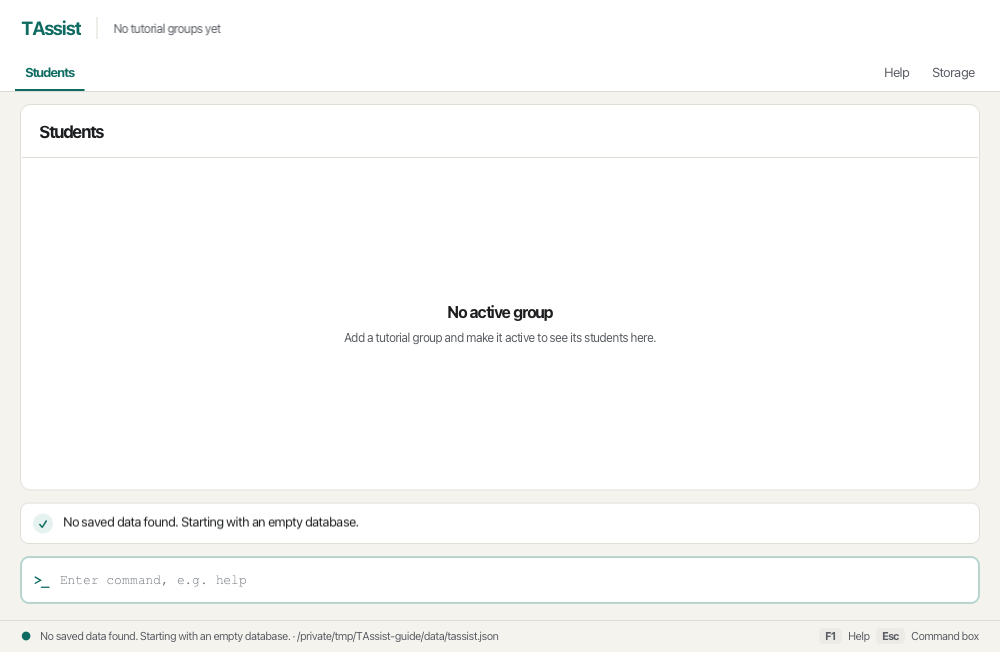
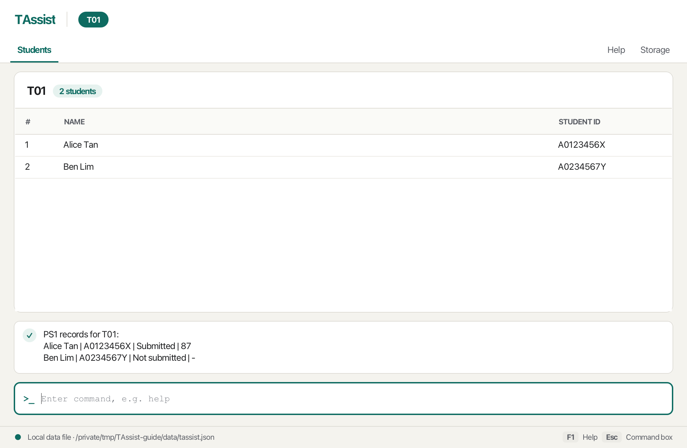

TAssist is a **desktop application for CS2040S teaching assistants, optimized for typing commands**.
The Students screen shows the students in your active tutorial group.
You can create, list, switch, rename, and delete tutorial groups, add, list, and delete their students, record weekly attendance,
record and list weekly participation scores, and create assignments, record submissions and grades, and list records.
A mistaken change can be reversed with `undo` and `redo` until you close TAssist.

* Table of Contents
{:toc}

--------------------------------------------------------------------------------------------------------------------

## Quick start

1. Ensure that Java `25` is installed on your computer.<br>
   **Mac users:** Ensure you have the precise JDK version prescribed [here](https://se-education.org/guides/tutorials/javaInstallationMac.html).

1. Download the latest `.jar` file from the [team releases page](https://github.com/AY2627S1-CS2103T-T12-4/tp/releases), when available.
   If no release is available yet, build the project with `./gradlew shadowJar` and use `build/libs/tassist.jar`.

1. Copy the file to the folder you want to use as the _home folder_ for TAssist.

1. Open a terminal, `cd` to the folder containing the JAR file, and run `java -jar tassist.jar`.<br>
   A GUI similar to the one below should appear in a few seconds. On the first launch, TAssist starts with no data.<br>
   

1. Type a command in the command box and press Enter to execute it. For example, type **`help`** and press Enter to open the command reference.<br>
   Some example commands you can try:

   * `help` : Opens the command reference.

   * `group add g/T01` : Creates tutorial group T01 and makes it active.

   * `view attendance` : Opens the Attendance screen.

   * `exit` : Exits the app.

1. Refer to the [Features](#features) section below for details of each command.

--------------------------------------------------------------------------------------------------------------------

## Using the workspace

The bar at the top shows the **tutorial groups** next to the TAssist name, with the active group highlighted, and
the **screens** below it. **Students**, **Attendance**, **Participation**, and **Assignments** are on the left;
**Groups**, **Help**, and **Storage** are on the right. A small orange dot marks a screen that is still **coming soon**.
Hover over a screen, or over a shortened group name, to see more. The tooltip of a screen names the command that does
the same, such as `view attendance`.

The implemented UI keeps the mock-up's command-first workspace, but uses a light group bar and a separate screen
navigation row in place of the mock-up's dark header and separate group strip. The [original UI mock-up](images/UiMockup.png)
is included for reference.



Use the `view` command to open the same screens by typing. The command box and feedback remain visible on every screen.
Press **Escape** to return focus to the command box, or **F1** to open Help. Clicking a screen keeps your cursor in
the command box.

* **Students** is titled with the name of the active tutorial group and the number of students in it, and lists the
  students with their names and student IDs. It updates as soon as the active group or its students change. When there are no students to list, the screen says whether no group is
  active or the active group has no students yet. Hover over a shortened name to read it in full, and scroll to see
  more students.
* **Groups** shows a planned table with a **Coming soon** label. Use `group list` to see your groups in the feedback
  box, and `group add` or `group use` to change the active group shown in the top bar.
* **Attendance** shows a planned table with a **Coming soon** label and unavailable week controls.
  Use `attendance mark` and `attendance list`; the Attendance screen remains a preview.
* **Participation** shows a planned table with a **Coming soon** label and unavailable week controls.
  Use `participation set` and `participation list` to record and view real scores in the feedback box.
* **Assignments** shows a planned layout with a **Coming soon** label.
  It contains no simulated records. Use `assignment add`, `assignment submit`, `assignment grade`, and
  `assignment list`; the Assignments screen remains a preview.
* **Help** provides an offline reference for every available command, with its format, rules, and examples.
  The `help` command opens it.
* **Storage** shows the configured local JSON file and explains automatic saving.

The feedback row below the screen tells you whether your last command worked: a check mark means it did, and a cross
on a red background means it failed. It grows to fit the message, up to six lines; only longer messages need
scrolling. The failed input stays in the
command box so you can correct it. A command stays on the current screen unless it opens another one, as `view` and
`help` do. Screen contents can be scrolled. Smaller windows use a compact layout.
The footer shows the local file path, reports successful saves or command failures, and reminds you of the F1 and
Escape shortcuts.
Opening a screen with `view` does not save or change data.

Press **Up** in the command box to bring back the commands you entered earlier, newest first, including ones that
failed. Press **Down** to move back towards the newest command; going past it restores what you were typing. You can
edit a recalled command before pressing **Enter** to run it, which saves retyping when you mark a whole group. Your
edits to recalled commands are kept while you move through the history, and the history itself keeps each command as
you entered it. Up and Down skip any command that matches the text already in the box, so after a command fails, the
first Up brings back the command before it. The history starts empty each time you open TAssist.

## Features

<div markdown="block" class="alert alert-info">

**:information_source: Notes about the command format:**<br>

* Words in `UPPER_CASE` are the parameters to be supplied by the user.<br>
  For example, in `view SCREEN`, replace `SCREEN` with a screen name such as `attendance`.

* Items in square brackets are optional.<br>
  For example, `help [TOPIC]` can be used as `help student` or as `help`.

* Commands that take no parameters, such as `exit`, `group list`, `student list`, `undo`, and `redo`, reject extra
  input like `exit 123`.

* Leading and trailing spaces around a command are ignored. Unknown commands identify the unrecognized keyword
  and suggest entering `help`. They do not change or save your data.

* Command keywords and prefixes use lowercase letters. Group names ignore case and extra spaces.
  Separate command words and parameters with spaces, and specify `g/` exactly once for `group add` and `group use`.

* If you are using a PDF version of this document, be careful when copying and pasting commands that span multiple lines as space characters surrounding line-breaks may be omitted when copied over to the application.
</div>

### Viewing help: `help`

Opens the **Help** screen, which lists the format, rules, and examples of every available command.
The feedback box confirms with `Showing the command reference.`

The reference starts with the general commands (`view`, `help`, `undo`, `redo`, and `exit`), followed by the group,
student, attendance, participation, and assignment commands, in the same order as their sections in this guide.
Within a topic, commands appear in the order you would use them. The examples are written to follow on from each other: in a new
TAssist, you can type the group, student, attendance, participation, and assignment examples in order, and each one
works.

Format: `help [TOPIC]`

* `TOPIC` is one of `group`, `student`, `attendance`, `participation`, or `assignment`. It is not case-sensitive.
* With a `TOPIC`, the Help screen opens at that topic's commands, for example `Showing student commands.`
  If no command of that topic exists yet, TAssist says so and opens the Help screen from the top.
* An unknown topic shows `Unknown help topic. Available topics: group, student, attendance, participation, assignment.`
  and does not change any data.

Examples:
* `help`
* `help student`
* `help assignment` shows `Showing assignment commands.` and opens the Help screen at the assignment commands.


### Opening a screen: `view`

Format: `view SCREEN`

`SCREEN` is one of `students`, `groups`, `attendance`, `participation`, `assignments`, `help`, or `storage`.
Screen names ignore case. Specify exactly one screen name. Opening a screen does not change any data.
An unknown screen name reports `Unknown screen` and lists the valid names. Missing or multiple screen names report
an invalid command format and show the expected syntax.

Examples: `view students`, `view attendance`, `view storage`.

### Creating a tutorial group: `group add`

Creates an empty tutorial group and makes it active, including when another group is already active.
Existing groups and their students remain unchanged.

Format: `group add g/GROUP_NAME`

* Group names contain 1–60 letters, digits, spaces, or hyphens, with at least one letter or digit.
* Leading and trailing spaces are removed, and repeated spaces inside a name count as one space.
  The length limit applies after this normalization.
* Names ignore case when matching, but keep the capitalization entered for display. `T01` and `t01` are duplicates;
  `Tutorial 1` and ` tutorial   1 ` are also duplicates.

Examples: `group add g/T01`, `group add g/T02`

```text
Created tutorial group: T01.
Active group is now T01.
```

### Listing tutorial groups: `group list`

Lists all tutorial groups in creation order, with numbering and the active group's name.
It does not change which group is active or any students.

Format: `group list`

For example, after creating T01 and T02:

```text
1. T01
2. T02
Active group: T02
```

With no groups, the feedback is `No tutorial groups exist. Create one using: group add g/GROUP_NAME`.
If groups were loaded from a file without an active selection, the final line is `Active group: None`.
Extra input, such as `group list g/T01`, is rejected. Long lists can be scrolled in the feedback box.

### Switching tutorial groups: `group use`

Makes an existing tutorial group active. The highlighted group in the top bar and the Students screen update
immediately. Each group's students and records stay separate. Selecting the already active group also succeeds.

Format: `group use g/GROUP_NAME`

Examples: `group use g/T01` switches back to T01 and shows `Switched active group to T01.` Because names ignore case,
`group use g/t01` does the same.

### Renaming a tutorial group: `group rename`

Changes the name of an existing tutorial group, for example to fix a typo. The group keeps its students, records,
position in the list, and active status.

Format: `group rename g/GROUP_NAME n/NEW_NAME`

* The new name follows the same rules as in `group add`. It must not match another group, ignoring case.
* Changing only the capitalization or spacing of a group's own name, such as `T01` to `t01`, is allowed.

Example: `group rename g/T02 n/T02-Thu` shows `Renamed tutorial group T02 to T02-Thu.`

### Deleting a tutorial group: `group delete`

Deletes a tutorial group together with all its students and their records. If deleted by mistake, `undo` brings the group back until you close
TAssist. Check the name with `group list` first. Other groups are unchanged. If the deleted group was active, no group is active
afterwards; select one with `group use`.

Format: `group delete g/GROUP_NAME [f/yes]`

* TAssist first asks you to confirm. The prompt names the group and how many students will be deleted. Cancel is
  selected by default, so Enter or Escape leaves the data unchanged. Choose Continue to delete.
* Add `f/yes` to skip the prompt.

Example: `group delete g/T02-Thu` asks whether to delete T02-Thu and its students. After you confirm, it shows
`Deleted tutorial group T02-Thu and its 0 student(s).` To skip the question, enter `group delete g/T02-Thu f/yes`.

#### Tutorial-group command errors

Rejected group commands do not change the groups, the active selection, or the saved data file.

Problem | Feedback and correction
--------|------------------------
Duplicate name | `A tutorial group named T01 already exists.` Use a different name, or switch with `group use g/T01`. This also applies to `group rename` when `n/` names another group.
Unknown group | `Tutorial group T03 does not exist.` Check `group list`, or create it with `group add g/T03`. `group use`, `group rename`, and `group delete` all report it.
Missing or blank name | `Missing group name. Usage: group add g/GROUP_NAME` (or the corresponding `group use`, `group delete`, or `group rename` usage). Supply a name after `g/`. `group rename` also reports `Missing new group name. Usage: group rename g/GROUP_NAME n/NEW_NAME` when `n/` is missing or blank.
Invalid name | `Invalid group name. Use 1-60 letters, digits, spaces, or hyphens.` Follow the naming rules above.
Repeated or unknown prefix | The feedback identifies the repeated or unknown prefix. Use `g/` exactly once (and `n/` once for `group rename`).
Missing or unknown subcommand | The feedback lists the valid subcommands: `add`, `delete`, `export`, `list`, `rename`, and `use`.

### Adding a student: `student add`

Adds a student to the active group and updates the Students screen immediately.
Create or select a group first with `group add` or `group use`.

Format: `student add n/NAME id/STUDENT_ID`

* Names contain 1–60 letters (including accented letters), spaces, apostrophes, or hyphens, with at least one letter.
  Leading and trailing spaces are removed and repeated spaces are collapsed; the limit applies after normalization.
* IDs contain 1–20 letters and digits, including at least one digit. IDs ignore case and are displayed in uppercase.
* An ID must be unique within the active group. The same ID may occur in another group.
  Students with the same name and different IDs are allowed. If the active group already has a student with the same
  name (ignoring case and extra spaces), the student is still added, and the feedback adds a warning so that you can
  check the ID, for example `Added Alice Tan to T01. Warning: T01 already has a student named Alice Tan. Check that the student ID is correct.`
* Supply each prefix exactly once, in either order, with a space before each parameter.

Examples: `student add n/Alice Tan id/A0123456X` shows `Added Alice Tan to T01.` when T01 is active.
`student add n/Ben Lim id/A0234567Y` then adds a second student.

### Listing students: `student list`

Lists the active group's students in roster order in the feedback box. It takes no parameters.

Format: `student list`

```text
Students in T01:
1. Alice Tan | A0123456X
2. Ben Lim | A0234567Y
```

An empty group shows `No students in T01. Add one using: student add n/NAME id/STUDENT_ID`.
Long rosters can be scrolled in the feedback box or viewed on the Students screen with `view students`.

### Deleting a student: `student delete`

Asks you to confirm before removing a student and all their records from the active group.
The prompt names the student, their student ID, and the group, because names are not unique. Cancel is selected
by default, so Enter or Escape leaves the data unchanged. Choose Continue to delete. The same student in another
group is unaffected, and remaining students are renumbered without changing their order. If you delete a student by
mistake, `undo` brings them back until you close TAssist.

Format: `student delete id/STUDENT_ID [f/yes]`

Example: `student delete id/A0234567Y` asks whether to remove Ben Lim (A0234567Y) and all their records from T01.
Enter `f/yes` to skip the prompt, for example `student delete id/A0234567Y f/yes`.
IDs ignore case, so `student delete id/a0234567y` targets the same student.

#### Student command errors

Rejected input leaves the roster and saved file unchanged.

Problem | Feedback and correction
--------|------------------------
No active group | `No active tutorial group. Create or select a group first.` Use `group add` or `group use`.
Duplicate ID | `Student ID A0123456X already exists in T01.` Check `student list` before adding.
Unknown ID when deleting | `Student ID A0123456X does not exist in T01.` Check the ID and active group.
Missing parameter | `Missing required parameter. Usage: student add n/NAME id/STUDENT_ID` (or the deletion format). Supply all required prefixes.
Invalid or blank value | The feedback identifies the invalid student name or ID and gives its rules.
Repeated or unknown prefix | The feedback identifies the prefix. Use only the command's documented prefixes, once each.
Extra input to `student list` | `This command takes no parameters. Remove the extra input.`

### Recording or correcting attendance: `attendance mark`

Records whether a student in the active tutorial group attended a teaching week.
The student must already be in that group. Add one with `student add` if needed.

Format: `attendance mark id/STUDENT_ID w/WEEK s/STATUS`

* `WEEK` is a whole number from 1 to 13. `STATUS` is `present` or `absent`, ignoring case.
* Student IDs ignore case. Supply each prefix exactly once, in any order, separated by spaces.
* Repeating a mark for the same student and week replaces the earlier mark, and the feedback shows the old and
  new status. Other students, weeks, and participation records are preserved.

For Alice Tan in active group T01, `attendance mark id/A0123456X w/3 s/present` shows
`Recorded Alice Tan as present for Week 3.` Re-entering it with `s/absent` shows
`Updated Alice Tan's attendance for Week 3: present to absent.` Entering `s/absent` again shows
`Alice Tan's attendance for Week 3 is already absent. Nothing changed.`

Invalid commands do not change or save data. An invalid week shows `Invalid week. Enter a number from 1 to 13.`;
an invalid status shows `Invalid attendance status. Use present or absent.` An unknown student shows
`Student ID A0999999Z does not exist in T01.` With no active group, use `group add g/GROUP_NAME` or
`group use g/GROUP_NAME` first. Missing, repeated, or unknown prefixes are identified in the feedback.

### Listing weekly attendance: `attendance list`

Lists attendance for the active tutorial group in student order, without changing any records.

Format: `attendance list w/WEEK`

For example, after the examples in this guide, which leave only Alice Tan in T01 and mark her present for week 3,
`attendance list w/3` shows the following in the scrollable feedback box:

```text
Attendance for T01, Week 3:
Alice Tan | A0123456X | Present
```

Each student appears with `Present`, `Absent`, or `Not recorded`. If no attendance has been recorded for that
week, including when the group has no students, the feedback is
`No attendance records have been recorded for Week 3.` Records in other groups or weeks are not included.
Use `group use g/GROUP_NAME` to choose another group before listing it.

Specify `w/` exactly once with a whole number from 1 to 13. Missing, repeated, or extra parameters are rejected;
invalid weeks and no active group have the same errors as `attendance mark`.

### Recording participation: `participation set`

Records a score for one student in the active tutorial group. Select a group with `group use` first.

Format: `participation set id/STUDENT_ID w/WEEK s/SCORE`

* `WEEK` is a whole number from 1 to 13. `SCORE` is a whole number from 0 to 5, including zero.
* Student IDs ignore case. The ID must belong to the active group.
* Supply each prefix exactly once, in any order, with spaces between parameters.
* Setting the same student and week again replaces the score, and the feedback shows the old and new score.
  Other weeks, other students, and other groups are unaffected.

Example: `participation set id/A0123456X w/3 s/2` shows
`Recorded participation score 2 for Alice Tan in Week 3.`
Then `participation set id/A0123456X w/3 s/4` shows
`Updated Alice Tan's participation score for Week 3: 2 to 4.`
Setting the same score again shows `Alice Tan's participation score for Week 3 is already 4. Nothing changed.`

### Listing participation: `participation list`

Lists every student in the active group in roster order, with their score for the requested week.
Scores appear in the feedback box; scroll it for long lists. The Participation table remains a preview.

Format: `participation list w/WEEK`

Example: after `participation set id/A0123456X w/3 s/2`, with only Alice Tan in T01, `participation list w/3` shows

```text
Participation for T01, Week 3:
Alice Tan | A0123456X | 2
```

Students without a score show `Not recorded`, even if no scores have been entered that week.
A recorded zero shows `0`. An empty group shows `No students in T01.`
Listing does not change scores. Successful score changes are saved automatically and restored when you reopen TAssist.

#### Participation command errors

Rejected input leaves the existing scores and saved data file unchanged.

Problem | Feedback and correction
--------|------------------------
No active group | `No active tutorial group. Create or select a group first.` Use `group add` or `group use`.
Unknown student | `Student ID A0999999Z does not exist in T01.` Check the ID, or switch to the student's group with `group use`.
Invalid or blank week | `Invalid week. Enter a number from 1 to 13.` Supply digits only, without a sign or decimal point.
Invalid or blank score | `Invalid participation score. Enter a whole number from 0 to 5.` Supply one of 0, 1, 2, 3, 4, or 5.
Missing parameter | The feedback names the missing prefixes. Include `id/`, `w/`, and `s/` for setting; `w/` for listing.
Repeated or unknown prefix | The feedback names the prefix. Use only the documented prefixes, once each.

### Creating an assignment: `assignment add`

Creates an assignment in the active tutorial group. Create or select a group first with `group add` or `group use`.

Format: `assignment add a/ASSIGNMENT_NAME`

* Assignment names contain 1–60 letters, digits, spaces, or hyphens, with at least one letter or digit.
* Leading and trailing spaces are removed, and repeated spaces inside a name count as one space.
  The length limit applies after this normalization.
* Names ignore case when matching, but keep the capitalization entered for display. `PS1` and `ps1` are duplicates,
  and so are `Problem Set 1` and ` problem   set 1 `.
* An assignment belongs to one group. Another group may have an assignment with the same name.
* Supply `a/` exactly once.

Example: `assignment add a/PS1` shows `Created assignment PS1 for T01.` when T01 is active.

### Recording a submission: `assignment submit`

Records or replaces one student's submission status for an assignment in the active group. Use `yes` for submitted
and `no` for not submitted. Marking a submission as not submitted clears its grade.

Format: `assignment submit a/ASSIGNMENT_NAME id/STUDENT_ID s/STATUS`

Example: `assignment submit a/PS1 id/A0123456X s/yes` shows
`Updated Alice Tan's PS1 submission status to submitted.`

### Recording a grade: `assignment grade`

Records or replaces a whole-number grade from 0 to 100 for a submitted assignment. Submit the assignment first with
`assignment submit`. Entering `s/no` clears any recorded grade and the feedback says so.

Format: `assignment grade a/ASSIGNMENT_NAME id/STUDENT_ID m/GRADE`

Example: `assignment grade a/PS1 id/A0123456X m/87` shows `Recorded grade 87 for Alice Tan's PS1.`
An unsubmitted assignment shows `Cannot record a grade for an unsubmitted assignment. Record it first with:
assignment submit a/PS1 id/A0123456X s/yes`.

### Listing assignment records: `assignment list`

Lists every student in the active group, in roster order, with their status and grade for one assignment.
Listing does not change any data.

Format: `assignment list a/ASSIGNMENT_NAME`

Example: after the examples in this guide, which leave only Alice Tan in T01 with PS1 submitted and graded 87,
`assignment list a/PS1` shows

```text
PS1 records for T01:
Alice Tan | A0123456X | Submitted | 87
```

Each row shows the student's name, ID, submission status, and grade. A student without a saved record shows
`Not submitted` and `-`. The name ignores case, and the heading shows the name as it was created. An empty group
shows `No students in T01.` Submission statuses and grades are saved automatically and restored when you reopen
TAssist.

#### Assignment command errors

Rejected input leaves the assignments and saved data file unchanged.

Problem | Feedback and correction
--------|------------------------
No active group | `No active tutorial group. Create or select a group first.` Use `group add` or `group use`.
Duplicate assignment | `Assignment PS1 already exists in T01` The message shows the name of the existing assignment. Use a different name, or list its records with `assignment list a/PS1`.
Unknown assignment | `Assignment PS2 does not exist in T01. Check the name, or create it with: assignment add a/PS2` Assignments belong to one group, so check the active group.
Invalid or blank name | `Invalid assignment name. Use 1-60 letters, digits, spaces, or hyphens.` Follow the naming rules above.
Invalid submission status | `Invalid submission status. Use yes or no.` Enter `yes` or `no` after `s/`.
Invalid grade | `Invalid grade. Enter a whole number from 0 to 100.` Supply a whole number after `m/`.
Grade before submission | `Cannot record a grade for an unsubmitted assignment. Record it first with: assignment submit a/PS1 id/A0123456X s/yes` Run the suggested command, using the assignment and student shown in the message.
Unknown student | `Student ID A0999999Z does not exist in T01.` Check the ID, or switch to the student's group with `group use`.
Missing parameter | The feedback names the missing prefix. Supply `a/`, `id/`, and `s/` or `m/`, once each.
Repeated or unknown prefix | The feedback names the prefix. Use only the prefixes listed in the command format, once each.
Missing or unknown subcommand | The feedback lists the valid subcommands: `add`, `submit`, `grade`, and `list`.

### Exporting a group's records: `group export`

Saves the attendance and participation of every student in the active group to a CSV file, which opens in Excel,
Numbers, Google Sheets, or any other spreadsheet. Use it to keep a copy, share marks, or work out totals.
Exporting only reads your records: it never changes them, the active group, or the saved data file.

Format: `group export`

* The file is saved in the `exports` folder next to the TAssist JAR, which is created if needed, and is named after
  the group, such as `exports/T01-records.csv`. Spaces in a group name become underscores, so the file for `Lab 1`
  is `Lab_1-records.csv`.
* Exporting the same group again replaces its earlier file, so the file always matches the latest records.
  Close the file in your spreadsheet before exporting again.
* The command takes no parameters. Select the group to export with `group use` first.

Example: with T01 active, `group export` shows the full path of the file, for example:

```text
Exported attendance and participation of 1 student in T01 to:
/Users/alex/TAssist/exports/T01-records.csv
```

The file has a header row, then one row per student in roster order:

* `Name` and `Student ID`.
* `Week 1 Attendance` to `Week 13 Attendance`, each `Present`, `Absent`, or empty if no attendance was recorded.
* `Week 1 Participation` to `Week 13 Participation`, each a score from 0 to 5, or empty if no score was set.

For example, if Alice Tan was marked absent and given a participation score of 4 in Week 3, her row reads
(with the empty weeks shortened):

Name | Student ID | Week 1 Attendance | Week 2 Attendance | Week 3 Attendance | … | Week 3 Participation | …
-----|------------|-------------------|-------------------|-------------------|---|----------------------|---
Alice Tan | A0123456X | | | Absent | … | 4 | …

An empty group exports only the header row. Assignment submissions and grades are not exported; list them with
`assignment list a/ASSIGNMENT_NAME`.

Problem | Feedback and correction
--------|------------------------
No active group | `No active tutorial group. Create or select a group first.` Use `group add` or `group use`.
File cannot be written | `Could not export T01 to …/exports/T01-records.csv. Check that TAssist can write to that folder and that the file is not open in another app.` Close the file if a spreadsheet has it open, or move TAssist to a folder you can write to, then export again. Your records are unchanged.
Extra input | `This command takes no parameters. Remove the extra input.` To export another group, such as T02, enter `group use g/T02` first, then `group export`.

### Undoing a change: `undo`

Reverses your latest change to tutorial groups, students, attendance, participation scores, or assignments.
Switching the active group with `group use` counts as a change too. Enter `undo` again to reverse earlier changes,
newest first.

Format: `undo`

* You can undo up to 20 changes made since TAssist was opened. Changes from before you last opened TAssist cannot be
  undone.
* Commands that were rejected or did not change any data, such as listing, `help`, `view`, or entering the same
  attendance mark again, are skipped.
* The data that `undo` restores is saved, just like any other change.

For example, after `attendance mark id/A0123456X w/3 s/absent`, entering `undo` shows
`Undone: attendance mark id/A0123456X w/3 s/absent` and restores Alice Tan's earlier Week 3 attendance.
If there is nothing to undo, TAssist shows
`Nothing to undo. TAssist can undo the last 20 changes made since it was opened.` and changes no data.

### Redoing a change: `redo`

Reapplies the latest change that you reversed with `undo`.

Format: `redo`

* Enter `redo` again to reapply further undone changes, in the order you made them.
* Making a new change after `undo` clears the changes you can redo.

Continuing the example above, entering `redo` shows `Redone: attendance mark id/A0123456X w/3 s/absent`.
If there is nothing to redo, TAssist shows
`Nothing to redo. Redo is available after undo, until you make another change.`

### Exiting the program: `exit`

Exits the program.

Format: `exit`

`exit` takes no parameters. Extra input, such as `exit now`, is rejected with
`This command takes no parameters. Remove the extra input.` and TAssist stays open.

### Saving the data

TAssist automatically saves your tutorial groups, their students, assignments and assignment records, attendance,
participation scores, and the active group after a successful command changes data. The footer shows `Changes saved.`
only after the save succeeds.
Closing and reopening TAssist restores the last successfully saved state.

Help, listing, navigation, export, and exit commands do not save data. Commands that leave the data unchanged, such as
selecting the already active group or entering the same attendance mark again, do not save either.
Undoing or redoing a change saves the restored data.

If saving fails, the feedback shows `Unable to save changes. Your previous saved data is unchanged.`
The command's changes are rolled back, including the active selection and roster. For a permission problem, the
feedback also says `Please check that the application has permission to write to its data folder.`
Resolve the disk or permission problem and enter the command again. Failed commands never show a save confirmation.

### Editing the data file

TAssist data is saved as `data/tassist.json` in the home folder, which is the folder containing the JAR file.
Preferences (`preferences.json`), the log file, and the `exports` folder for `group export` are in that same folder.
TAssist does not read or write files outside it, including when the JAR is started from another directory.
The Storage screen shows the absolute path. Close the app before editing this JSON file manually.
If the file is missing, TAssist shows `No saved data found. Starting with an empty database.`
It creates the file after the first successful command that changes data.

The file looks like this:

```json
{
  "activeGroup" : "T01",
  "groups" : [ {
    "name" : "T01",
    "students" : [ {
      "name" : "Alice Tan",
      "studentId" : "A0123456X",
      "attendance" : { "3" : "PRESENT" },
      "participation" : { "3" : 2 }
    } ],
    "assignments" : [ "PS1", "Mid-term 1" ],
    "assignmentRecords" : [ {
      "assignmentName" : "PS1",
      "studentId" : "A0123456X",
      "submitted" : true,
      "grade" : 87
    } ]
  } ]
}
```

* `activeGroup` is the name of the active group, or `null` if no group is active. It should match the name of one of
  the groups, ignoring case. If it names no group, TAssist still loads every group and starts with no active group.
* Each group needs a `name`. No two groups may have the same name, ignoring case.
* A group's optional `assignments` list holds the assignment names, in creation order, such as `"PS1"`. Names follow
  the same rules as when you type them, and no two names in a group may be the same, ignoring case. An invalid,
  empty, or repeated name makes the file invalid. An omitted list means the group has no assignments.
* A group's optional `assignmentRecords` list stores explicit records by assignment and student. Each entry needs an
  existing `assignmentName`, an existing `studentId`, and a boolean `submitted`; its optional `grade` must be a whole
  number from 0 to 100 and requires `submitted` to be `true`. A fractional grade such as `87.5` makes the file
  invalid, while `87.0` is read as `87`. Duplicate assignment/student pairs and references to missing assignments
  or students make the file invalid. Older files can omit this list.
* Each student needs a `name` and a `studentId`. No two students in a group may have the same student ID, ignoring
  case.
* A student's optional `participation` map stores week numbers as keys and scores as values, such as `"3" : 2`.
  Weeks must be 1–13 and scores must be whole numbers from 0 to 5. A fractional score such as `4.5`, or a week or
  score outside that range, makes the file invalid. A score such as `4.0` is read as `4`. An omitted map means no
  scores have been recorded.
* Group names, student names, and student IDs follow the same rules as when you type them in a command.
* `attendance` maps week numbers (`"1"` through `"13"`) to `"PRESENT"` or `"ABSENT"`.
  Status values ignore case and surrounding spaces when loaded. An omitted attendance map means no attendance
  records for that student. Invalid weeks or statuses make the file invalid.

<div markdown="span" class="alert alert-warning">:exclamation: **Caution:**
If the data file is unreadable or invalid, TAssist opens with no data and shows `Saved data could not be read.`,
the reason, and `No changes were made to the saved file.` For example:
`Saved data could not be read. Group T01 has more than one student with ID A1. No changes were made to the saved file.`
For a file that is not valid JSON, or a value of the wrong type, the reason names the line where reading stopped.
The file must contain a single JSON object. Extra text or another JSON value after its closing brace makes the
file invalid; trailing spaces, tabs, and line breaks are allowed.
The file is protected for that session: commands that would change data are rejected. Help, listing, navigation,
and exit remain available. The log file `tassist.log.0` also records the reason loading failed.
Close TAssist, back up and repair the file, then restart. To start afresh, move the unreadable file to a backup
location while TAssist is closed, then restart. Repairing the file while the app is open does not re-enable saving.
</div>

--------------------------------------------------------------------------------------------------------------------

## FAQ

**Q**: How do I transfer my data to another computer?<br>
**A**: Install the app on the other computer, then copy `data/tassist.json` from your previous TAssist home folder into the `data` folder of the new home folder.

--------------------------------------------------------------------------------------------------------------------

## Known issues

1. **When using multiple screens**, if you move the application to a secondary screen, and later switch to using only the primary screen, the GUI will open off-screen. The remedy is to delete the `preferences.json` file created by the application before running the application again.
1. **Double-clicking the JAR file** may not open TAssist, or may open it with the wrong Java version, on some
   systems. Start it from a terminal with `java -jar tassist.jar`, as in the [Quick start](#quick-start).
1. **In a folder TAssist cannot write to**, such as a read-only folder, TAssist opens
   but cannot save. Every command that changes data reports
   `Unable to save changes. Your previous saved data is unchanged.` with a reminder to check the folder's
   permissions. Move the JAR to a folder you can write to, such as one in your home folder, and start it again.

--------------------------------------------------------------------------------------------------------------------

## Command summary

Action | Format, Examples
--------|------------------
**Help** | `help [TOPIC]`<br> e.g., `help student`
**View** | `view SCREEN`<br> e.g., `view attendance`
**Undo** | `undo`
**Redo** | `redo`
**Add group** | `group add g/GROUP_NAME`<br> e.g., `group add g/T01`
**List groups** | `group list`
**Switch group** | `group use g/GROUP_NAME`<br> e.g., `group use g/T01`
**Rename group** | `group rename g/GROUP_NAME n/NEW_NAME`<br> e.g., `group rename g/T02 n/T02-Thu`
**Delete group** | `group delete g/GROUP_NAME [f/yes]`<br> e.g., `group delete g/T02-Thu`
**Export group records** | `group export`
**Add student** | `student add n/NAME id/STUDENT_ID`<br> e.g., `student add n/Alice Tan id/A0123456X`
**List students** | `student list`
**Delete student** | `student delete id/STUDENT_ID [f/yes]`<br> e.g., `student delete id/A0234567Y`
**Mark attendance** | `attendance mark id/STUDENT_ID w/WEEK s/STATUS`<br> e.g., `attendance mark id/A0123456X w/3 s/present`
**List attendance** | `attendance list w/WEEK`<br> e.g., `attendance list w/3`
**Set participation** | `participation set id/STUDENT_ID w/WEEK s/SCORE`<br> e.g., `participation set id/A0123456X w/3 s/2`
**List participation** | `participation list w/WEEK`<br> e.g., `participation list w/3`
**Add assignment** | `assignment add a/ASSIGNMENT_NAME`<br> e.g., `assignment add a/PS1`
**Record submission** | `assignment submit a/ASSIGNMENT_NAME id/STUDENT_ID s/STATUS`<br> e.g., `assignment submit a/PS1 id/A0123456X s/yes`
**Record grade** | `assignment grade a/ASSIGNMENT_NAME id/STUDENT_ID m/GRADE`<br> e.g., `assignment grade a/PS1 id/A0123456X m/87`
**List assignment records** | `assignment list a/ASSIGNMENT_NAME`<br> e.g., `assignment list a/PS1`
**Exit** | `exit`
